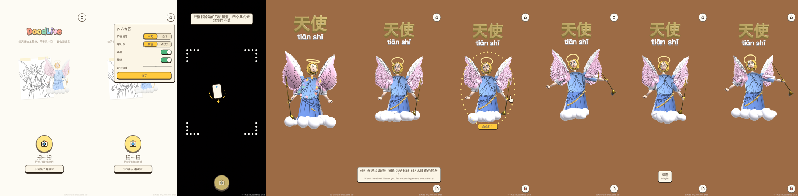
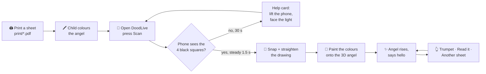
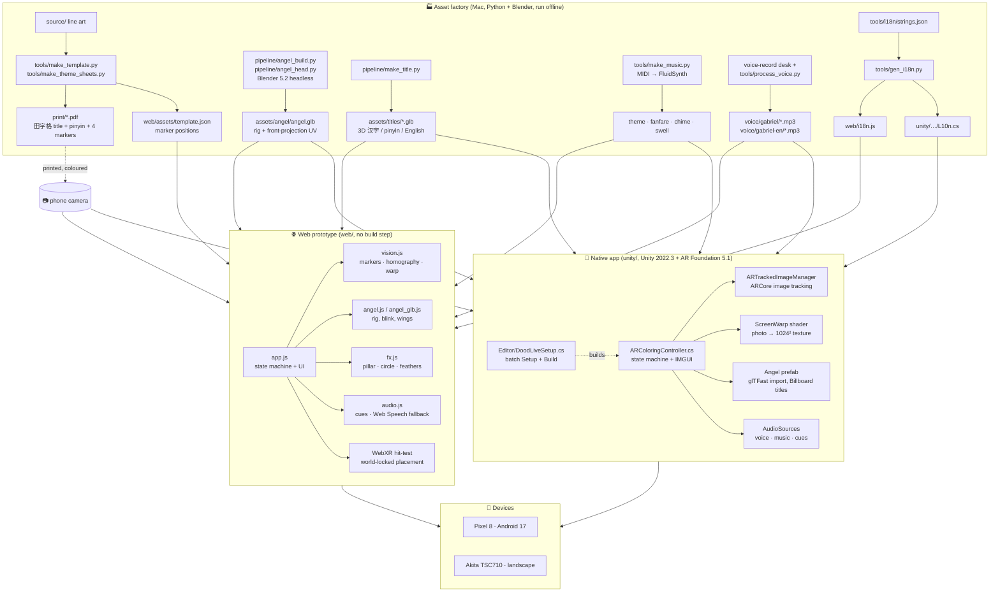
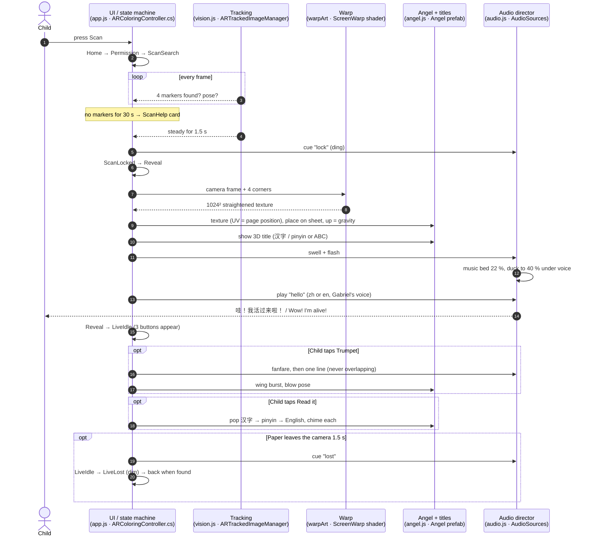
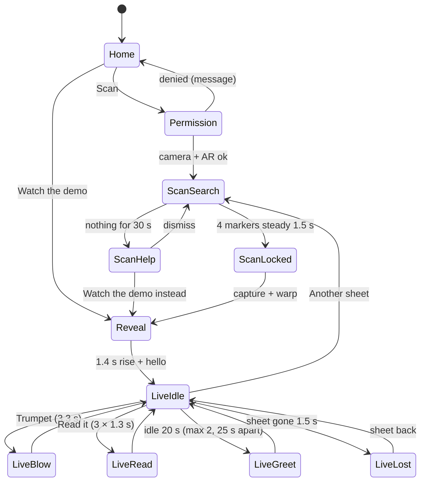
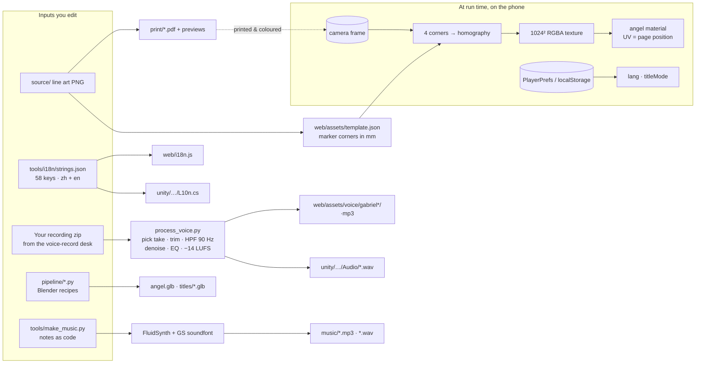

# DoodLive — colour it in, scan it, watch it come alive

**Language · 语言：** English · [中文](README.zh.md)

A child colours a printed angel. A phone looks at the page. A 3D angel wearing *exactly those colours* rises out of
the paper, flaps her wings, blows a trumpet and talks — in Chinese or English. The same angel also teaches the word
**天使 / tiān shǐ / Angel** with a 3D title the child can read aloud.

Two apps share one design: a **web prototype** (three.js, runs in Chrome, nothing to install) and a **native Android app**
(Unity + AR Foundation + ARCore, an APK). Everything else in the repo makes the things they need: colouring sheets,
the 3D model, music, voice and the bilingual strings.



> **Status (2026-10-24):** the **Paper & Crayon redesign** ([design direction](docs/DESIGN-DIRECTION.md), Figma mocks) is
> built in both apps on top of M1 (state machine, stop/go rules, bilingual UI, Gabriel's own voice in zh and en).
> The angel is now the button: tap her for the trumpet, tap the 3D title to read it. A dotted ring and hand appear after
> 5 s without a touch, and settings sit behind a 2-second hold on the lock. Verified by per-state screenshots on a Pixel 8
> (grid above) and in a desktop browser. **Not yet checked:** a real printed sheet scanned with this build, the Akita
> (TSC710, landscape) and a test with children. Later milestones: M2 scene/face polish, M3 stroke order, M4 David vs
> Goliath inside the state machine, M5 store release.

---

## Contents

1. [For non-programmers: what happens, in pictures](#1-for-non-programmers-what-happens-in-pictures)
2. [Try it in five minutes](#2-try-it-in-five-minutes)
3. [Architecture](#3-architecture)
4. [The scan, lane by lane](#4-the-scan-lane-by-lane)
5. [The state machine (stop/go rules)](#5-the-state-machine-stopgo-rules)
6. [Where the data comes from and goes](#6-where-the-data-comes-from-and-goes)
7. [Repository map](#7-repository-map)
8. [Build fingerprints and QA](#8-build-fingerprints-and-qa)
9. [Glossary](#9-glossary)
10. [Known limits and lessons](#10-known-limits-and-lessons)

---

## 1. For non-programmers: what happens, in pictures



Why does it work? The colouring sheet is really a **map**. Every spot on the paper corresponds to one spot on the
3D angel's skin (we call that the *UV rule*: *UV = page position*). So when the phone photographs the page and
straightens it, the photo *is already* the angel's texture — no AI, no guessing, no internet. The four black squares
in the corners are there only so the phone can find the page and straighten the photo.

Three things make it feel alive rather than a static model:

| Feeling | What actually happens |
|---|---|
| "She stands on my paper" | ARCore keeps tracking the sheet; the angel is pinned to it and re-fitted every frame. If the paper leaves the camera for 1.5 s she dims and asks for it back. |
| "She talks to *me*" | Gabriel recorded every line (zh and en). Lines never overlap; music ducks to 40 % while she speaks; after 20 s of silence she says something once or twice, then waits. |
| "I learned a word" | The title is real 3D extruded text: 汉字 on top, pinyin or English below (a designed toggle). **Read it** pops each part in turn with a chime. |

---

## 2. Try it in five minutes

### Web prototype (desktop demo, no phone)

```bash
python3 scripts/serve.py
```

Open <http://localhost:8080> and press **No sheet? Watch the demo** (**没有纸？看演示** in Chinese; the 中/EN button
switches). The whole flow runs with a pre-coloured sheet.

### Web prototype on an Android phone (camera + WebXR)

```bash
scripts/run-on-phone.sh            # ADB_SERIAL=<serial> if more than one phone
```

Serves `web/`, runs `adb reverse`, opens Chrome on the phone at `http://localhost:8080` (localhost counts as secure,
so the camera works without HTTPS).

### Native Android app

Needs ARCore ("Google Play Services for AR") on the phone. Build once on a Mac with Unity 2022.3 LTS + Android module:

```bash
scripts/build-apk.sh                    # → unity/Builds/DoodLive.apk + .fingerprint
scripts/install-apk.sh <serial>         # installs AND checks the fingerprint on the device
```

### Colouring sheets

`print/doodlive-angel-A4.pdf` (the original) and three themed sheets `angel-fiery.pdf`, `angel-wrath.pdf`,
`angel-holy.pdf` (same angel, same markers, one shared palette, a coloured example on page 2). Keep the four black
squares clean.

---

## 3. Architecture



**One design, two runtimes.** The web app is the fast lane: edit a file, reload. The Unity app is the real product:
ARCore image tracking is far steadier than our hand-written marker detection, and it runs without a computer. Both
read the *same* model, titles, music, voice and strings, so they look and sound identical. Everything that is
generated (sheets, model, i18n) is generated by a script, never drawn or typed twice.

---

## 4. The scan, lane by lane

Who does what, from "Scan" to "Hello". Every lane is a file you can open.



---

## 5. The state machine (stop/go rules)

Both apps run this exact machine (names and timings are shared; the Unity log prints `DoodLive state A -> B`
for every arrow, which is how the QA script verifies a build).



The rules in words:

- **Stop** while busy: Trumpet and Read it are disabled (dimmed) during Blow, Read and Greet, so taps cannot stack sounds.
- **Go** only on the child's action or on a timer the plan allows (Help at 30 s, Greet at 20 s, at most twice).
- **Voices never overlap**; a new line fades the old one out in 150 ms. Music sits at 22 % and ducks to 40 % of that under speech.
- **Backgrounding** pauses the voice and silences the music; coming back resumes and resets the idle timer.
- Transitions are short (0.2–0.4 s fades, a flash on Reveal) and the same in both apps.

Timings live in one place per app: `LockSeconds, HelpAfter, LostAfter, GreetAfter, GreetEvery, GreetMax,
RevealSeconds, BlowSeconds, ReadStep` in `ARColoringController.cs`, and the matching constants in `web/app.js`.

---

## 6. Where the data comes from and goes



Nothing leaves the phone. There is no account, no server, no analytics, no upload: the photo becomes a texture in
memory and is gone when the app closes. The only things persisted are two preferences (language, pinyin/ABC).

**The UV rule is the contract between the sheet and the model.** `pipeline/angel_build.py` projects the model from the
front in its rest pose and writes those page coordinates as UVs (`front_uv`). `tools/make_template.py` draws the sheet
from the same projection. If either side moves, colours land in the wrong place — so both are generated from the same
numbers, never adjusted by hand.

---

## 7. Repository map

```
web/                      the web prototype — open index.html through scripts/serve.py
  app.js                  flow, state machine, UI, placement (paper / WebXR)
  vision.js               marker detection, homography, warp, white balance, line erase
  angel.js angel_glb.js   rigged angel (procedural fallback / glTF), blink, wings
  fx.js audio.js          effects; cues, music, Web Speech fallback
  i18n.js                 GENERATED from tools/i18n/strings.json
  battle/ battle.html     David vs Goliath theatre (M4 will fold it into the state machine)
  assets/                 model, titles, music, voice (zh: gabriel, en: gabriel-en), template.json
unity/                    the native app
  Assets/DoodLive/Scripts/ARColoringController.cs   state machine, tracking, warp, audio, IMGUI
  Assets/DoodLive/Scripts/L10n.cs                    GENERATED strings
  Assets/DoodLive/Editor/DoodLiveSetup.cs            batch Setup (scene, prefab, library) and Build
  Builds/DoodLive.apk (+ .fingerprint)               output of scripts/build-apk.sh
pipeline/                 Blender recipes: angel body + head, 3D titles (fonts/ is git-ignored)
tools/                    sheet + 田字格 generators, music, voice processing, i18n generator, palette
scripts/                  serve.py, run-on-phone.sh, build-apk.sh, install-apk.sh, qa-shots.sh, stamp-web.sh
print/                    the four A4 sheets and previews
docs/                     UX-PLAN.md (the plan), LESSONS.md (30 pitfalls), UPGRADE.md, qa/<fingerprint>/ shots
CLAUDE.md                 the short map + invariants for anyone (human or agent) editing the repo
```

---

## 8. Build fingerprints and QA

Every build carries `<git sha>[-dirty].<UTC time>` in its `versionName`, in `Resources/build_fingerprint.txt`, on the
first log line and in the corner of the screen (web: `web/build.json`). `scripts/install-apk.sh` refuses to call an
install done until the phone reports the same fingerprint. This exists because we were once "fixed twice" while the
phone still ran the old code ([L28](docs/LESSONS.md)).

`scripts/qa-shots.sh <serial> [--quick]` drives the installed app over adb through every reachable state and saves
`docs/qa/<fingerprint>/<state>.png` plus `states.log` (the `DoodLive state A -> B` lines). The grid at the top of this
page is one of those runs.

---

## 9. Glossary

| Term | Plain meaning |
|---|---|
| **AR** (augmented reality) | Drawing 3D things on top of the live camera picture so they look like they are in the room. |
| **ARCore** | Google's AR engine on Android. It can recognise a printed picture (our sheet) and tell us where it is in space. |
| **AR Foundation** | Unity's wrapper around ARCore (and ARKit on iPhone), so the same code could run on both. |
| **Marker** | One of the four solid black squares. The web version finds them itself; the Unity version lets ARCore find the whole sheet. |
| **Homography** | The maths that turns a tilted photo of a rectangle back into a flat rectangle. |
| **Texture / UV** | The picture wrapped around a 3D model, and the coordinates that say which pixel goes where. Here UV = position on the page. |
| **Rig / bones** | Invisible joints inside the model (hips, spine, wings…) so it can be animated. |
| **glTF / .glb** | The file format of the 3D model. glTFast is the Unity importer (it mirrors X — see L26). |
| **IL2CPP, ARM64** | How the Unity app is compiled: to native code for 64-bit Android. |
| **LUFS** | A loudness unit; all voice lines are normalised to −14 LUFS so none is quieter than another. |
| **Ducking** | Turning the music down while someone speaks. |
| **Fingerprint** | The build's identity string, so a phone and a repo can be compared. |
| **i18n / L10n** | Internationalisation: one strings file, two generated outputs, so zh and en never drift apart. |
| **田字格** | The four-square grid Chinese children write characters in; the sheet title uses it. |

---

## 10. Known limits and lessons

- The web paper mode assumes a focal length (≈65° FOV), so alignment is approximate; the Unity app uses ARCore's
  estimated sheet size and is steady.
- Very dark crayon (navy, black) is treated as ink by the line eraser.
- Fonts used for the 3D titles are extracted system fonts kept out of git; swap for Noto before any public release.
  (The UI fonts are OFL subsets in `web/fonts/` and `unity/.../Resources/Fonts/`, with their licences.)
- Coloured/themed sheets are in the Unity reference-image library since L23; a fresh on-device scan with the newest build is still to be done.

Thirty concrete pitfalls, each with the symptom, the cause and the fix, are in [docs/LESSONS.md](docs/LESSONS.md).
Start there if a phone shows `unauthorized`, Chrome keeps running old code, or the angel looks at the ceiling.

---

*Made by Gabriel Chen with Claude. The angel's voice is Gabriel's own.*
