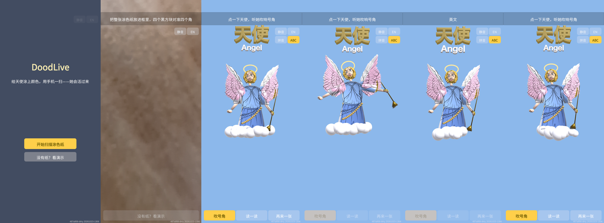
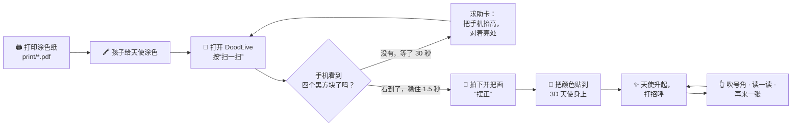
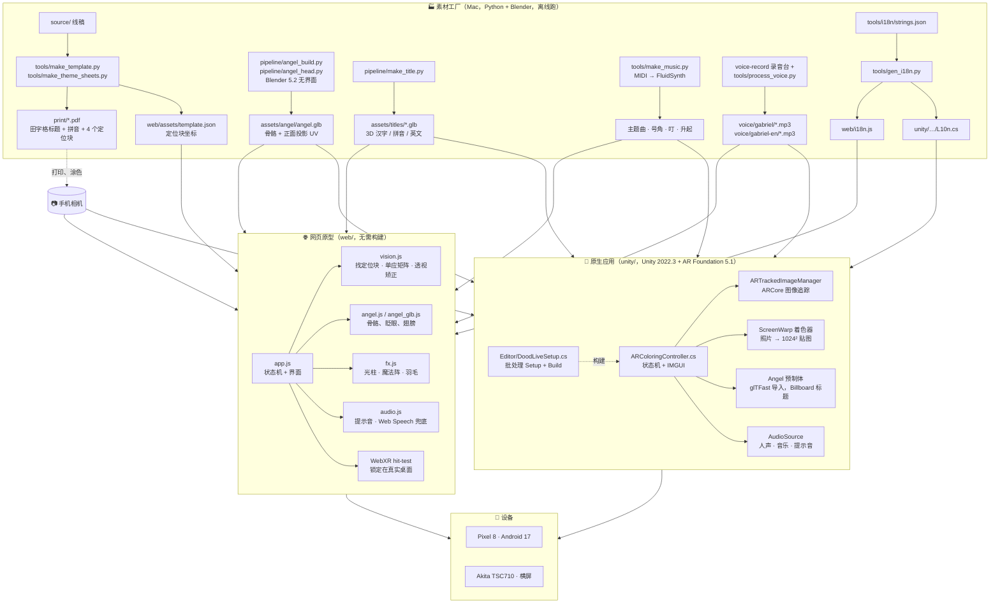
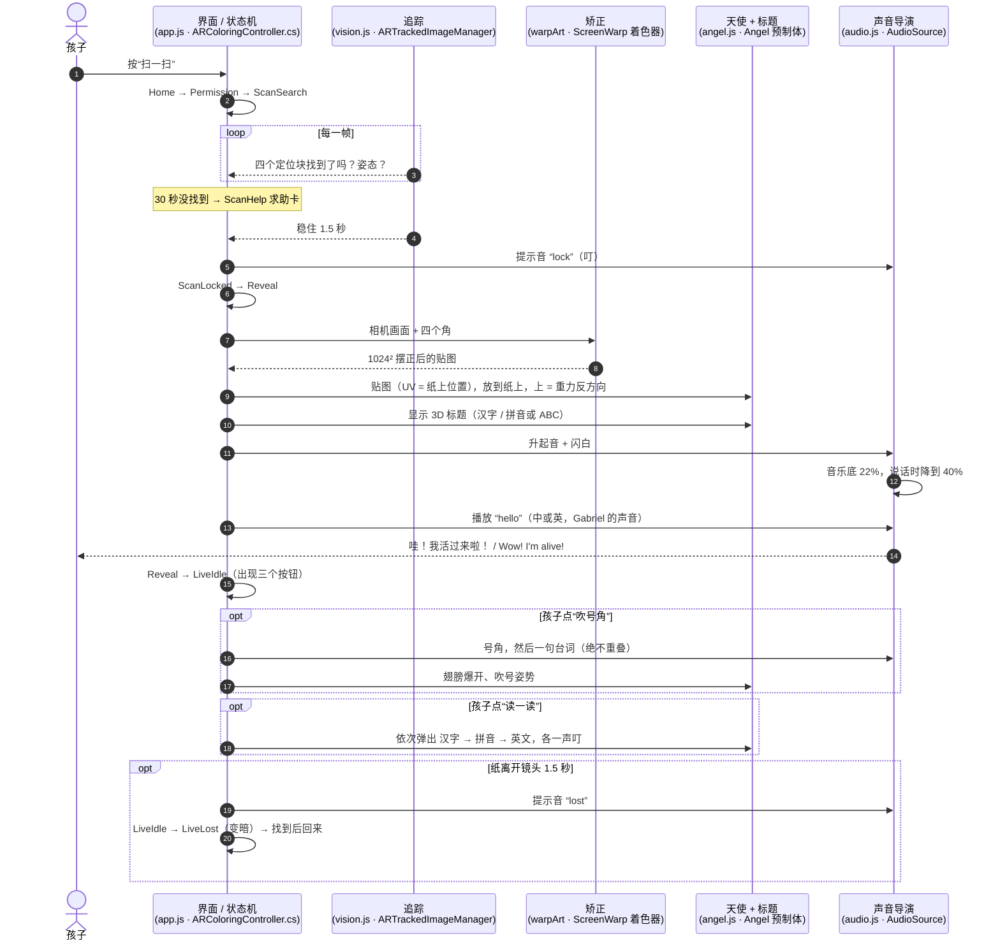
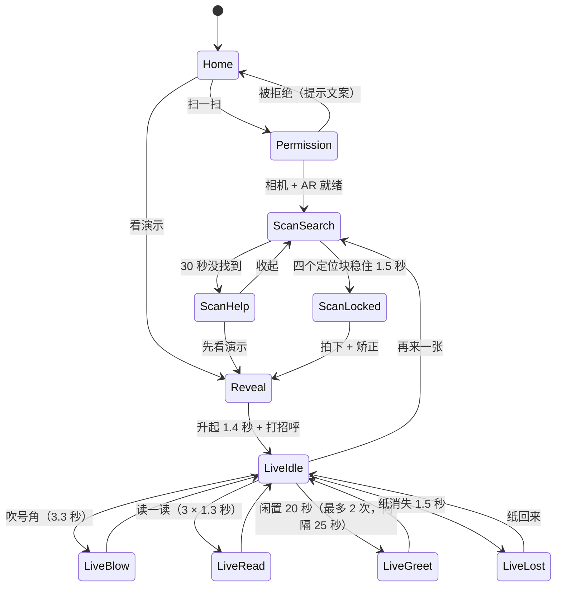
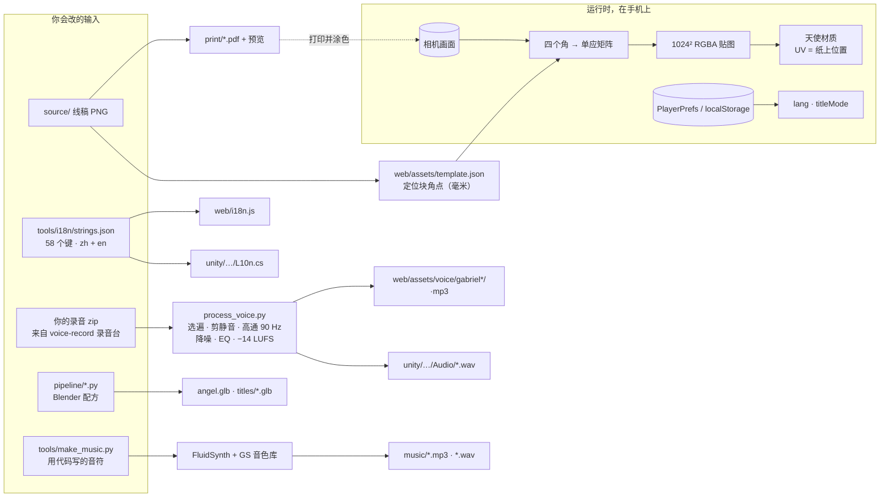

# DoodLive —— 涂上颜色，扫一扫，她就活过来

**Language · 语言：** [English](README.md) · 中文

孩子给一张打印的天使线稿涂色。手机对着纸看一眼，一个**穿着孩子涂的颜色**的 3D 天使从纸上升起来，扇翅膀、吹号角、开口说话——中文或英文都行。她还会教孩子认一个词：**天使 / tiān shǐ / Angel**，用的是能跟着读的 3D 立体标题。

两个应用共用一套设计：**网页原型**（three.js，Chrome 里直接跑，什么都不用装）和 **安卓原生应用**（Unity + AR Foundation + ARCore，一个 APK）。仓库里其余的东西都是“工厂”：生成涂色纸、3D 模型、音乐、配音和中英文文案。



> **进度（2026-10-24）：** [体验计划](docs/UX-PLAN.md) 的 M1 两端都完成了——状态机、停/走规则、过渡动效、中英双语、声音规则、Gabriel 自己录的中英文配音。已用 Pixel 8 逐状态截图（上图）和桌面浏览器验证。下一步要验：用最新包扫一张真打印的纸、Akita（TSC710，横屏）。后面的里程碑：M2 场景/脸部打磨，M3 笔顺，M4 把“大卫 vs 歌利亚”并进状态机，M5 上架。

---

## 目录

1. [给小白看：到底发生了什么](#1-给小白看到底发生了什么)
2. [五分钟跑起来](#2-五分钟跑起来)
3. [架构图](#3-架构图)
4. [一次扫描的泳道图](#4-一次扫描的泳道图)
5. [状态机（什么时候停、什么时候走）](#5-状态机什么时候停什么时候走)
6. [数据从哪来、到哪去](#6-数据从哪来到哪去)
7. [仓库地图](#7-仓库地图)
8. [构建指纹与 QA](#8-构建指纹与-qa)
9. [名词解释](#9-名词解释)
10. [已知限制与踩坑记录](#10-已知限制与踩坑记录)

---

## 1. 给小白看：到底发生了什么



为什么能行？涂色纸其实是一张**地图**。纸上每一个点，都对应 3D 天使皮肤上的一个点（我们叫它 *UV 规则*：*UV = 纸上位置*）。所以手机把纸拍下来、摆正以后，这张照片**本身就是**天使的贴图——不用 AI、不用猜、不用联网。四个角的黑方块只有一个用处：让手机找到纸、把照片摆正。

让她“像活的”而不是一个静止模型，靠三件事：

| 感受 | 实际发生的事 |
|---|---|
| “她站在我的纸上” | ARCore 持续追踪这张纸；天使钉在纸上，每一帧重新贴合。纸离开镜头 1.5 秒她就变暗，请你把纸拿回来。 |
| “她在跟*我*说话” | 每句话都是 Gabriel 自己录的（中、英两套）。台词绝不重叠；说话时音乐降到 40%；安静 20 秒她会主动说一两句，然后就等着。 |
| “我学会了一个词” | 标题是真正的 3D 立体字：上面汉字，下面拼音或英文（一个有设计感的切换钮）。**读一读**会把三部分依次弹出来，各配一声叮。 |

---

## 2. 五分钟跑起来

### 网页原型（桌面演示，不用手机）

```bash
python3 scripts/serve.py
```

打开 <http://localhost:8080>，按 **没有纸？看演示**（右上角 中/EN 切语言）。会用一张预先涂好色的纸跑完整流程。

### 网页原型装到安卓手机（相机 + WebXR）

```bash
scripts/run-on-phone.sh            # 多台手机时加 ADB_SERIAL=<序列号>
```

它会托管 `web/`、做 `adb reverse`、在手机 Chrome 打开 `http://localhost:8080`（localhost 算安全来源，不用 HTTPS 相机也能用）。

### 安卓原生应用

手机需要 ARCore（“Google Play Services for AR”）。在装有 Unity 2022.3 LTS + Android 模块的 Mac 上构建一次：

```bash
scripts/build-apk.sh                    # → unity/Builds/DoodLive.apk + .fingerprint
scripts/install-apk.sh <序列号>          # 安装，并核对设备上的指纹
```

### 涂色纸

`print/doodlive-angel-A4.pdf`（原版）和三张主题纸 `angel-fiery.pdf`（炙热）、`angel-wrath.pdf`（愤怒）、`angel-holy.pdf`（神圣）：同一个天使、同样的定位块、一套共用调色板，第 2 页是涂好的示例。四个黑方块不要涂。

---

## 3. 架构图



**一套设计，两个运行时。** 网页版是快车道：改一个文件、刷新就看到。Unity 版是真正的产品：ARCore 的图像追踪比我们手写的定位块检测稳得多，而且不需要电脑。两者读的是**同一份**模型、标题、音乐、配音和文案，所以看起来、听起来完全一样。所有生成物（涂色纸、模型、i18n）都由脚本生成，绝不手画或手敲第二遍。

---

## 4. 一次扫描的泳道图

从按下“扫一扫”到她说“你好”，谁在做什么。每一条泳道都是一个你能打开的文件。



---

## 5. 状态机（什么时候停、什么时候走）

两个应用跑的是同一台状态机（状态名和时间参数共用；Unity 每走一条箭头都会打一行日志 `DoodLive state A -> B`，QA 脚本就靠这个核对一个包）。



用人话说这些规则：

- **忙的时候停**：吹号角、读一读在 Blow / Read / Greet 期间禁用（变暗），连点不会叠声音。
- **只在孩子动手，或计划允许的计时器上走**：30 秒出求助卡、20 秒主动招呼，最多两次。
- **人声绝不重叠**；新的一句会在 150 毫秒内把旧的淡出。音乐底 22%，说话时再降到它的 40%。
- **切到后台**暂停人声、静音音乐；回来恢复，并重置闲置计时。
- 过渡都很短（0.2–0.4 秒淡入淡出，Reveal 一下闪白），两个应用手感一致。

时间参数每个应用只在一处：`ARColoringController.cs` 里的 `LockSeconds, HelpAfter, LostAfter, GreetAfter, GreetEvery, GreetMax, RevealSeconds, BlowSeconds, ReadStep`，`web/app.js` 里对应的常量。

---

## 6. 数据从哪来、到哪去



什么都不出手机。没有账号、没有服务器、没有统计、没有上传：照片变成内存里的一张贴图，应用关掉就没了。唯一保存的是两个偏好（语言、拼音/ABC）。

**UV 规则是纸和模型之间的合同。** `pipeline/angel_build.py` 在静止姿态下从正面投影模型，把纸面坐标写进 UV（`front_uv`）；`tools/make_template.py` 用同一套投影画涂色纸。任何一边动了，颜色就会贴错位置——所以两边都由同一组数字生成，绝不手调。

---

## 7. 仓库地图

```
web/                      网页原型 —— 通过 scripts/serve.py 打开 index.html
  app.js                  流程、状态机、界面、放置（纸上 / WebXR）
  vision.js               找定位块、单应矩阵、矫正、白平衡、去线条
  angel.js angel_glb.js   带骨骼的天使（程序化兜底 / glTF）、眨眼、翅膀
  fx.js audio.js          特效；提示音、音乐、Web Speech 兜底
  i18n.js                 由 tools/i18n/strings.json 生成
  battle/ battle.html     大卫 vs 歌利亚剧场（M4 会并进状态机）
  assets/                 模型、标题、音乐、配音（中：gabriel，英：gabriel-en）、template.json
unity/                    原生应用
  Assets/DoodLive/Scripts/ARColoringController.cs   状态机、追踪、矫正、声音、IMGUI
  Assets/DoodLive/Scripts/L10n.cs                    生成的文案
  Assets/DoodLive/Editor/DoodLiveSetup.cs            批处理 Setup（场景、预制体、图像库）与 Build
  Builds/DoodLive.apk (+ .fingerprint)               scripts/build-apk.sh 的产物
pipeline/                 Blender 配方：天使身体 + 头、3D 标题（fonts/ 不入 git）
tools/                    涂色纸 + 田字格生成器、音乐、人声后期、i18n 生成器、调色板
scripts/                  serve.py、run-on-phone.sh、build-apk.sh、install-apk.sh、qa-shots.sh、stamp-web.sh
print/                    四张 A4 涂色纸和预览
docs/                     UX-PLAN.md（计划）、LESSONS.md（30 个坑）、UPGRADE.md、qa/<指纹>/ 截图
CLAUDE.md                 给任何人（人或智能体）改仓库前看的短地图 + 不变量
```

---

## 8. 构建指纹与 QA

每个包都带着 `<git sha>[-dirty].<UTC 时间>`：在 `versionName` 里、`Resources/build_fingerprint.txt` 里、第一行日志里、屏幕角落里（网页版：`web/build.json`）。`scripts/install-apk.sh` 在手机报出同一个指纹之前，不会说“装好了”。这条规矩来自一次教训：我们“修好了两遍”，手机却一直跑着旧代码（[L28](docs/LESSONS.md)）。

`scripts/qa-shots.sh <序列号> [--quick]` 通过 adb 把装好的应用走一遍所有能到的状态，存成 `docs/qa/<指纹>/<状态>.png` 和 `states.log`（那些 `DoodLive state A -> B` 行）。页首那张拼图就是其中一次。

---

## 9. 名词解释

| 名词 | 大白话 |
|---|---|
| **AR**（增强现实） | 在实时相机画面上画 3D 东西，让它看起来就在房间里。 |
| **ARCore** | Google 在安卓上的 AR 引擎。它能认出一张打印的图片（我们的涂色纸），告诉我们它在空间里的位置。 |
| **AR Foundation** | Unity 对 ARCore（和 iPhone 的 ARKit）的封装，同一份代码两边都能跑。 |
| **定位块（Marker）** | 四个实心黑方块之一。网页版自己找它们；Unity 版让 ARCore 认整张纸。 |
| **单应矩阵（Homography）** | 把一张斜着拍的长方形照片“掰”回平的长方形的那套数学。 |
| **贴图 / UV** | 包在 3D 模型外面的那张图，以及“哪个像素贴到哪”的坐标。这里 UV = 纸上位置。 |
| **骨骼（Rig / bones）** | 模型里看不见的关节（胯、脊柱、翅膀……），有了它才能做动画。 |
| **glTF / .glb** | 3D 模型的文件格式。glTFast 是 Unity 的导入器（它会把 X 轴镜像——见 L26）。 |
| **IL2CPP、ARM64** | Unity 应用的编译方式：编成 64 位安卓的原生代码。 |
| **LUFS** | 一种响度单位；所有台词统一到 −14 LUFS，不会有哪句特别小声。 |
| **闪避（Ducking）** | 有人说话时把音乐压低。 |
| **指纹（Fingerprint）** | 这个包的身份字符串，让手机和仓库能对得上号。 |
| **i18n / L10n** | 国际化：一份文案文件、两个生成产物，中英文永远不会各改各的。 |
| **田字格** | 中国孩子写字用的四格方框；涂色纸的标题用的就是它。 |

---

## 10. 已知限制与踩坑记录

- 网页版“纸上模式”假设了一个焦距（约 65° 视场角），对齐是近似的；Unity 版用 ARCore 估算的纸张尺寸，很稳。
- 很深的蜡笔色（藏青、黑）会被去线条算法当成墨线。
- 3D 标题用的是从系统里提取的字体，没有入 git；公开发布前要换成 Noto。
- 彩色/主题涂色纸自 L23 起已加入 Unity 的参考图库；用最新包在真机上重新扫一遍还没做。

三十个具体的坑，每个都写了症状、原因、修法，在 [docs/LESSONS.md](docs/LESSONS.md)。手机一直 `unauthorized`、Chrome 老跑旧代码、天使盯着天花板看——先去那里。

---

*Gabriel Chen 与 Claude 一起做的。天使的声音是 Gabriel 本人。*
