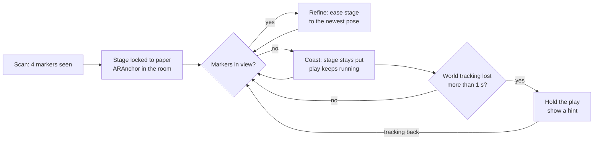
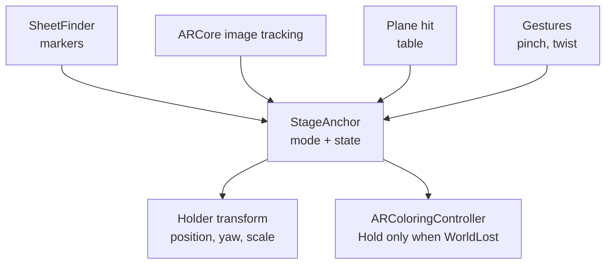
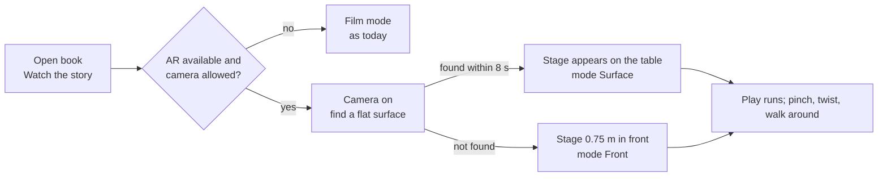

# Anchoring design: scan once, then look as close as you like

Status: **implemented 2026-11-21** in `unity/Assets/DoodLive/Scripts/ARColoringController.Stage.cs` (owner: "全部解决掉，一次性地").
Section 8 answered with the proposed defaults. Section 10 lists what was built and what differs from the proposal.

Source labels: `[A]` read in the code on 2026-11-21, `[D]` my inference, needs a device test.

## 1. The goal

After a sheet is scanned, the play is fixed to the paper. The child can move the phone
very close and look at the models and the story from any angle. The play keeps running.

Demo mode (a book opened from the shelf, no sheet) gets the same thing on a table or
another flat surface. It is still 3D AR, not only a film.

## 2. Why it freezes today

Moving close pushes the four corner markers out of the picture. The app reads that as
"the sheet is lost" and holds the play. Moving back shows the markers again and the
play resumes. This is the designed behaviour (UX-PLAN section 3, Live.Lost), and the
design is what has to change.

| Step | Code | Label |
|---|---|---|
| A marker sheet counts as tracked only if it was detected in the last 1.0 s | `SheetTarget.Tracking` | [A] |
| Not tracked for another 1.0 s moves the state to `LiveLost` | `ARColoringController.Update`, `LostAfter` | [A] |
| `LiveLost` sets `active.Hold = true`, which stops the play | `ARColoringController.Update` | [A] |
| The scene already sits under an `ARAnchor` in world space | `SheetFinder.Track` | [A] |

The last row matters most. The scene does not need the markers to stay in place.
ARCore already holds it in the room. Only the hold rule ties the play to the markers.

## 3. The idea

Use two separate signals where today there is one.

| Signal | Question it answers | What it controls |
|---|---|---|
| **World tracking** (ARCore session) | Does the phone know where it is in the room? | Whether the play holds |
| **Sheet sighting** (markers or image) | Where exactly is the paper right now? | Small corrections to the stage position |

## 4. Architecture

One new component, `StageAnchor`, owns where the stage (the holder of all models) is.
Today that logic is spread over `PlaceOnSheet`, `FitToSheet`, `AnchorHere`,
`PlaceInFront` and `TrackingLost` in `ARColoringController` [A].

| Part | Value |
|---|---|
| Modes | `Sheet` (scanned paper), `Surface` (demo on a table), `Front` (fallback: no plane found), `Film` (no AR at all, today's demo) |
| States | `Refining` (sheet in view), `Coasting` (sheet out of view, world OK), `WorldLost` |
| Output | holder position, yaw about gravity only (LESSONS L14), scale |
| Controller rule | `TrackingLost()` becomes `stage.State == WorldLost` |

Rules inside `StageAnchor`:

1. **Refine gently.** While the sheet is in view, ease towards the new pose as today
   (`FitToSheet`). A jump over 15 % of the sheet width is taken at once (the paper was moved) [A].
2. **Coast without limit.** No timer ends coasting. Only `WorldLost` holds the play.
3. **Sheet moved while out of view.** The stage stays at the old place until the
   markers are seen again, then rule 1 moves it. No error state.
4. **User scale and yaw** are kept on top of the sheet pose, so a refine does not undo a pinch.

## 5. Close-up viewing

Walking the phone to 5 cm from a 15 cm stage has real limits, so the design gives two ways to get close.

| Way | How | Why |
|---|---|---|
| Move the phone | Coasting (section 3) | Natural, works for 15 cm and further [D] |
| **Pinch to enlarge** | Two fingers scale the stage 1x to 4x, twist turns it; a "reset" button returns to sheet size | Phone cameras do not focus below about 8 to 10 cm, and ARCore drifts when it sees only white paper [D]. A 3x stage viewed from 30 cm shows the same detail as a 1x stage from 10 cm, and tracking stays good |

Supporting changes:

| Item | Change | Label |
|---|---|---|
| Near clip plane | Already 0.01 m (`DoodLiveSetup.cs`, camera setup); no change needed | [A] |
| Page texture | Check sharpness at 3x; the scanned page texture may need a higher capture size | [D] |
| Frame rate | In `Coasting` and `Refining`, run `SheetFinder` every 0.5 s instead of 0.15 s, and switch ARCore image tracking off after lock. This should help the Samsung (15 to 16 fps on the scan screen, 2026-11-20) | [D] |

## 6. Demo mode on a table

Today a shelf book without a scan plays as a film: fixed camera, brown background,
camera moves from the shot list (`NoArCamera`, `ShowDemoStory`) [A].

Proposed flow:

| Decision | Choice |
|---|---|
| Placement | Automatic at the screen centre on the first horizontal plane hit. No tap needed (stop/go rule: go where the system can tell). A "move it here" button re-places it |
| Anchor | `ARAnchorManager.AttachAnchor` to the plane, so it follows plane updates |
| Size | 0.30 m wide by default, pinch 0.5x to 4x |
| Film mode | Kept as the fallback and as a button ("watch as a film"), because it needs no camera and works on a sofa |

## 7. Phases

| Phase | Work | Size | Proof |
|---|---|---|---|
| P1 | Hold only on `WorldLost`; near plane 0.02 m; UX-PLAN Live.Lost row updated | Small, controller only | Scan, move to 10 cm, play keeps running; screen recording |
| P2 | `StageAnchor` extracted; pinch scale, twist, reset | Medium | Pinch to 3x, walk round, refine does not undo it |
| P3 | Demo on a table (`Surface`, `Front`), film kept as fallback | Medium | Shelf book appears on the desk on Pixel 8 and Samsung A53 |
| P4 | Finder slow-down and image tracking off after lock; texture sharpness check | Small | fps before and after on the Samsung |

P1 alone removes the freeze the owner reported.

## 8. Open questions for the owner

1. **Demo default:** table AR first with film as the fallback (proposed), or film first with a "put it on my table" button?
2. **Hint while coasting:** nothing at all (proposed), or a small "sheet out of view" dot?
3. **Pinch on the scanned sheet:** allowed (proposed), or keep the scene at drawn size so it always matches the paper?

## 9. Weakest claims

| Claim | Why weak | How to check |
|---|---|---|
| ARCore holds the anchor well when the camera sees only white paper | Inference; a blank page has few features | P1 build, move to 10 cm over a blank and a coloured sheet, record the drift |
| Near plane 0.02 m has no depth-fighting side effect | Not tested | P1 build, look at ground and shadows from 1 m |
| Finder slow-down gives a visible fps gain on the Samsung | The 2026-11-20 test showed ARCore threads as the main cost | P4 A/B with `scripts` fps measurement |

## 10. As built (2026-11-21)

| Item | Built | Where |
|---|---|---|
| No hold on tracking | `Live.Lost` is never entered; only the app going to the background holds a story | `ARColoringController.Update` |
| Stage anchor | `StageAnchor` GameObject with `ARAnchor`; Holder eases its local pose (0.35 s glide) | `Stage.cs` `MoveStage`, `StageLateUpdate` |
| Drift filter | One sample per sighting, last 5 kept (2 s); median pose; newest 3 must agree (6 % art width, 5°); move only outside a dead band (4 % art width or 8 mm, 4°, 6 % scale) | `Stage.cs` `RefineFromSheet` |
| Turning the paper | Stage yaw = placed yaw + change in the sheet's heading | `Stage.cs` `SheetStagePose` |
| Gestures | Two fingers: pinch 0.5x–4x, twist after 10°; taps are read on release so a pinch never pauses | `Stage.cs` `StageGestures`, `UI.cs` `TapOutsideUI` |
| Reset | Chip bottom-left after a pinch or twist | `Stage.cs` `StageGUI` |
| Find it back | Off screen 1 s: pulsing arrow at the edge + "故事在这边"; 4 s: "把故事拉到眼前" | `Stage.cs` `StageGUI`, `BringBack` |
| Weak tracking | After 1.5 s not tracking: "慢慢移动手机，让它看清桌面"; the play goes on | `Stage.cs` `StageGUI` |
| Demo in AR | Shelf book asks for the camera, waits for tracking (4 s max), stands on the table at the screen centre or 0.6 m in front, then settles onto a plane found under it (15 s) | `Stage.cs` `StartArStage`, `PlaceFront`, `SettleOnTable` |
| Film fallback | No camera permission or no ARCore: film as before. Grown-ups panel: "看动画片" / "放到我的桌子上", remembered | `Stage.cs` `SwitchToFilm`, `SwitchToAr` |
| Camera off on the shelf | Home disables the AR session | `ARColoringController.Go(Home)` |
| Load after lock | Finder every 0.35 s in Live; ARCore image tracking only while scanning or when the stage follows an image | `ARColoringController.Update` |

Differences from the proposal: no "world lost" hold at all (the owner asked that the story never stops); after
"bring it here" the stage stays where it was put and no longer follows the sheet until the next scan.
