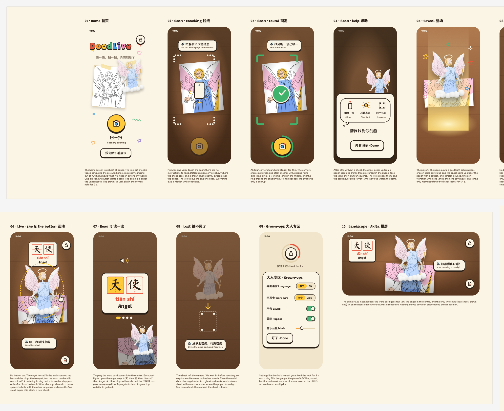

# Design direction: Paper & Crayon (2026-10-24, for review)

**Figma:** [DoodLive · Paper & Crayon redesign](https://www.figma.com/design/M0UmTttcXkqXKgz6vQvJGD). The page
`00 Foundations` holds the tokens and components; `01 Screens` holds the 10 screens.
**Status:** approved 2026-10-24 and built in both apps (web: `web/style.css`, `web/app.js`; Unity: `ARColoringController.UI.cs`). Not yet tested with children or with a printed sheet on the new build.

## The idea in one line

Every screen is a sheet of paper, and every control looks like something a child could draw. We replace the dark
navy "tech" look and the row of pill buttons with warm paper, crayon colours, a pencil outline and a solid "lip"
shadow that makes buttons look pressable. **The angel herself is the main control.**

## What changes, and why

| # | Change | Why (source, grade, date checked) |
|---|---|---|
| 1 | The angel is the button. Tap her = trumpet; tap the word card = read aloud. The three bottom pills are removed. | Apple AR HIG: "Let people use direct manipulation to interact with objects when possible." `[A · developer.apple.com/design/human-interface-guidelines/augmented-reality · 2026-10-24]` |
| 2 | One on-screen control during AR (the new-sheet chip), plus the grown-up lock. | Apple AR HIG: "Avoid cluttering the screen with controls and information that diminish the immersive experience." `[A · same page · 2026-10-24]` |
| 3 | Scan coaching uses pictures and one spoken line instead of instructions to read. | ARCore design: "Use visual cues, motion, and animation to guide users rather than text instructions." `[A · developers.google.com/ar/design/interaction/ui · 2026-10-24]` |
| 4 | The help card is a thought bubble from the angel showing 3 pictures. It never says "error". | Sago Mini on Apple Developer: engagement "skyrocketed" once children found a character with a thought bubble `[A · developer.apple.com/news/?id=3t6o5jec · 2026-10-24]`; ARCore: "Avoid blaming the user." `[A]` |
| 5 | Language, pinyin/ABC, sound and haptics move behind a 2-second hold gate. | App Store guideline 1.3 (Kids) on parental gates `[A · Apple]`. Google Play's Families policy is the rule that binds this Android app and **has not been read yet** `[D]`. |
| 6 | Touch targets: shutter 112 px, chips 56 px. | Android: "at least 48dp x 48dp. Larger is even better." `[A · developer.android.com/guide/topics/ui/accessibility/apps · 2026-10-24]` The 56/112 sizes are our choice `[D]`. |
| 7 | Lost tracking waits 1 s before reacting, then dims the scene and shows a ghost angel. | Apple AR HIG: "consider waiting up to one second before fading them out" `[A]`. Today we wait 1.5 s; this change shortens it. |
| 8 | The reveal is the big payoff: glow, light column, crayon stars, squash-and-stretch, one haptic when she lands. | Apple: "Use audio and haptics to enhance the immersive experience." `[A]` "Juice" talk (GDC Europe 2012) `[C · gamedeveloper.com]` |
| 9 | The word card shows 汉字 in 田字格 boxes, then pinyin, then English. Each line lights up as she says it. | Khan Academy Kids: every text element can be tapped to hear it `[A · blog.khanacademy.org · 2026-10-24]`. |
| 10 | One scan, not two. | Quiver's App Store listing describes scanning a QR code and then the page `[A · apps.apple.com]`; doing it in one step is our choice `[D]`. |

## Foundations

- **Colour:** paper `#FBF5E6`, shade `#F1E6CC`, deep `#E4D3AE`; pencil ink `#2B2118`, soft ink `#6B5B4A`; crayons:
  red `#E8553D`, orange `#F59A2F`, sun `#FFC93C`, leaf `#4DB37A`, sky `#4BA3E3`, pink `#F49AC1`, grape `#8A6FD1`;
  gold foil `#E3B04B`; OK green `#3FB36B`. These are Figma variables in the `DoodLive` collection.
- **Type:** Grandstander Black for the logo and display; Fredoka for UI; ZCOOL KuaiLe for Chinese UI; Ma Shan Zheng
  for the characters being taught; Nunito ExtraBold for pinyin, because it has the tone marks. All are Google Fonts
  under the OFL. Licences still need to be checked before shipping `[D]`.
- **Shape:** 3 px pencil outline + solid 4–7 px "lip" shadow. When pressed, the lip shrinks to 2 px and the button
  moves down. No gradients on controls.
- **Logo:** each letter of "DoodLive" in a different crayon colour, with an outline, a lip and ±6° wobble. App icon idea:
  the two "o"s become eyes under a gold halo (not drawn yet).
- **Components:** `Button/Shutter`, `Button/Crayon`, `Chip/Icon` (grown-up lock), `Chip/NewSheet`, `Scan/Corner`, `WordCard`.

## The 10 screens

01 Home · 02 Scan coaching · 03 Found (lock) · 04 Help · 05 Reveal · 06 Live (she is the button) · 07 Read it ·
08 Lost · 09 Grown-ups (parent gate + settings) · 10 Landscape (Akita). Each frame in Figma has a note underneath
describing its motion and sound.

## References studied

Ten Figma Community files, used only for direction; nothing was copied into the repo: Button UI Kit for Kids 6–12,
Doodle Dee Doo, Torn Paper Texture Collection, Ocean Friends Coloring Book, Brawl Stars UI Kit, Sweet Pop Match-3,
2D Game UI Kit, Kiddo 3D Kids Icons, Claymorphism UI, Wood Screw Game UI Kit.

## Open questions (weakest points)

1. **64 dp vs 56 dp chips, the 5 s idle hint, and how long the animations last** are our guesses `[D]`. Test with
   children aged 4–6 before locking them in.
2. **Google Play Families policy** (ads, parental gates, data) has not been read. It decides how the grown-up area must work.
3. **Mock vs. real AR:** the sheet under the angel is flattened in the mocks. On a phone it will look like a sheet
   lying in perspective on the table.

## Build order (done 2026-10-24)

1. Tokens and fonts in `web/style.css` and Unity (a TMP font asset and colour constants). One shared table, like the strings.
2. Live screen first (06), with the angel as the button and the word card. This is where the biggest UX gain is.
3. Scan coaching, lock, help and lost (02–04, 08).
4. Reveal juice (05), the grown-up gate (09), then landscape (10).
5. Home (01) and the app icon last.

## Where the build differs from the mocks

- **Word card:** the live screen keeps the 3D extruded title above the angel (an earlier requirement), so tapping
  the title reads it. The flat 2D word card from the mocks is not built.
- **Unity tap hint:** the dotted ring and hand are drawn in IMGUI; the ring follows the angel's on-screen bounds.
- **Unity scan shutter:** capture is automatic (ARCore image tracking), so the shutter is a progress dial, not a button.
- **Web scan shutter:** still a real button (manual capture fallback), with the same green progress ring.
