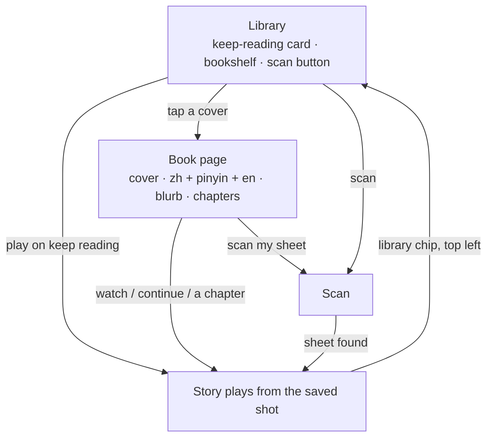

# Library — the home screen

The home screen is a children's library instead of a stack of demo buttons (owner request, 2026-11-14: "home is
piling up; it should be a library, every story in a picture frame, remember where the child stopped, in both
languages").

| Piece | Where |
|---|---|
| Screen code | `unity/Assets/DoodLive/Scripts/ARColoringController.Library.cs` (IMGUI, Paper & Crayon tokens) |
| Shelf order, pinyin, blurbs, minutes, cover choice | `assets/library.json` (the angel is a book too) |
| Covers | `tools/story/make_covers.py`: a frame of a real on-device demo recording (`scripts/record-demo.sh <id>`), cropped to the stage, 600×800 → `assets/<id>/cover.png` + `Resources/Covers/<id>.png`; also writes `Resources/library.json` (titles + the chapter list from each timeline) |
| Resume | `IStoryPlayer.BeginAt(shot)`: both directors fast-forward silently to the shot's start (moves, props, the music cue playing then at its offset, effects still running such as night or sunset, ambience loops) |
| Progress | `PlayerPrefs`: `lib.last` (last book), `lib.shot.<id>` (shot to resume, 0 after the end), `lib.done.<id>`, `lib.open.<id>` (NEW mark until first opened). Stored on the device only. |

Rules: every title shows both languages (Chinese face + Latin face); the scan button stays on screen while the shelf
scrolls; the grown-up lock stays top right; the language switch (中文 / EN) sits next to it. After adding a story:
add it to `assets/library.json`, record its demo, run `python3 tools/story/make_covers.py`, rebuild.
