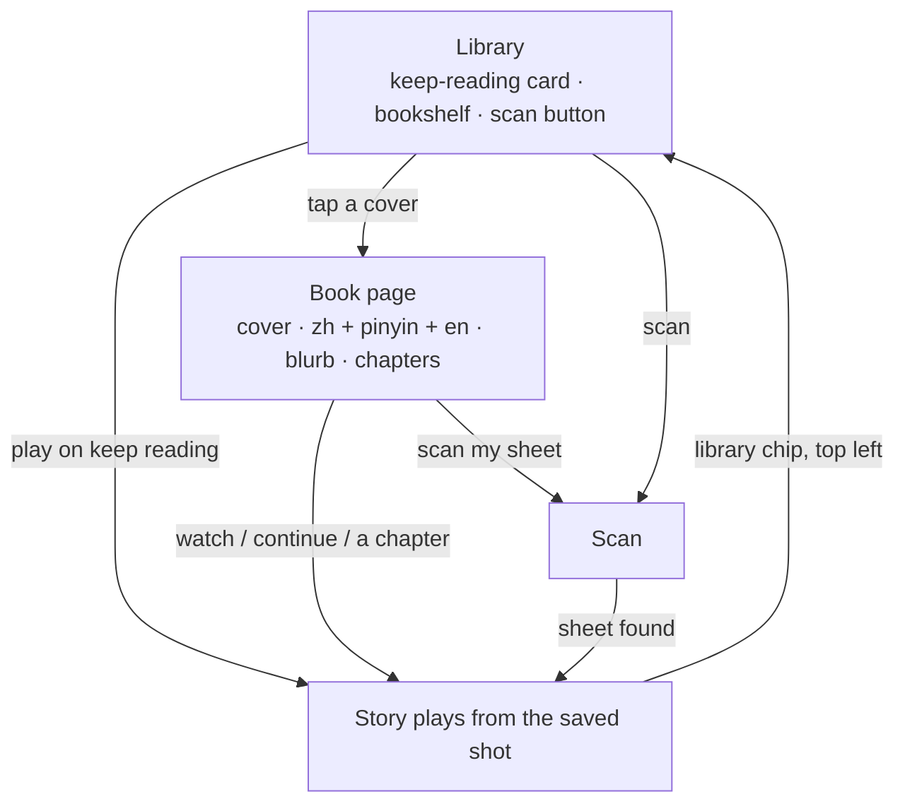

# Library — the home screen

The home screen is a children's library instead of a stack of demo buttons (owner request, 2026-11-14: "home is
piling up; it should be a library, every story in a picture frame, remember where the child stopped, in both
languages").

| Piece | Where |
|---|---|
| Screen code | `unity/Assets/DoodLive/Scripts/ARColoringController.Library.cs` (IMGUI, Paper & Crayon tokens) |
| Shelf order, pinyin, blurbs, minutes, cover choice | `assets/library.json` (the angel is a book too) |
| Covers | `tools/story/make_covers.py`: a frame of a real on-device demo recording (`scripts/record-demo.sh <id>`), cropped to the stage, 600×800 → `assets/<id>/cover.png` + `Resources/Covers/<id>.png`; also writes `Resources/library.json` (titles + the chapter list from each timeline) |
| Resume | `IStoryPlayer.BeginAt(shot)`: both directors fast-forward silently to the shot's start (moves, props, the music cue playing then at its offset, effects still running such as night or sunset, ambience loops) |
| Progress | `PlayerPrefs`: `lib.last` (last book), `lib.shot.<id>` (shot to resume, 0 after the end), `lib.done.<id>`, `lib.open.<id>` (NEW mark until first opened). Stored on the device only. |
| How to play | `ARColoringController.Howto.cs`; `PlayerPrefs` `lib.howto.seen` = 1 once the video was opened or the card dismissed |
| Sheet actions | `ARColoringController.SheetActions.cs` + `Assets/Plugins/Android/` (Java); PDFs from `Editor/SheetPdfSetup.cs` |

Rules: every title shows both languages (Chinese face + Latin face); the scan button stays on screen while the shelf
scrolls; the grown-up lock stays top right; the language switch (中文 / EN) sits next to it. After adding a story:
add it to `assets/library.json`, record its demo, run `python3 tools/story/make_covers.py`, rebuild.

## How to play (owner request 2026-11-14: "blank paper → colouring → phone camera → virtual 3D, seen from every side")

- **First run:** a "怎么玩 · How to play" card at the top of the shelf, above keep reading: the four steps as pictures
  (sheet → crayon → camera → angel with a 3D sticker), a play chip, and a small × that dismisses it. Opening the video
  or pressing × sets `lib.howto.seen` = 1; the card is then gone for good.
- **Afterwards:** a small "?" chip left of the 中文 / EN switch reopens the video.
- **Player:** fullscreen, Unity `VideoPlayer` (module `com.unity.modules.video`, render mode API-only, drawn by IMGUI),
  from `Assets/StreamingAssets/howto/howto.mp4` (contract: 720×1280 portrait, H.264 + AAC). In English
  `howto_en.mp4` is tried first and the app falls back to `howto.mp4` when it is missing. Tap = pause / resume,
  × top right (or Android back) = close, the end returns to the library. Music pauses while it plays; the app's mute
  setting mutes the video.
- **No file yet:** an error from the player, or no prepare within 8 s, shows the four steps big with
  "演示视频马上就来！ · The how-to video is coming soon!"; a tap closes it.

## Sheet actions on the book page: save PDF · share · print

Every book whose blank colouring sheet has a PDF shows a row at the bottom of its page: **保存 PDF / Save PDF**,
**分享 / Share**, **打印 / Print**. They act on the sheet as printed (`print/<sheet>.pdf`, where sheet =
`assets/stories.json` `sheets[0]`; the angel uses `doodlive-angel-A4`).

**Two files per book.** Above the three buttons a two-way choice picks the file: **空白 / Blank** (the sheet to
colour, `print/<sheet>.pdf`) or **涂好的示范 / Coloured sample** (the demo colouring on the same page,
`print/<sheet>-colored.pdf`). Blank is chosen each time a book page opens; choosing is a plain tap (it does not leave
the app), the three buttons keep the grown-up gate. A book with no coloured PDF shows no choice and offers the blank
sheet only.

The coloured PDFs come from `python3 tools/story/make_colored_pdf.py [id ...]`: the full-page coloured A4 image
(`print/<sheet>-colored.png` if one is kept by hand, as for David & Goliath's bright print; else
`assets/<id>/sheet/demo-sheet.png`; the angel: `web/assets/demo-sheet.png`) at 100 % on an A4 page (1240 × 1754 px at
150 dpi, the same as the blank PDF), so it prints at true size. The tool checks the page size and that the four corner
markers sit where the blank sheet's do, and names any book it skips for want of an image. Run it after a sheet changes.

| Step | What happens |
|---|---|
| Bundle (editor) | `Editor/SheetPdfSetup.cs`, called by `DoodLiveSetup.Setup`, copies each PDF to `Assets/StreamingAssets/sheets/<sheet>.pdf` (and `<sheet>-colored.pdf`) and writes `Resources/sheet_pdfs.json` (`book`, `file`, `colored`; `colored` is empty when there is no coloured PDF). A missing blank PDF is left out and its book shows no row. Generated: never hand-edit. |
| Save PDF | `MediaStore.Downloads` (API 29+, no storage permission) → `Download/DoodLive-<中文书名>-<Id>-<which>.pdf`, e.g. `DoodLive-出埃及-Exodus-空白-Blank.pdf` or `DoodLive-出埃及-Exodus-示范-Coloured.pdf` (Android numbers a duplicate); then the note "已保存到“下载” · Saved to Downloads". Below API 29 it opens the share sheet instead. |
| Share | The PDF is copied out of the APK to `<cacheDir>/shared/`, served read-only by `DoodLiveFileProvider` as `content://today.onemorething.doodlive.doodlive.files/<name>`, and sent with `ACTION_SEND` (`application/pdf`) through `Intent.createChooser` (Drive, Gmail, WeChat, Files, printer apps). |
| Print | `PrintManager.print("DoodLive – <title>", adapter, A4)` (the coloured sample's job name adds " · 涂好的示范 / Coloured sample"): the adapter streams the PDF unchanged, so the sheet prints at real size (the markers must stay square). |
| Not Android | Logs and opens the PDF with the system viewer (`Application.OpenURL`), note "已在电脑上打开 PDF". |

**Grown-up gate.** The book page is the children's screen, and these actions leave the app (share sheet, print
dialog). They reuse the lock chip's rule (`GateHold` = 2 s): holding a button for 2 s fires it, with the same red-dot
ring. While the grown-ups panel is open, a plain tap fires it. A short tap only shows "请大人按住按钮 2 秒 · Grown-ups:
press and hold for 2 seconds". The row sits at the bottom under a small "给大人" caption, so it does not compete with
watch / scan. The chapter grid always ends above the row (taller with the choice): its buttons shrink first.

Android pieces: `unity/Assets/Plugins/Android/DoodLiveShare.java` (save / share / print), `DoodLiveFileProvider.java`
(the content provider; plain `android.content.ContentProvider`, so the Unity gradle build needs no androidx
dependency), `DoodLiveShare.androidlib/AndroidManifest.xml` (only the `<provider>` entry, merged by Unity; authority
`${applicationId}.doodlive.files`). No ProjectSettings flags and no custom gradle templates.
