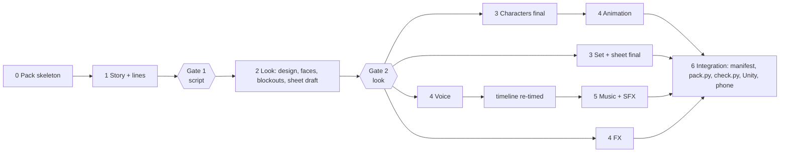

# Adding a story pack — checklist

The short path from "a Bible story" to "a pack the app plays". Architecture: `docs/STORY-ARCHITECTURE.md`; what is
shared and how a pack plugs into it: `docs/STORY-KIT.md`; how the app plays a pack: `docs/STORY-ENGINE.md`.

Rule of thumb: **a pack is data plus the code only it needs.** Before you copy a function from another pack, look in
`pipeline/story_kit/`, `tools/story/music_kit.py`, `pipeline/story_mesh.py` and the FX registry (`FxLibrary`); if a
second pack needs the same thing, move it into the kit (byte-identical for the packs already using it) instead of
copying it.

Two human gates. Nothing expensive (Blender modelling, animation, music, recorded voices, Unity) starts before the
owner has said yes at Gate 1, and no animation / music / FX / final voice work starts before Gate 2.

## 0. Skeleton (lead, cheap model is fine)

- [ ] Pick the id (kebab-case), a two-letter script prefix (`ru`, `da` ...) and the env prefix (`RU_`).
- [ ] `docs/<id>/CONTRACT.md` from the last pack's: roles, file ownership, ids, bone names, clip names. Say which kit
      parts the pack uses and which functions it overrides.
- [ ] `assets/<id>/manifest.json` — subtitle names (`strings`: `dg_<name>` keys), library book (pinyin, blurbs,
      minutes, `"after"`), FX (`class` and/or `aliases`) and, **at Integration only**, the registry entry (order,
      titles, sheets, cast, set): the app reads every registry entry and does not look at `status`, so a merged
      registry entry puts the story in the next APK. Run `python3 tools/story/merge_packs.py` after each change.
      **Never edit `assets/stories.json`, `assets/library.json`, `tools/i18n/strings.json` or the registration lines
      of `DGFxEffects.cs` by hand** — they are merged from the manifests, so two packs built in parallel never touch
      the same file.

## 1. Story and lines (lead, best model) → **Gate 1: script**

- [ ] `docs/<id>/STORY.md`, `docs/<id>/storyboard/story.py` (shots, acting, lines zh + en, fx / sfx / music cues).
- [ ] `tools/story/cast_<id>.json`; `python3 tools/story/voice.py <id> gen` (TTS draft), then
      `python3 tools/story/build_timeline.py <id>`.
- [ ] Storyboard frames + the TTS draft mix for the owner.
- [ ] **Gate 1.** The owner reads / listens and approves the script, the line lengths and the shot list.
      Record the decision (date, what changed) in the Hours project folder, not in the repo.

## 2. Look (characters + set roles, best model) → **Gate 2: look**

- [ ] `docs/<id>/DESIGN.md`: palette inside `docs/DESIGN-DIRECTION.md`, each character's silhouette and costume.
- [ ] Characters: constants + builders only in `pipeline/<xx>_characters.py`; `story_kit.include(globals(), "characters")`
      provides the skeleton, heads, hair, hands, robes, hoods, eyelids, UV fixes, previews and checks.
      Run `faces`, `build`, `preview` → turnaround previews.
- [ ] Set: a blockout from `story_kit` stage primitives (`box`, `lathe`, `tube`, `extrude`, `puff`, `ngon_top`) and the
      layout; first preview from the phone view.
- [ ] Sheet draft: `python3 tools/story/make_sheet.py <id>` → `print/<id>-A4.png`.
- [ ] **Gate 2.** The owner approves faces, costumes, set mood and the printed page. Changes after this gate are
      expensive (animation and UVs follow the meshes), so ask now.

## 3–5. Production (parallel, one role per session, one file set per role)

| Role | Runs | Kit it builds on | Model |
|---|---|---|---|
| Characters final | `blender -b --factory-startup --python pipeline/<xx>_characters.py -- build / verify` | `story_kit/characters.py` | best (geometry judgement) |
| Set + sheet final | `pipeline/<xx>_<set>.py -- all`, `tools/story/make_sheet.py <id>` | `story_kit/stage.py`, `make_sheet.py` | best for the set; sheet: cheaper |
| Animation | `python3 pipeline/<xx>_animate.py all` | `story_kit/animation.py` (IK, gait, kneel, blink, talk, springs, bake, verify) | best for acting clips; cheaper for re-bakes / verify |
| Voice | `tools/story/voice.py <id> gen / import`, `build_timeline.py <id>` | `voice.py` | cheaper (mechanical) |
| Music + SFX | `python3 tools/story/music_<id>.py` (after the voices re-time the timeline) | `music_kit.py` (engine, rooms, loudness, sparkle / cheer) | mid: the score is creative, the engine is not |
| FX | aliases in the manifest first; a `StoryFx<Id>.cs` only for effects nothing in `FxLibrary` can play | `FxLibrary`, `StoryFxAlias` | mid |

"Best" = the strongest model available (Opus-class); "cheaper" = Sonnet-class; checks and merges can run on the
smallest model (Haiku-class). Each role reads its CONTRACT section and the kit file docstring, not other packs' scripts.

## 6. Integration (lead; only this role runs Unity or uses the phone, and only after asking the owner)

- [ ] Add the `registry` section to the manifest; `python3 tools/story/merge_packs.py` (manifest → shared files; runs
      `gen_i18n.py`), `python3 tools/make_fonts.py`.
- [ ] `python3 tools/story/pack.py <id>`, `python3 tools/make_sheet_signatures.py`.
- [ ] `python3 tools/story/check.py <id>` — must print `0 FAIL`.
- [ ] Unity setup + APK (`scripts/build-apk.sh`, `scripts/install-apk.sh <serial>`), scan the printed sheet, record
      the demo.
- [ ] New pitfalls go to `docs/LESSONS.md` in the same commit as the fix.
