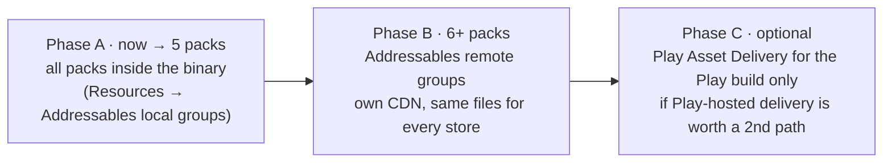
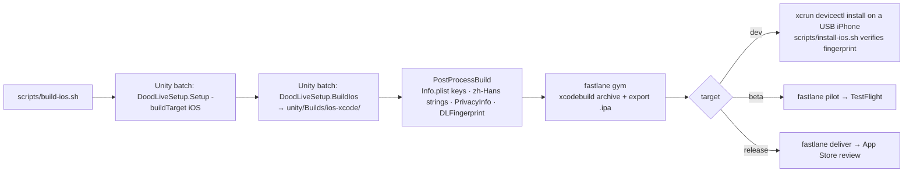
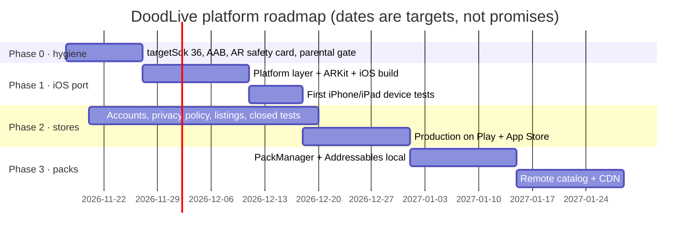

# Platform architecture — one Unity app, many stores

Status: proposal v1, 2026-11-14. Owner of this file: platform architect role.
Companions: `docs/STORY-ARCHITECTURE.md` (packs), `docs/STORY-ENGINE.md` (how a pack plays),
`docs/VOICE-SYSTEM.md` (voice packs; being written in parallel; this file defines only how voice packs are
**delivered, versioned and stored**, never their format).

Evidence tags follow the owner's rule: `[A · domain · checked date]` = official page fetched and the sentence read
(short quote given); `[B …]` = official page fetched but summarised; `[C …]` = third party or general knowledge;
`[D · inference …]` = my reasoning, to be verified. Local facts measured on this Mac today carry `[A · local …]`.

---

## 0. Decisions in one table

| # | Decision | Why (short) |
|---|---|---|
| D1 | **One Unity 6.3 project, one scene, one codebase** for Android and iOS. The web three.js app stays a prototype and is not shipped to stores. | AR Foundation already abstracts ARCore and ARKit; the story engine is data-driven. |
| D2 | A thin **platform layer** (`DoodLive.Platform`) with six small interfaces: camera permission, haptics, audio session, storage paths, share/links, launch arguments. All `#if UNITY_ANDROID / UNITY_IOS` code lives there and nowhere else. | Today Android-only calls sit inside `ARColoringController` (section 3.1). |
| D3 | **The marker path (`SheetFinder` + `Vision/`) is the primary sheet finder on both platforms**; image tracking (ARCore / ARKit) stays a second path for coloured sheets. | The marker path is pure C# on the camera picture, so it is platform-neutral. ARKit, like ARCore, will not lock onto a blank white page (LESSONS L49), and ARKit needs a fixed physical size (section 3.2). |
| D4 | **Content delivery: packs ship inside the app first; when there are more than ~5, use Addressables with a remote catalog on our own CDN**, the same files for every store. Not Play Asset Delivery as the main path, not iOS On-Demand Resources. | PAD works only on Google Play; On-Demand Resources is deprecated from iOS 27 (section 2.2). One CDN pipeline serves Play, App Store and any other Android store. |
| D5 | **Offline-first.** The app never needs the network to play anything it already has. No account, no login, no server-side user data. | Kids policies on both stores and the product promise "nothing leaves the phone". |
| D6 | **No third-party SDKs that collect data**: no analytics, no ads, no third-party crash SDK. Crash data comes from the stores' own consoles (Play Console Android vitals, App Store Connect / Xcode Organizer). | Apple 1.3 / 5.1.4 and the Play Families policy (section 4). |
| D7 | **Paid packs, if any, are sold only through store in-app purchase, behind a parental gate.** A printed sheet never unlocks paid content. | Apple 3.1.1 forbids "augmented reality markers" as an unlock mechanism (section 4.2). |
| D8 | **Minimum targets:** Android minSdk 25 (unchanged), targetSdk **36**; iOS **16.0**, ARKit **required**, iPhone + iPad. | Play requirement since 2026-08-31; iOS 16 is the floor of Background Assets should we ever need it (section 3.4). |
| D9 | **Builds run on the owner's Mac** (iOS needs macOS + Xcode anyway); GitHub Actions only for cheap Linux checks (pack validation, Python tools). fastlane for upload. | Unity licence activation and macOS minutes in CI cost more than they save for a one-person studio [D]. |
| D10 | **Build fingerprint invariant extended to iOS** with numeric store versions plus a fingerprint key (section 5.1). | Apple only accepts numeric `CFBundleShortVersionString` / `CFBundleVersion`. |

---

## 1. Target architecture

### 1.1 Layers

```mermaid
flowchart TB
  subgraph Content["Content (data, downloadable, no code)"]
    SP[Story packs<br/>timeline · models · anim · sheets · music · sfx]
    VP[Voice packs<br/>format: docs/VOICE-SYSTEM.md]
    REG[Pack catalog<br/>stories.json + Addressables catalog]
  end
  subgraph Engine["Engine (C#, ships in the binary)"]
    CTL[ARColoringController<br/>state machine + UI]
    STO[StoryDirector · StoryActor · StoryFx]
    VIS[SheetFinder · Vision/MarkerDetector · SheetIdentifier<br/>PageWarp]
    PK[PackManager (new)<br/>catalog · download · cache · entitlement]
    L10[L10n · DesignTokens]
  end
  subgraph Platform["Platform layer DoodLive.Platform (new, the only place with #if)"]
    PERM[ICameraPermission]
    HAP[IHaptics]
    AUD[IAudioSession]
    STG[IStoragePaths]
    SHR[IExternalActions<br/>links · share · settings · store page]
    ARG[ILaunchArgs<br/>QA autodemo]
  end
  subgraph Vendor["Unity + vendor"]
    ARF[AR Foundation 6.3]
    ARC[ARCore XR Plug-in<br/>Android]
    ARK[ARKit XR Plug-in<br/>iOS]
    URP[URP 17 · Metal / GLES3 / Vulkan]
    ADR[Addressables]
    IAP[Store IAP<br/>only if packs are sold]
  end
  Content --> PK
  PK --> STO
  CTL --> VIS & STO & PK & L10
  CTL --> Platform
  VIS --> ARF
  ARF --> ARC & ARK
  PK --> ADR
  PK -.-> IAP
```

Rules:

1. **Engine code never names a platform.** `UnityEngine.Android`, `AndroidJavaClass`, `Handheld`, ObjC plug-ins and
   `#if UNITY_IOS` appear only under `unity/Assets/DoodLive/Platform/`. A grep in the build script enforces it
   (section 5.2).
2. **Content never contains code.** A pack is data (meshes, textures, audio, JSON). Anything that needs new behaviour
   is engine code and ships in an app update. This keeps packs within Apple 2.5.2 ("may not … download, install, or
   execute code") and Play asset packs ("no executable code") `[A · developer.apple.com/app-store/review/guidelines · checked 2026-11-14]`
   `[A · developer.android.com/guide/playcore/asset-delivery · checked 2026-11-14: asset packs "are composed of assets (such as textures, shaders, and sounds), but no executable code"]`.
3. **AR is used through AR Foundation only.** No direct ARCore / ARKit native calls.
4. **Every pack declares the engine version it needs** (`minEngine`, section 2.3). The engine refuses a pack that is
   newer than itself and offers the store update instead.

### 1.2 Engine vs content

| Kind | Lives in | Changes need |
|---|---|---|
| State machine, UI, scan, warp, story player, FX code, shaders, fonts for UI | binary | app update + store review |
| Angel (built-in demo), at least one full story, UI audio cues | binary (install-time) | app update |
| Story packs 2..n (timeline, models, sheets, music, sfx, subtitles) | pack | catalog publish only |
| Voice packs (per language / per voice actor) | pack, format per `VOICE-SYSTEM.md` | catalog publish only |
| Printable sheets (PDF) | website / pack metadata link (behind parental gate) | none in app |
| Sheet signatures (`sheet_signatures.json`) + image-tracking reference images | inside each pack; engine merges at load | catalog publish |

Shaders are a special case: a pack may only use shaders that are already in the binary (Addressables would otherwise
ship shader variants the player did not compile). `tools/story/check.py` must reject a pack that references an unknown
shader `[D · Unity shader-variant stripping behaviour, verify with a first remote pack]`.

### 1.3 The platform layer (C# sketch, to be implemented)

```csharp
namespace DoodLive.Platform {
  public interface ICameraPermission { IEnumerator Request(Action<bool> done); bool Granted { get; } void OpenAppSettings(); }
  public interface IHaptics         { void Tap(); void Land(); }                 // light impact / medium impact
  public interface IAudioSession    { void ConfigureForStory(); }                // iOS: play even with the silent switch? (3.6)
  public interface IStoragePaths    { string PackCache { get; } string Prefs { get; } }
  public interface IExternalActions { void OpenUrl(string url); void Share(string file, string text); void OpenStorePage(); }
  public interface ILaunchArgs      { string Get(string key); }                  // QA: autodemo
  public static class Services { public static ICameraPermission Camera; public static IHaptics Haptics; /* … */ }
}
```

Implementations: `AndroidPlatform.cs` (current JNI code moved here), `IosPlatform.cs` + `Plugins/iOS/DoodLiveHaptics.mm`
(UIImpactFeedbackGenerator, ~30 lines), `EditorPlatform.cs` (no-ops). `IExternalActions.*` must be called only from
inside the grown-ups area (parental gate, section 4.2).

---

## 2. Content delivery (packs)

### 2.1 Phases



Size headroom for phase A: the current APK is 58.7 MB with three stories `[A · local · unity/Builds/DoodLive.apk, 2026-11-14]`;
Google Play's base-module limit is 500 MB compressed `[A · support.google.com/googleplay/android-developer/answer/9859372 · checked 2026-11-14: "Base module 500MB"]`.
So phase A can hold the 5 packs foreseen in `STORY-ARCHITECTURE.md` without any delivery machinery. The real reasons to
move to phase B are first-install size for families on mobile data and publishing a story without a store review
`[D]`.

### 2.2 Why our own CDN and not PAD / On-Demand Resources

| Option | Stores it works in | Status | Verdict |
|---|---|---|---|
| Play Asset Delivery (via Unity "Addressables for Android") | Google Play only | current; Unity package exists `[A · docs.unity3d.com/Packages/com.unity.addressables.android@1.0 · checked 2026-11-14: "works in conjunction with the Addressables package to support Play Asset Delivery"]` | Keep as optional phase C. Huawei, Xiaomi, sideload builds cannot use it `[D]`. |
| iOS On-Demand Resources (`NSBundleResourceRequest`) | App Store only | **deprecated in iOS 27**: "Use Background Assets instead." `[A · developer.apple.com/documentation/foundation/nsbundleresourcerequest (metadata) · checked 2026-11-14]` | Rejected. |
| Apple Background Assets (Apple-hosted or self-hosted) | App Store only, iOS 16+ | current; "You can host your assets on your own servers or use Apple-hosted assets." `[A · developer.apple.com/documentation/backgroundassets · checked 2026-11-14]` | Not needed if we self-host; worth a look only if Apple hosting becomes free and simpler. |
| **Addressables remote catalog on own CDN** (e.g. Cloudflare R2 + custom domain) | every store, every platform | current | **Chosen.** One build step per platform, one upload, one catalog. |

Kids-policy notes for the CDN: requests carry no identifier, no cookies, no query parameters with user data; the CDN
logs IP addresses for a short time like any web server. This must be named in the privacy policy and answered in both
privacy forms (section 4) `[D · verify the exact wording of the "ephemeral processing" rules for Play and "Collect" for Apple, quoted in 4.1 / 4.2]`.

### 2.3 Pack identity, versioning, compatibility

```jsonc
// catalog entry (generated from assets/stories.json by tools/story/pack.py; never hand-edited)
{ "id": "esther", "kind": "story",            // story | voice (voice: fields per VOICE-SYSTEM.md)
  "version": 3,                               // integer, +1 on every content change
  "minEngine": 2,                             // engine contract version compiled into the app
  "langs": ["zh", "en"],
  "price": "free",                            // free | iap:<productId>
  "sizeBytes": { "android": 18500000, "ios": 19100000 },
  "sha256": { "android": "…", "ios": "…" },   // of each bundle, checked after download
  "sheets": ["esther-A4", "esther-A4-demo"] }
```

- `ENGINE_VERSION` is a constant in the binary, bumped only when the timeline/pack contract changes
  (`docs/STORY-ENGINE.md`). Packs with `minEngine > ENGINE_VERSION` show "Update the app to play this story".
- Bundles are built **per platform** (texture compression and shader variants differ). The ARKit image library inside
  a bundle must be built on macOS with Xcode installed: "To use an XRReferenceImageLibrary in an AssetBundle, the
  AssetBundle must be built on macOS with Xcode installed." `[A · docs.unity3d.com/Packages/com.unity.xr.arkit@6.3/manual/arkit-image-tracking.html · checked 2026-11-14]`
- Bundle names include the content hash so the CDN can cache forever; the catalog is the only mutable file
  (short cache time).

### 2.4 Offline-first and storage

```mermaid
sequenceDiagram
  participant App
  participant Cache as Local pack cache
  participant CDN
  App->>Cache: on launch, list installed packs (works offline)
  App-->>App: home screen shows installed packs + "get more" tiles from last known catalog
  App->>CDN: (only if online, at most once a day) fetch catalog.json
  Note over App,CDN: no identifiers, no cookies
  App->>CDN: child taps a new story → grown-up confirms on Wi-Fi/mobile data → download bundle
  CDN-->>App: bundle → verify sha256 → move into cache atomically
  App->>Cache: play from cache; never streams during play
```

- Cache location: our own folder under `Application.persistentDataPath/packs/` (Android: app-internal storage;
  iOS: inside the app container). On iOS, mark it excluded from iCloud backup because it can be downloaded again
  `[D · Apple storage guidance not fetched this round]`. Do not rely on Unity's default `Caching` folder on iOS,
  which may live in a purgeable caches directory `[D · verify]`.
- Downloads ask a grown-up first (the size and "Wi-Fi recommended"), behind the parental gate. The child never sees a
  progress spinner that blocks play: installed stories stay playable.
- Deleting a pack is a grown-ups setting; the built-in story cannot be deleted.

### 2.5 Entitlements (only if packs are sold)

- Store IAP only (Google Play Billing, StoreKit). "Google Play's billing system is required for developers offering
  in-app purchases of digital goods" `[A · support.google.com/googleplay/android-developer/answer/10281818 · checked 2026-11-14]`;
  Apple 3.1.1 "you must use in-app purchase" `[A · developer.apple.com/app-store/review/guidelines · checked 2026-11-14]`.
- Non-consumable product per pack (or one "all stories" product). Restore purchases button in the grown-ups area.
- No own server at first: entitlement = the store's purchase record, checked on device. Paid bundles are not
  secret on the CDN (they are useless without the app); if piracy ever matters, add signed URLs later `[D]`.
- **Other Android stores** need their own billing (Huawei IAP, etc.) or the paid packs simply are not offered there
  `[D]`. Recommendation: launch free (or one paid "full version") everywhere; decide on per-pack sales after Phase 3.

### 2.6 Voice packs

Voice packs ride the same `PackManager`: `kind: "voice"`, same catalog, same cache, same `minEngine` / `version`
rules, same parental gate for downloads. Everything inside a voice pack (line ids, file layout, loudness, fallback
order between recorded voice and TTS, how a story finds its lines) is owned by `docs/VOICE-SYSTEM.md`. When that file
lands, check that it uses `id`, `kind`, `version`, `minEngine`, `langs` with the meanings above; otherwise this file
changes, not that one.

---

## 3. iOS port plan

### 3.1 Code audit: every Android / ARCore-only call (2026-11-14, `git` HEAD `ef8d59e` + working tree)

| # | File:line | What it does | iOS behaviour today | Replacement |
|---|---|---|---|---|
| 1 | `Scripts/ARColoringController.cs:24-25` | `using UnityEngine.Android;` under `#if UNITY_ANDROID` | compiled out | move with #3 into `AndroidPlatform` |
| 2 | `Scripts/ARColoringController.cs:121-129` | reads Intent extra `demo` via `AndroidJavaClass` (QA autodemo) | compiled out; no QA autodemo on iOS | `ILaunchArgs`: Android = Intent extra; iOS = process arguments (`xcrun devicectl device process launch … -- -demo esther`) read through `Environment.GetCommandLineArgs()` `[D · verify that Unity iOS passes launch arguments through]` |
| 3 | `Scripts/ARColoringController.cs:162-171` | camera permission with `Permission.RequestUserPermission` + callbacks | compiled out: **no explicit request**. ARKit will trigger the system prompt when the session starts; a denial leaves the session without frames and the child on an endless "scanning" screen `[D]` | `ICameraPermission`: iOS = `Application.RequestUserAuthorization(UserAuthorization.WebCam)` then `Application.HasUserAuthorization`; on denial go to Home with the `noPerm` message and a grown-ups "Open Settings" button |
| 4 | `Scripts/ARColoringController.cs:173-176` | `ARSession.CheckAvailability()` / `ARSession.Install()` | portable; `Install` is an ARCore concept, on iOS the state goes to Ready or Unsupported `[D]` | keep; with ARKit "required" (3.4) Unsupported cannot happen on store installs |
| 5 | `Scripts/ARColoringController.cs:249, 258` | Escape = Android back button; `Application.Quit()` on Home | never fires on iOS (no back key) | keep; add a visible back button on every screen (already in the design?) — iOS has no system back `[D · check UX-PLAN screens]` |
| 6 | `Scripts/ARColoringController.UI.cs:66-75` | vibration via `getSystemService("vibrator")`, fallback `Handheld.Vibrate()` | compiled out: **no haptics** | `IHaptics`: iOS = `UIImpactFeedbackGenerator` light / medium in `Plugins/iOS/DoodLiveHaptics.mm`. Do not use `Handheld.Vibrate()` on iOS (one long buzz only) `[D]` |
| 7 | `Scripts/SheetFinder.cs:185` | raycast with `TrackableType.Depth` to rescale a screen-shown sheet | ARKit has no depth raycast in AR Foundation as far as I know; planes and feature points still work `[D · verify ARKit raycast support table]` | keep; result degrades gracefully (falls back to planes / feature points / PnP) |
| 8 | `Scripts/SheetFinder.cs:206-208` and `Scripts/ARColoringController.cs:275-278` | camera picture = `Graphics.Blit(null, rt, ARCameraBackground.material)` + `ReadPixels` | should work (ARKit's background material is also a full-screen material); risk = vertical flip on Metal and the YCbCr two-texture background shader `[D]` | **first device test on iOS**: capture a known sheet, compare the warped texture with Android. If flipped, fix once in a shared helper, not per call site |
| 9 | `Editor/DoodLiveSetup.cs:14` | `using UnityEditor.XR.ARCore;` | editor only, compiles on any target as long as the ARCore package is installed | keep; add `UnityEditor.XR.ARKit` for #11 |
| 10 | `Editor/DoodLiveSetup.cs:75-77, 83-84, 93` | Build switches to Android, APK only, writes fingerprint into shared `bundleVersion` | n/a | split into `BuildAndroid(apk|aab)` and `BuildIos()`; iOS needs numeric versions (5.1). `PlayerSettings.bundleVersion` is **shared** by both targets: set it per build, never leave the Android fingerprint in it when building iOS |
| 11 | `Editor/DoodLiveSetup.cs:450-468` | XR loader assignment and `ARCoreSettings` for Android only | iOS has no loader → **AR would not start** | add iOS branch: `AssignLoader(…, "UnityEngine.XR.ARKit.ARKitLoader", BuildTargetGroup.iOS)`, `ARKitSettings.requirement = Required` |
| 12 | `Editor/DoodLiveSetup.cs:154-155` | reference images with `SetSpecifySize(false)` (ARCore estimates size) | **ARKit requires physical dimensions**: "Requires physical image dimensions … Yes" `[A · docs.unity3d.com/Packages/com.unity.xr.arkit@6.3/manual/arkit-image-tracking.html · checked 2026-11-14]` → library build fails or images are skipped `[D]` | for iOS set `SetSpecifySize(i, true)` with A4 0.210 × 0.297 m. Screen-shown sheets then land at the wrong depth on iOS (LESSONS L25); acceptable because the marker path (D3) is primary and rescales with raycasts |
| 13 | `Editor/DoodLiveSetup.cs:473-493` | player settings for Android only (id, IL2CPP, ARM64, min/target SDK, GLES3, orientation, splash) | iOS uses defaults: no bundle id, empty camera usage string | add iOS block (3.3, 3.4). Android: target SDK 34 → **36** (4.1) |
| 14 | `ProjectSettings/ProjectSettings.asset:431` | `cameraUsageDescription:` empty | ARKit needs it; without `NSCameraUsageDescription` iOS kills the app on camera access `[C · well-known iOS behaviour]` | set from `DoodLiveSetup` (3.3) |
| 15 | `ProjectSettings/ProjectSettings.asset:257` | `iOSRequireARKit: 0` | app would install on non-AR devices | set to 1 (D8) |
| 16 | `Scripts/L10n.cs:203-204` | system language → zh for Simplified **and Traditional** Chinese | portable | fine for now; when zh-Hant content exists, split. Store listings must say Simplified Chinese only `[D]` |
| 17 | `Scripts/ARColoringController.cs:114`, `:115-116`, `UI.cs:577-582`, `L10n.cs:196-199` | `Screen.sleepTimeout`, `PlayerPrefs` | portable. On iOS `PlayerPrefs` = `NSUserDefaults`, a "required reason" API category (4.2) | declare `NSPrivacyAccessedAPICategoryUserDefaults` in `PrivacyInfo.xcprivacy` unless Unity's own framework manifest already covers it `[D · inspect UnityFramework's PrivacyInfo after the first iOS build]` |
| 18 | `Story/StoryDirector.cs:88-101`, `Scripts/SheetFinder.cs:42`, `Scripts/Template.cs:20` | `Resources.Load` for timelines, audio, signatures | portable, but **blocks downloadable packs** (Resources is baked into the binary) | Phase B: `PackManager` loads through Addressables keys `Stories/<id>/…`; signatures merged per pack |
| 19 | `Scenes/DoodLive.unity:728,749` | `<HandheldARInputDevice>` bindings | portable (AR Foundation) | keep |
| 20 | `unity/Packages/manifest.json` | `com.unity.xr.arcore` only | no ARKit package | add `com.unity.xr.arkit` **6.3.5** (same version as AR Foundation) |

Shaders (`Shaders/PaperLit.shader`, `DavidGoliath/Shaders/DGPaperLit|DGGround|DGWater.shader`,
`DGFx/DGFxUnlit.shader`) contain no `only_renderers` / `gles` pragmas `[A · local grep 2026-11-14]`, so they should
compile for Metal; confirm in the first iOS build log `[D]`. `UnityConnectSettings.asset` has every service disabled
(`m_Enabled: 0`) `[A · local 2026-11-14]` — keep it that way (D6).

### 3.2 ARKit specifics

| Topic | Android today | iOS plan |
|---|---|---|
| Sheet detection | markers (primary) + ARCore image tracking for coloured sheets | same markers (pure C#) + ARKit image tracking with fixed A4 size |
| Reference library | built by `DoodLiveSetup`; ARCore estimates size | same library asset; ARKit compiles it at build time with Xcode, or as an AR Resource Group `[A · ARKit image tracking page above]` |
| Downloadable sheets | (phase B) | ARKit supports mutable libraries `[A · same page: "Mutable library … Yes"]`; or ship each pack's library inside its bundle (built on macOS) |
| Moving images | not used | supported iOS 12+ `[A · same page]`; not needed |
| Depth / LiDAR | ARCore Depth optional (`arcore.depth = Optional`) | optional only. Environment depth "only works on iOS 14 devices with the LiDAR scanner" `[A · docs.unity3d.com/Packages/com.unity.xr.arkit@6.3/manual/arkit-occlusion.html · checked 2026-11-14]`. Never require it; use it only to improve the screen-sheet rescale if present |
| Camera picture | Blit + ReadPixels (screen space) | same; verify flip (audit #8). `XRCpuImage` is supported too ("Camera image … Yes") `[A · docs.unity3d.com/Packages/com.unity.xr.arkit@6.3/manual/arkit-camera.html · checked 2026-11-14]` |
| Autofocus | ARCore default | ARKit supports focus modes `[A · same camera page]`; request auto focus (paper is near) |

### 3.3 Info.plist and privacy strings (zh-Hans + en)

| Key | Needed | Text (en / zh-Hans) |
|---|---|---|
| `NSCameraUsageDescription` | yes (ARKit): "The string assigned to this field is added to your app's Info.plist file for the NSCameraUsageDescription key." `[A · docs.unity3d.com/Packages/com.unity.xr.arkit@6.3/manual/project-configuration-arkit.html · checked 2026-11-14]` | "DoodLive looks at your colouring page so your drawing can come alive. Pictures stay on this device." / "DoodLive 需要用相机看你涂好的画，让它活起来。照片只留在这台设备上。" |
| `NSPhotoLibraryAddUsageDescription` | only if we add "save a picture of my angel" | "Save a picture of your story to Photos." / "把故事画面保存到相册。" |
| `NSMicrophoneUsageDescription` | **no** (never record children) | — |
| `UIRequiredDeviceCapabilities` | `arkit` (set by "ARKit required") `[A · ARKit manual index: "By default, ARKit is required, which means your app can only be installed on AR-supported devices"]` | — |
| `CFBundleLocalizations` | `en`, `zh-Hans` | localise the usage string with `InfoPlist.strings` per language (post-process step) |
| `ITSAppUsesNonExemptEncryption` | `false` (we use only HTTPS from the OS) `[D · export-compliance answer, confirm in App Store Connect]` | — |
| `DLFingerprint` (custom) | yes, build fingerprint (5.1) | — |

Unity's single "Camera Usage Description" field is English-only; the zh-Hans string needs a `PostProcessBuild` step
that writes `zh-Hans.lproj/InfoPlist.strings` into the Xcode project `[D]`.

### 3.4 Minimum OS, devices, graphics

- Unity 6.3 "supports iOS 15 and above" `[A · docs.unity3d.com/6000.3/Documentation/Manual/ios-requirements-and-compatibility.html · checked 2026-11-14]`.
  The project already says `iOSTargetOSVersionString: 15.0` `[A · local]`. **Decision: 16.0**, because Background
  Assets (our only Apple-native fallback for packs) starts at iOS 16 `[A · developer.apple.com/documentation/backgroundassets metadata: introducedAt 16.0]`
  and the share of iOS 15 devices is small `[D · check Apple's App Store usage chart before release]`.
- ARKit required; iPhone + iPad (universal). The Akita lesson (landscape) already made the UI rotate.
- Graphics: Metal only ("iOS devices support Metal") `[A · same Unity page]`. Android stays OpenGLES3 (tested);
  Vulkan only after a device test.
- Device floor for QA: oldest = an A12 iPhone (XR/XS class) or 8th-gen iPad; newest = current iPhone Pro (LiDAR)
  `[D · pick from what friends/family own]`.

### 3.5 Build pipeline (iOS)



- Toolchain on this Mac: Xcode **27.2** is installed `[A · local xcodebuild -version]`; Apple requires uploads built
  "with Xcode 26 or later using an SDK for iOS 26" since 2026-04-28 `[A · developer.apple.com/news/upcoming-requirements · checked 2026-11-14]`.
  fastlane is not installed yet `[A · local]`.
- **Unity iOS Build Support is not installed** (only `AndroidPlayer` under `PlaybackEngines`) `[A · local]`. Install
  command (run when there is disk space, see section 6 owner tasks):
  `"/Applications/Unity Hub.app/Contents/MacOS/Unity Hub" -- --headless install-modules --version 6000.3.27f1 -m ios`.
- Signing: Xcode automatic signing with the team id in `PlayerSettings.iOS.appleDeveloperTeamID`; uploads with an
  App Store Connect API key (`.p8`) kept outside the repo (section 5.3). Bundle id: `today.onemorething.doodlive`
  (same as Android) `[D · the id must be registered in the Apple developer account first]`.
- Two batch runs, as for Android (LESSONS L22).

### 3.6 iOS-only behaviours to design for

- **Silent switch.** Unity's default audio session follows the ring/silent switch when "Mute Other Audio Sources" is
  off, so a phone on silent plays no voice `[D · verify on device]`. A story app needs sound: `IAudioSession` sets
  the `playback` category on iOS (native plug-in or Unity setting), and the in-app mute toggle stays the child's
  control.
- **No back button**: every screen needs an on-screen way back (audit #5).
- **Backgrounding**: `OnApplicationPause` already pauses voice and holds the story (`ARColoringController.cs:603-608`);
  ARKit also needs the session to resume cleanly — test lock/unlock in each state.
- **Simulator vs device**: the iOS Simulator has no ARKit camera, so AR cannot be tested there `[C · well known]`.
  Use AR Foundation's **XR Simulation** in the editor for logic (image tracking is supported by XR Simulation
  `[A · docs.unity3d.com/Packages/com.unity.xr.arfoundation@6.3/manual/features/image-tracking/platform-support.html · checked 2026-11-14]`),
  the Simulator only for UI layout at many screen sizes, and a real iPhone/iPad for every release candidate.

---

## 4. Store requirements for a kids app

### 4.1 Google Play

| Requirement | Fact | DoodLive action |
|---|---|---|
| Target API | "Starting August 31 2026: New apps and app updates must target Android 16 (API level 36) or higher"; extension possible to 2026-11-01 `[A · developer.android.com/google/play/requirements/target-sdk · checked 2026-11-14]` | **Blocking.** Today targetSdk = 34 (`DoodLiveSetup.cs:481`, APK badging `targetSdkVersion:'34'` `[A · local]`). Unity's SDK has `android-36` `[A · local]` → set 36, retest camera/permission flow. |
| 16 KB pages | "Starting February 1, 2027, if your app updates don't support 16 KB memory page sizes, you won't be able to release these updates." `[A · developer.android.com/guide/practices/page-sizes · checked 2026-11-14]` | Already OK: every `.so` in the current APK has LOAD alignment `0x4000` and `zipalign -c -P 16` passes `[A · local llvm-readelf + zipalign, 2026-11-14]`. Add the check to the build script. |
| App Bundle | Play needs `.aab` for new apps `[C · widely documented since 2021; verify at Play Console upload]` | `EditorUserBuildSettings.buildAppBundle = true` for store builds (`DoodLiveSetup.cs:77`); keep APK for QA and other stores. |
| Size | base module 500 MB; install-time total 4 GB `[A · answer/9859372]` | no issue in phase A. |
| New personal accounts | "must run a closed test … with a minimum of 12 testers who have been opted in continuously for at least 14 days" (accounts created after 2023-11-13) `[A · support.google.com/googleplay/android-developer/answer/14151465 · checked 2026-11-14]` | Plan 3 weeks of closed testing with ≥ 12 families, or use an organisation account (owner decision, section 6). |
| Families: target audience | children in the target audience → full Families policy `[A · answer/9893335 · checked 2026-11-14]` | Target audience 5-8 (maybe 6-8 + 9-12) in Play Console. |
| Families: data | "must not transmit Android advertising identifier (AAID) …"; "should not request AD_ID permission"; "may not request location permission"; camera sensor data is "sensitive information from children" `[A · answer/9893335]` | The APK requests only `CAMERA`, `INTERNET`, `VIBRATE` `[A · local aapt2 badging]`. Never add `AD_ID` or location. Camera frames never leave the device. |
| Families: SDKs | "must not contain any APIs or SDKs that are not approved for use in primarily child-directed services" `[A · answer/9893335]` | No SDKs beyond Unity/AR Foundation/ARCore. ARCore (Google Play Services for AR) is a Google service; confirm it is acceptable for child-directed apps `[D · weakest claim, see section 7]`. |
| Families: AR | "If your app uses Augmented Reality, you must include a safety warning immediately upon launch of the AR section" (parental supervision + physical hazards) `[A · answer/9893335]` | **New UI requirement**: a short bilingual safety card before the first scan of each session (grown-up taps "OK"). Not in the app today. |
| Teacher Approved | apps that comply "can opt in to be rated for the Teacher Approved program", no guarantee `[A · answer/9893335]` | Opt in after launch. |
| Data safety form | "Even developers with apps that do not collect any user data must complete this form and provide a link to their privacy policy." `[A · answer/10787469 · checked 2026-11-14]` | Answer "no data collected / shared"; revisit when the CDN goes live (ephemeral processing of IP addresses must be included in the form response but may not be displayed if it meets Google's standard `[A · answer/10787469: "User data transmitted off device that is processed ephemerally needs to be included in your form response"]`). |
| Billing | Google Play Billing for digital goods `[A · answer/10281818]` | Only if packs are sold. |
| Privacy policy | required before the target-audience section `[A · support.google.com/googleplay/android-developer/answer/9867159 · checked 2026-11-14: "You must also have added a privacy policy"]` | owner publishes a URL (section 6). |
| ARCore listing | `ARCoreSettings.Requirement.Required` → Play shows the app only to ARCore devices (`DoodLiveSetup.cs:465`) | keep; the APK declares `android.hardware.camera.ar` `[A · local badging]`. |

COPPA / GDPR-K: with no data collected, no accounts and no third-party SDKs, there is no personal data to obtain
parental consent for `[D · not legal advice; the privacy policy should still name COPPA, GDPR (Art. 8) and the NZ
Privacy Act 2020 and say plainly that nothing is collected]`.

### 4.2 Apple App Store

| Requirement | Fact | DoodLive action |
|---|---|---|
| Kids Category | apps "must not include links out of the app, purchasing opportunities, or other distractions to kids unless reserved for a designated area behind a parental gate"; "should not include third-party analytics or third-party advertising" (guideline 1.3) `[A · developer.apple.com/app-store/review/guidelines · checked 2026-11-14]` | Join the Kids Category, age band **6-8** (choices: "5 and under, 6-8, or 9-11" `[A · developer.apple.com/app-store/kids-apps · checked 2026-11-14]`). |
| Parental gate | parental gates are "adult-level tasks that must be completed in order to continue" `[A · developer.apple.com/app-store/kids-apps]` | The current grown-ups entry is a **2-second hold on the lock** (README). A hold is not an adult-level task `[D]` → add a question a 7-year-old cannot answer quickly (e.g. "type the number forty-seven" with digits on a keypad, words in the other language). All `IExternalActions`, downloads and purchases go behind it. |
| Privacy (5.1.4) | Kids apps "must include a privacy policy"; "drawings" are listed among personal information `[A · guidelines 5.1.4(b)]` | Drawings never leave the device; say so in the policy. |
| "For kids" wording | reserved for the Kids Category (2.3.8 via 5.1.4) `[A]` | fine once in Kids Category. |
| In-app purchase | "you must use in-app purchase. Apps may not use their own mechanisms to unlock content or functionality, such as license keys, **augmented reality markers**, QR codes" (3.1.1) `[A]` | **Design constraint (D7):** scanning a printed sheet may select a story the user already has; it may never unlock a paid story. A printed colouring book sold separately cannot carry unlock codes for the iOS app. |
| Code download | 2.5.2: apps may not "download, install, or execute code" `[A]` | Packs are data only (rule 1.1.2). |
| Privacy manifest | "Starting May 1, 2024, apps that don't describe their use of required reason API in their privacy manifest file aren't accepted by App Store Connect." `[A · developer.apple.com/documentation/bundleresources/describing-use-of-required-reason-api · checked 2026-11-14]`. Unity: create the file "and save it in the Assets/Plugins folder of your project"; "It's your responsibility to check the accuracy of the privacy manifest within the Unity framework" `[A · docs.unity3d.com/6000.3/Documentation/Manual/apple-privacy-manifest-policy.html · checked 2026-11-14]` | Add `Assets/Plugins/iOS/PrivacyInfo.xcprivacy`: `NSPrivacyTracking=false`, no tracking domains, no collected data types, accessed API `UserDefaults` (PlayerPrefs) with the "app's own data" reason (CA92.1 `[D · reason code from memory, confirm on Apple's list]`), plus whatever the first build's UnityFramework manifest does not already cover (file timestamp / system boot time are often used by engines `[D]`). |
| Nutrition label | "Collect" = "transmitting data off the device in a way that allows you and/or your third-party partners to access it for a period longer than what is necessary to service the transmitted request in real time" `[A · developer.apple.com/app-store/app-privacy-details · checked 2026-11-14]` | Answer **Data Not Collected** (camera frames processed on device; CDN requests served in real time) `[D · check CDN log retention fits this definition]`. |
| Age rating | new rating system; questionnaire due by 2026-01-31 for existing apps `[A · upcoming-requirements]`; "4+" = no objectionable material `[A · developer.apple.com/help/app-store-connect/reference/age-ratings-values-and-definitions · checked 2026-11-14]` | Expect 4+. Bible stories include a giant's defeat (David & Goliath) and a villain (Haman): answer the violence questions honestly ("infrequent/mild cartoon") and check the result `[D]`. |
| Screenshots | at least one for "iPhone with Dynamic Island (medium display)" and, for iPad apps, one for "iPad 13-inch display" `[A · developer.apple.com/help/app-store-connect/reference/app-information/screenshot-specifications · checked 2026-11-14]` | `scripts/qa-shots.sh` equivalent for iOS + a printed-sheet photo shoot (`docs/SHOOT-PLAN.md`). Localise screenshots for en and zh-Hans. |
| SDK / Xcode | Xcode 26+ / iOS 26 SDK since 2026-04-28 `[A]` | Xcode 27.2 installed. |
| Fees | "99 USD per membership year" `[A · developer.apple.com/programs/enroll · checked 2026-11-14]` | owner. |

Accessibility (both stores, best practice `[D]`): big touch targets (already ≥ 64 px in the design tokens), every
spoken line also as subtitle (exists), no information by colour alone, respect "Reduce Motion" for the reveal flash,
VoiceOver/TalkBack labels on the grown-ups screens (IMGUI has no accessibility tree — a reason to move the grown-ups
screens to UI Toolkit later). The store "Accessibility Nutrition Labels" on Apple should be answered only for what we
actually test.

Localisation: store listings, screenshots, Info.plist strings and in-app UI in **en** and **zh-Hans**. The app
already picks zh from the system language (`L10n.cs:196`).

### 4.3 Other Android stores (mostly C / D evidence — verify before committing)

| Store / market | What changes | Evidence |
|---|---|---|
| **Android developer verification (all stores)** | Google: from 2026-09-30, protections for installs "from participating stores in Brazil, Indonesia, Singapore, and Thailand on certified devices", global in 2027; Play apps are mostly registered automatically, apps outside Play are registered in Play Console or the Android Developer Console | `[A · developer.android.com/developer-verification · checked 2026-11-14]` |
| Chinese Android markets (Huawei AppGallery CN, Xiaomi, OPPO, vivo) | No Google Play Store on devices. ARCore is available "as a separate downloadable service" from Xiaomi, Huawei, OPPO, Samsung and vivo stores, but only on the listed China models (mostly older Huawei/Honor, Xiaomi, OPPO, vivo lines) | `[A · developers.google.com/ar/devices · checked 2026-11-14]` |
| — ICP / APP备案 | Since 2023 apps distributed in mainland China need an MIIT app filing (APP备案) by a mainland entity | `[C · trade press; not fetched from MIIT]` |
| — 软著 (software copyright certificate) | Most Chinese stores ask for it, some categories mandatory | `[C]` |
| — Kids rules | stricter minor-protection rules, real-name systems for some categories | `[C]` |
| — Billing | no Google Play Billing; each store has its own IAP | `[C]` |
| Huawei phones after 2019 / HarmonyOS NEXT | no Google services; HarmonyOS NEXT does not run APKs at all; AR would need Huawei AR Engine, which has no official AR Foundation provider | `[C / D]` |
| Samsung Galaxy Store | same APK/AAB, ARCore works on supported Samsung phones; own listing and age rating | `[C]` |

Recommendation `[D]`: **Google Play + App Store first.** Chinese markets only after (a) a mainland partner entity
exists for APP备案, (b) the CDN has a China-reachable mirror, (c) a no-ARCore fallback exists (the marker path +
gyroscope-only "sticker" mode could make the story play on any phone; product decision). A global Huawei AppGallery
listing is cheap to add later because it does not need the China filing `[C]`.

---

## 5. CI/CD, signing, release

### 5.1 Build fingerprint, extended to iOS (invariant 7)

| Where | Android | iOS |
|---|---|---|
| Marketing version | `versionName` = `1.2.0` for store builds; dev builds may keep `<sha>[-dirty].<UTC>` as today | `CFBundleShortVersionString` = `1.2.0` — must be "three period-separated integers" `[A · developer.apple.com/documentation/bundleresources/information-property-list/cfbundleshortversionstring · checked 2026-11-14]` |
| Build number | `versionCode` = minutes since 2026-01-01 (today's scheme) | `CFBundleVersion` = the same integer — "one to three period-separated integers" `[A · …/cfbundleversion · checked 2026-11-14]` |
| Fingerprint | `Resources/build_fingerprint.txt` + log `DoodLive build <fp>` (+ versionName for dev) | same Resources file + log line + Info.plist key `DLFingerprint` |
| Verify | `scripts/install-apk.sh` (versionName + logcat) | new `scripts/install-ios.sh`: read `DLFingerprint` from the `.ipa`, install with `xcrun devicectl device install app`, launch with console and wait for `DoodLive build <fp>` `[D · confirm devicectl console capture works with Xcode 27]` |
| Release rule | store builds refuse `-dirty` | same |

Because `PlayerSettings.bundleVersion` is shared between targets, each `Build*` method sets it immediately before its
own `BuildPlayer` call.

### 5.2 Where builds run

```mermaid
flowchart TB
  subgraph GH["GitHub Actions (Linux, cheap)"]
    C1[tools/story/check.py every pack]
    C2[python tools tests · i18n generated files up to date]
    C3[grep: no UnityEngine.Android / AndroidJava outside Platform/]
  end
  subgraph MAC["Owner's Mac (M1 Pro)"]
    B1[scripts/build-apk.sh → QA APK]
    B2[scripts/build-aab.sh → Play AAB]
    B3[scripts/build-ios.sh → .ipa]
    B4[scripts/build-packs.sh → Addressables bundles per platform → CDN]
    F[fastlane: supply (Play) · pilot / deliver (Apple)]
  end
  GH -->|green| MAC
  B2 --> F
  B3 --> F
```

GameCI on GitHub-hosted macOS runners can build Unity iOS, but needs a Unity licence secret and costs macOS minutes
`[C]`; revisit if a second developer joins.

**Disk is the first blocker on this Mac:** 1.7 GiB free on the data volume `[A · local df, 2026-11-14]`; LESSONS L46
already records a build failing with "No space left on device". The Android player alone is 10 GB `[A · local du]`.
Plan for ≥ 40 GB free before adding iOS builds (iOS module + Xcode derived data + two Library caches) `[D]`.

### 5.3 Key custody

| Secret | Where it lives | Backup |
|---|---|---|
| Android **upload** keystore + passwords | outside the repo, e.g. `~/ff-private/doodlive-signing/` (owner's private area), passwords in the password manager | encrypted backup (Hours `scripts/backup-private.sh`) |
| Android **app signing** key | Google (Play App Signing) — lose the upload key and Google can reset it | n/a |
| Apple signing certificates | Xcode automatic signing (Keychain) | re-creatable from the developer account |
| App Store Connect API key `.p8` + Play service-account JSON | same private folder, read by fastlane via env vars | encrypted backup |
| Other-store keystores | **same** upload keystore if the store allows, so one app id = one signature everywhere `[D]` | — |

Never commit any of these; add patterns to `.gitignore` (`*.keystore`, `*.jks`, `*.p8`, `*service-account*.json`).

### 5.4 Release channels

```mermaid
flowchart LR
  QA[QA APK / dev iPhone<br/>fingerprint-verified] --> INT[Play internal testing<br/>TestFlight internal]
  INT --> CL[Play closed testing ≥ 12 testers × 14 days<br/>TestFlight external (beta review)]
  CL --> PR[Production<br/>staged rollout 10% → 50% → 100% on Play<br/>phased release on iOS]
```

Crash reporting: Play Console **Android vitals** and App Store Connect / Xcode Organizer crash logs only (first-party,
no SDK) — D6. Upload IL2CPP symbols (`*.symbols.zip` for Play; dSYMs come with the Xcode archive) so stack traces are
readable `[D]`. No Unity Cloud Diagnostics, no Firebase Crashlytics in the kids build.

---

## 6. Roadmap



### Phase 0 — Android store-ready (engineering)

- [ ] `Editor/DoodLiveSetup.cs:481` target SDK 34 → 36; rebuild; test permission denial, background/resume, scan.
- [ ] `Editor/DoodLiveSetup.cs:77` add `BuildAab()` (`buildAppBundle = true`) + `scripts/build-aab.sh`; keep APK path.
- [ ] Store versioning (5.1): `versionName` numeric for store builds, fingerprint stays in Resources + log.
- [ ] `scripts/build-apk.sh`: add `zipalign -c -P 16` + `llvm-readelf` 16 KB check (already passing today).
- [ ] AR safety card before scanning (Play Families requirement, 4.1) — strings in `tools/i18n/strings.json`.
- [ ] Parental gate on the grown-ups area (adult-level question) — required by Apple, good practice on Play.
- [ ] Privacy policy page text (no collection; camera on device; CDN logs if phase 3) — in `web/` or the website.
- [ ] `.gitignore` signing patterns (5.3).

### Phase 1 — iOS port (engineering)

- [ ] Free ≥ 40 GB disk; install Unity iOS module (command in 3.5); `brew install fastlane` (owner approves).
- [ ] `Packages/manifest.json`: add `"com.unity.xr.arkit": "6.3.5"`.
- [ ] New `Assets/DoodLive/Platform/` with the six interfaces; move code from audit rows 2, 3, 6.
- [ ] `DoodLiveSetup.SetupXR` iOS loader + `ARKitSettings.Required` (audit #11).
- [ ] `DoodLiveSetup.MakeReferenceLibrary` fixed A4 size for iOS (audit #12).
- [ ] `DoodLiveSetup.SetupPlayer` iOS block: bundle id, team id, iOS 16.0, ARKit required, camera string,
      Metal, orientation, IL2CPP (default on iOS), splash off (audit #13-15).
- [ ] `PostProcessBuild`: zh-Hans `InfoPlist.strings`, `DLFingerprint`, `ITSAppUsesNonExemptEncryption`.
- [ ] `Assets/Plugins/iOS/PrivacyInfo.xcprivacy` (4.2) after inspecting UnityFramework's own manifest.
- [ ] `Plugins/iOS/DoodLiveHaptics.mm`; `IAudioSession` playback category.
- [ ] `scripts/build-ios.sh`, `scripts/install-ios.sh` (fingerprint), `fastlane/Fastfile` (gym, pilot, deliver).
- [ ] Device tests: capture flip (audit #8), marker detection speed on A12, image tracking of coloured sheets,
      silent switch, lock/unlock, iPad landscape, VoiceOver on grown-ups screens.

### Phase 2 — Store listings and accounts (mostly the owner)

**Only the owner can do these (identity, money, legal):**

- [ ] Decide **personal vs organisation** developer accounts. Apple shows the organisation as seller and requires a
      legal entity and a **D-U-N-S number** ("We do not accept DBAs, fictitious business names, trade names")
      `[A · developer.apple.com/programs/enroll]`. "One More Thing" (the company name in `PlayerSettings`) would need to
      be a registered legal entity for that `[D]`. A personal Google account adds the 12-tester / 14-day rule `[A]`.
- [ ] Apple Developer Program (99 USD/year `[A]`), agreements, **tax and banking** forms in App Store Connect
      (needed even for a free app only if IAP is planned `[D]`).
- [ ] Google Play Console account (one-time fee `[C · amount not fetched]`), identity verification, payments profile
      if selling.
- [ ] Publish the **privacy policy URL** and a support URL / email (a dedicated support address, not a personal one).
- [ ] Recruit ≥ 12 closed-test families (Play) and TestFlight testers; collect consent from parents, not children.
- [ ] Store texts zh-Hans + en, age questionnaires, Data safety, nutrition label, Kids Category band 6-8,
      Families target audience, screenshots (phone + iPad 13"), optional preview video.
- [ ] Keep the signing secrets per 5.3 and confirm the encrypted backup ran.

### Phase 3 — Packs (engineering)

- [ ] `PackManager` + Addressables local groups; replace `Resources.Load` in `StoryDirector.cs:88-101`,
      `SheetFinder.cs:42`, `Template.cs:20` with pack-aware loading (audit #18).
- [ ] Catalog generator in `tools/story/pack.py`; `minEngine`, `sha256`, sizes (2.3).
- [ ] Mutable image library per pack (ARCore + ARKit) or per-pack libraries built on macOS.
- [ ] CDN bucket + custom domain, upload script, catalog cache rules.
- [ ] Grown-ups download screen (size, Wi-Fi hint), delete pack, restore purchases (if IAP).
- [ ] Re-answer Data safety / nutrition label for CDN traffic.

---

## 7. Weakest claims and how to verify them

| # | Claim | Level | Why unsure | How to verify |
|---|---|---|---|---|
| 1 | ARCore (Google Play Services for AR) is acceptable inside a Families-policy app | D | The policy bans "APIs or SDKs that are not approved for use in primarily child-directed services"; I found no statement about ARCore either way | Read ARCore's terms (developers.google.com/ar) for child-directed use; ask Play support via Console before submitting; check that other kids AR apps on Play use ARCore |
| 2 | The screen-space capture (`Blit` of `ARCameraBackground.material` + `ReadPixels`) works unchanged on ARKit/Metal | D | Background shaders and UV origin differ by platform | First iOS device build: scan the demo sheet, save the warped 1024² texture, compare with Android |
| 3 | A 2-second hold is not an acceptable parental gate | D | Apple describes gates as "adult-level tasks" but gives no checklist on the page I read | Read Apple's parental-gate guidance linked from guideline 1.3; look at approved Kids Category apps |
| 4 | Unity's default iOS audio session is silenced by the ring/silent switch | D | From memory of Unity behaviour | On an iPhone with the switch on silent, start a story; listen |
| 5 | `PrivacyInfo.xcprivacy` needs only UserDefaults (CA92.1) beyond Unity's own manifest | D | Reason code from memory; Unity's framework manifest not inspected | After the first iOS build, open `UnityFramework/PrivacyInfo.xcprivacy` in the Xcode project; compare with Apple's required-reason list (fetch the page in a browser; it is JavaScript-rendered) |
| 6 | Chinese-market rules (APP备案, 软著, store billing) | C | No official MIIT or store page fetched | Fetch beian.miit.gov.cn guidance and each store's developer docs before any China plan |
| 7 | Play requires AAB for new apps | C | The Play page fetched did not contain the sentence | Play Console upload will refuse an APK; or read answer/9859152 |
| 8 | CDN IP logging can be answered as "not collected" (Apple) / ephemeral (Play) | D | Depends on log retention and the provider's terms | Choose retention ≤ 24 h or disable logs; re-read both definitions quoted in 4.1/4.2 when the CDN exists |
| 9 | ≥ 40 GB free disk needed for iOS builds | D | Estimate | Measure after installing the module and doing one iOS build |

---

## 8. Sources fetched on 2026-11-14

| Fact | Source | Level |
|---|---|---|
| Play target API 36 from 2026-08-31 | developer.android.com/google/play/requirements/target-sdk | A |
| 16 KB deadline 2027-02-01 | developer.android.com/guide/practices/page-sizes | A |
| Play size limits | support.google.com/googleplay/android-developer/answer/9859372 | A |
| 12 testers × 14 days | support.google.com/googleplay/android-developer/answer/14151465 | A |
| Families policy (AAID, location, SDKs, AR warning, Teacher Approved) | support.google.com/googleplay/android-developer/answer/9893335 | A |
| Data safety form | support.google.com/googleplay/android-developer/answer/10787469 | A |
| Payments policy | support.google.com/googleplay/android-developer/answer/10281818 | A |
| Target audience needs privacy policy | support.google.com/googleplay/android-developer/answer/9867159 | A |
| Android developer verification | developer.android.com/developer-verification | A |
| ARCore devices incl. China | developers.google.com/ar/devices | A |
| PAD modes, no code in asset packs | developer.android.com/guide/playcore/asset-delivery | A |
| Addressables for Android = PAD | docs.unity3d.com/Packages/com.unity.addressables.android@1.0 | A |
| Apple guidelines 1.3, 2.5.2, 3.1.1, 5.1.4 | developer.apple.com/app-store/review/guidelines | A |
| Kids apps, age bands, parental gates | developer.apple.com/app-store/kids-apps | A |
| Xcode 26 / iOS 26 SDK; age rating update | developer.apple.com/news/upcoming-requirements | A |
| Required-reason API enforcement since 2024-05-01 | developer.apple.com/documentation/bundleresources/describing-use-of-required-reason-api | A |
| ODR deprecated iOS 27; Background Assets iOS 16+ | developer.apple.com/documentation (JSON metadata) | A |
| CFBundleShortVersionString / CFBundleVersion format | developer.apple.com/documentation/bundleresources/information-property-list | A |
| App privacy "Collect" definition | developer.apple.com/app-store/app-privacy-details | A |
| Screenshot sizes | developer.apple.com/help/app-store-connect/reference/app-information/screenshot-specifications | A |
| Age rating 4+ | developer.apple.com/help/app-store-connect/reference/age-ratings-values-and-definitions | A |
| Program fee, D-U-N-S | developer.apple.com/programs/enroll | A |
| Unity iOS 15+, Metal | docs.unity3d.com/6000.3/Documentation/Manual/ios-requirements-and-compatibility.html | A |
| Unity privacy manifest guidance | docs.unity3d.com/6000.3/Documentation/Manual/apple-privacy-manifest-policy.html | A |
| ARKit image tracking, camera, occlusion, project config | docs.unity3d.com/Packages/com.unity.xr.arkit@6.3/manual/… | A |
| AR Foundation image tracking platform support | docs.unity3d.com/Packages/com.unity.xr.arfoundation@6.3/manual/features/image-tracking/platform-support.html | A |
| APK target 34, permissions, 16 KB alignment, 58.7 MB | local: aapt2, llvm-readelf, zipalign on `unity/Builds/DoodLive.apk` | A · local |
