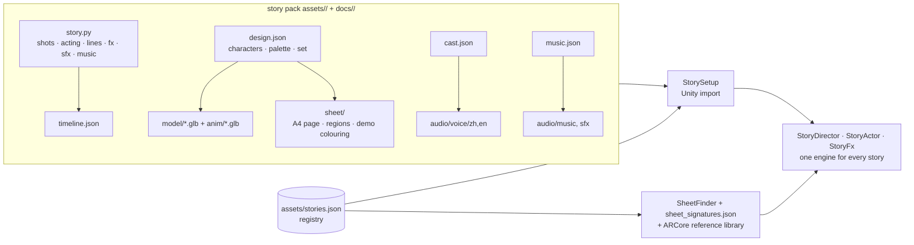

# Story architecture — many sheets, many stories

Status: agreed direction, 2026-11-13. Applies from the third story (Esther) on; David & Goliath becomes story pack #1
without moving its files.

## The idea in one line

**The app is an engine; every story is a data pack.** Adding a story means adding a folder of data and running the
pipeline. It never means copying code, adding `if (story == ...)` branches, or editing the scan code.



## Rules

1. **Content is data, the engine is code.** Story-specific facts (who stands where, what they say, when the music
   changes, which colours the demo uses) live in the pack. The Unity scripts and the pipeline tools take a story id.
2. **One source of truth per kind of fact.** `story.py` for timing and words (generates `timeline.json`, the
   storyboard and the subtitles), `design.json` for the look, `cast.json` for voices, `music.json` for the score.
   Generated files are never edited by hand.
3. **The registry is the only list.** `assets/stories.json` names every story, its sheets and its order on the home
   screen. The sheet signatures, the ARCore reference library, the home screen and the QA scripts all read it. A story
   that is not in the registry does not exist for the app.
4. **Every sheet is found the same way.** All sheets share the A4 geometry (4 corner markers, art rectangle, title band;
   `web/assets/template.json`). The title band is unique per sheet; that is how the app tells sheets apart
   (`Scripts/Vision/SheetIdentifier.cs`). A new sheet must pass `tools/make_sheet_signatures.py` (distinct from every
   other story's title) before it ships.
5. **A contract per story.** `docs/<id>/CONTRACT.md` fixes file ownership, bone names, clip names and the timeline
   format for the roles that build the pack (story, art, rig, animation, music, voice, sheet, integration), so roles can
   work in parallel. The engine's own contract is this file plus `docs/STORY-ENGINE.md`.
6. **Checks before builds.** `tools/story/check.py <id>` validates a pack: lines fit their slots, every clip / FX / SFX
   the timeline names exists, the sheet's regions map to model UVs, voices are in both languages, loudness is in range.
   The APK build refuses a pack that fails.
7. **Stable names.** Story ids are kebab-case (`david-goliath`, `esther`). Sheet reference names are `<id>-A4`
   (blank), `<id>-A4-demo` and `<id>-A4-colored` (coloured versions for ARCore). Unity folders are
   `Assets/DoodLive/Stories/<Id>/` and are generated, never hand-made.
8. **Process stays out of the repo.** Decisions, chats, dead ends and reviews are recorded outside the repository.
   The repo gets clean code and data only.

## Layout

```
assets/stories.json                 registry (id, order, titles zh/en, sheets, status, version)
assets/<id>/                        the pack's data: timeline.json, design.json, sheet/, model/, anim/, audio/
docs/<id>/                          the pack's docs: STORY.md, CONTRACT.md, storyboard/story.py, design/, qa/
pipeline/story_*.py                 Blender: characters, set, animation — take --story <id>
tools/story/*.py                    timeline, sheet, voice, music, check — take <id>
unity/Assets/DoodLive/Story/        engine: StoryDirector, StoryActor, StoryTimeline, Fx/
unity/Assets/DoodLive/Stories/<Id>/ generated per pack by StorySetup (models, materials, Resources/<id>/...)
```

David & Goliath already follows `assets/<id>/` + `docs/<id>/`, so it joins as pack #1 in place. Its engine classes
(`DGDirector`, `DGActor`, `DGTimeline`, `DGFx*`) become the generic `Story*` classes; the scripts keep their `.meta`
GUIDs so the prefab references survive the rename.

## Growth: when there are many stories

- **APK size.** Each pack adds about 10-20 MB (models, voices in two languages, music). Up to ~5 packs ship inside the
  APK. Beyond that, packs move to Unity Addressables delivered with Play Asset Delivery (on-demand packs): the base
  app stays small and a child downloads a story the first time its sheet is scanned. The registry already carries a
  `version` per pack for this.
- **Scan time.** Identification compares one title band per sheet: 100 sheets cost well under 50 ms on a phone.
- **Look consistency.** Shared art rules (line weight, palette families, face style, proportions) live in
  `docs/DESIGN-DIRECTION.md`; each pack's `design.json` may only choose within them.
- **Voices.** TTS first for every line, then real voices replace clips one by one (`tools/story/voice.py import`),
  through the natural chain for recordings (LESSONS L50).
