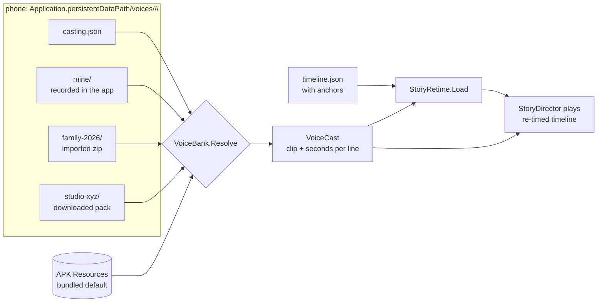
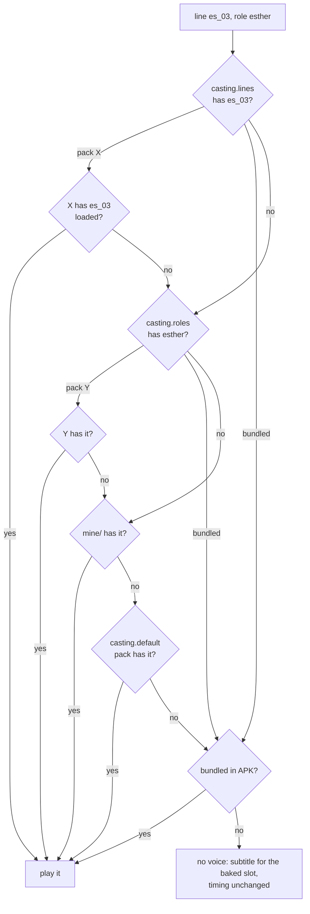
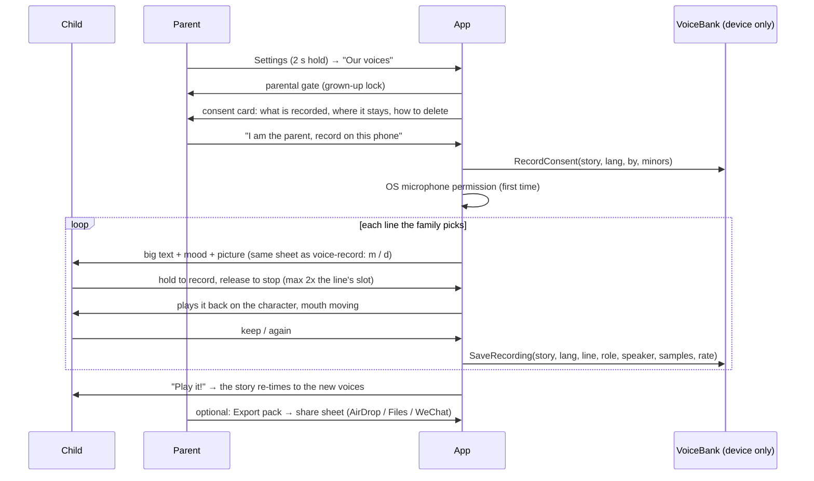

# Voice system — voices you can swap without rebuilding the app

Status: design + first implementation, 2026-11-14. Owner's brief: "Redesign the whole dubbing/voice system so that the
voices in the APK can be replaced much more freely." Family recordings (parents and children re-voicing characters)
are a core wish; more languages and more stories are coming; the app ships on Google Play and the App Store in the
kids category.

Companion to `docs/STORY-ARCHITECTURE.md` and `docs/STORY-ENGINE.md`. Per-story voice production stays in
`docs/<id>/VOICE.md` (e.g. `docs/esther/VOICE.md`).

## 1. What was wrong

Before: a voice is `assets/<id>/audio/voice/{zh,en}/<line>.wav`, copied into `Resources/` by `StorySetup`, loaded by
`StoryDirector.Clip("voice/zh/<id>")`. `tools/story/build_timeline.py` placed every event at an absolute second
computed from `durations.json`. A clip that is 1 s longer than the one the play was timed to overlaps the next line,
so changing one voice meant: re-run voice tools → re-run `build_timeline.py` → `StorySetup` → new APK.

After: **the timeline knows *why* each event is where it is** (its anchor), and **the app re-times the play at load
time** to whatever clips are installed. A voice is then just a file the app finds at run time, from the APK, from a
downloaded pack, or from a recording made on the device a minute ago.

## 2. Concepts

| Term | Meaning | Example |
|---|---|---|
| **line** | one spoken sentence of a story, stable id | `es_03`, `ru_14`, `dg_02` |
| **role** | who speaks it in the story (`voice` field of the line, else `who`) | `narrator`, `king`, `haman` |
| **voice pack** | one story × one language × one cast: a folder or zip with `voicepack.json` + clips | `esther / zh / tts-default`, `esther / zh / family-2026` |
| **mine** | the special pack of recordings made on this device | `voices/esther/zh/mine/` |
| **bundled** | the default pack inside the APK (today's `Resources/Stories/<id>/voice/<lang>/`) | — |
| **casting** | per story + language, which pack speaks which role or line | "Dad is the king, Ruth is Esther, everything else TTS" |
| **voice cast** (`VoiceCast`) | the frozen result for one play: clip + length per line | built when the play starts |



## 3. The voice pack manifest (`voicepack.json`)

Same file in a pack folder on the device, in an export zip and in a repo export. Flat archive: the manifest plus
`<name>.wav` / `<name>.ogg`, nothing else (no sub-folders, no other types; the importer refuses anything else).
JsonUtility-friendly (arrays, no dictionaries). C# classes: `VoicePack`, `VoiceLine`, `VoiceSpeaker`,
`VoiceConsent` in `unity/Assets/DoodLive/Story/Voice/VoiceBank.cs`.

```json
{
 "format": "doodlive-voicepack", "formatVersion": 1,
 "id": "family-2026", "story": "esther", "lang": "zh", "title": "陈家 2026",
 "kind": "family",                       // tts | family | studio
 "licence": "private-family",            // or a real licence for distributable packs
 "created": "2026-11-14", "tool": "tools/voice/pack_voices.py", "storyVersion": 1,
 "targetLufs": -17.0,
 "consent": {"by": "Dad", "date": "2026-11-14", "scope": "device", "minors": true, "parentConfirmed": true},
 "speakers": [{"id": "ruth", "name": "路得", "role": "esther", "minor": true},
              {"id": "dad", "name": "爸爸", "role": "king", "minor": false}],
 "lines": [
  {"id": "es_03", "file": "es_03.wav", "role": "esther", "speaker": "ruth",
   "source": "own:2026-11-14", "sec": 4.21, "lufs": -17.0, "peak": -3.1}
 ]
}
```

Rules:

- `id`, `story`, `lang` are safe ids (`[a-z0-9][a-z0-9_-]{0,63}`); `mine` and `bundled` are reserved.
- `sec` / `lufs` / `peak` are measured at import, never typed by hand. The runtime does not trust `sec` (it uses the
  loaded clip's length); `pack_voices.py check` warns when they disagree.
- A pack may cover some lines only. Missing lines fall back (section 4).
- `storyVersion` = the registry's `version` of the story the pack was made for. A line whose text changed gets a new
  id in `story.py` (rule: **changing the words of a line changes its id**), so an old pack never speaks wrong words;
  it just lacks the new line.
- A folder without a manifest (WAVs dropped in through the Files app) is read as a pack whose lines are the file names.

## 4. Which clip plays: resolution order

Per line, first hit wins (`VoiceBank.Resolve`):



- Default with no `casting.json`: **mine → bundled**. That is the owner's order "user recording on device → installed
  pack → bundled default" once a pack is chosen as `default`.
- `"bundled"` as an explicit choice puts one line or role back to the original while other recordings stay.
- **No cross-language fallback.** A Chinese play never borrows an English clip; the subtitle carries the line.
- Device clips load asynchronously; `Resolve` skips a clip that has not finished loading, so the clip that plays and
  the length the play was timed to always agree. `VoiceCast` is a snapshot for one play.

## 5. Runtime re-timing

### 5.1 Anchors (written by `build_timeline.py`)

`build_timeline.py` walks `story.py` with a cursor. Every element is placed relative to the **cursor segment it was
authored in**: the segment starts at the end of the previous line's voice (or at the start of the play) and runs
through that line's `post`, any `pause()`, events (with their own `dt`, negative allowed) and the next line's `pre`.
Each line, event and shot now also carries:

```json
"anchor": {"line": "es_16c", "edge": "end", "dt": -4.05}     // line "" + edge "origin" = from the start of the play
```

plus, on every line, `"dur"` (the voice length the play was timed to = max of the zh / en clip, or the estimate),
`"pre"`, `"post"`; at the top, `"durationAnchor"` and `"retime": 1`. **Only keys are added**: every older field and
every absolute `t` is unchanged (verified on esther and ruth: the new output minus the added keys is byte-identical to
the old output; CLI unchanged; `build()` gained optional `write=` and `durations=` keywords for tests).

Example (Esther S10, the constraint from the Esther session): Haman's drag moves sit at `dt=-4.4` after `es_16c`
and the props that hide the actors 1.2 s after it. They are all anchored to `es_16c`'s end, so if a family records
a longer `es_16c`, the drag and the exits move with it.

### 5.2 The rule (the same in Python and C#)

> Every element moves by the **shift of its anchor**. A line's shift is the shift of its own anchor. The shift at a
> line's `end` edge is that shift plus `(installed duration − dur)`.

```
for line in lines (time order):               # anchors only point backwards
    S[line] = shift(line.anchor)
    D[line] = d_installed(line) - line.dur     # d_installed <= 0 (no clip) -> D = 0
    line.t += S[line];  line.maxSec += D[line]
shift(anchor) = 0                         if origin
              = S[anchor.line]            if edge == "start"
              = S[anchor.line] + D[...]   if edge == "end"
event.t  = max(0, event.t + shift(event.anchor))
shot.t0 += shift(shot.anchor);  shot.t1 = next shot.t0 (or duration)
duration += shift(durationAnchor)
```

Computing a **shift added to the baked time** (instead of re-adding `dt`s) makes the identity case bit-exact: with
the baked durations every shift is exactly 0. Lines can never overlap: each line starts after the previous voice end
plus a non-negative gap, whatever the durations.

Implementations: `tools/voice/retime.py` (reference) and `unity/Assets/DoodLive/Story/StoryRetime.cs`
(`Core()` + `InferAnchors()` are plain C#; `Load(json, durationOf)` is the Unity drop-in for `DGTimeline.Load`).
`tools/voice/test_retime.py` proves they agree with each other and with re-running `build_timeline.py`.

### 5.3 Which duration

The app re-times to **the clip of the language being played** (`VoiceCast.Duration`), not to max(zh, en). So the
English play no longer carries the Chinese play's silences (es_08: 3 s gap in English today). Lines without a clip
keep `dur`.

### 5.4 Timelines without anchors (David & Goliath)

`InferAnchors` (both implementations) gives an old, hand-timed timeline anchors: line *i* → end of line *i−1* (the
gap is kept), anything else → the latest line that started at or before it (`start` edge inside the line's slot,
`end` edge after it), before the first line → origin. With no `dur`, the baked slot is `maxSec` and **slots only grow**
(a shorter clip keeps the hand-made pause; a longer clip pushes everything after it).

### 5.5 What re-timing does not fix

- **Music** is composed to the baked spans (`cues.json`: each cue is `span + 0.6 s` long, not looping). If a play
  grows by more than the 0.6 s tail inside one cue's span, that cue ends before the next one starts (a silent gap
  before the cross-fade). Shrinking is fine (the next cue cross-fades in earlier). Mitigation, in order: (a) the music
  tool renders every non-final cue with a tail of +25 % or a loopable last bar (open question 1); (b) the director
  holds the last bar / fades a cue that runs out. Until then, the check tool prints the play's new length per pack.
- **In-clip timing.** Acting clips, FX durations and SFX lengths are not stretched; only their start times move.
- **Lip sync** already follows whatever clip plays (RMS of the voice source), so it needs nothing.

## 6. Loudness of people's recordings

One target for every recording, wherever it is made: **-17 LUFS integrated, peak ≤ -1.5 dBFS, no EQ, no
compression, no time-stretch** (the gentle "natural" chain of LESSONS L50; TTS stays at -16 LUFS).

| Where | How |
|---|---|
| Mac / repo (`tools/voice/pack_voices.py import`, `tools/story/voice.py import`) | voice.py's `natural` chain (1.8:1 soft-knee compressor, slow limiter, ffmpeg ebur128) |
| Phone (`VoiceBank.SaveRecording`) | `VoiceDsp`: trim at -45 dBFS (30 ms lead, 60 ms tail, 6 ms fades) → BS.1770-4 integrated loudness (K-weighting, 400 ms blocks, -70 / -10 gates) → one gain to -17 LUFS, capped so the peak stays ≤ -1.5 dBFS → 16-bit WAV |

The phone path has no compressor on purpose: a child's shout keeps its peak; a spiky quiet take ends up slightly
softer rather than squashed. `VoiceDsp.Loudness` matches ffmpeg's ebur128 within 0.05 LU on three test clips
(esther es_01 -16.17 vs -16.2; an imported family clip -17.04 vs -17.0; dg_02 -16.00 vs -16.0).

## 7. In-app recording (future screen)

Not built yet; `VoiceBank` already has the data side (`RecordConsent`, `HasConsent`, `SaveRecording`,
`DeleteRecording`, `GetCasting` / `SetCasting`, `ExportZip`, `ImportZip`, `DeletePack`).



UX rules:

- **Cast by role first** ("Who is the king?"), then line by line. A family can voice one character and leave the rest.
- Each line shows the text, the mood and a picture to hold in mind (the voice-record skill's `t` / `m` / `d`, already
  produced per line by `tools/story/voice.py <id> session`). Ship them as `Resources/Stories/<id>/voice/<lang>/lines.json`
  (open question 4).
- Record at the OS rate, mono, 30 s cap. No time limit per line: the play adapts. Show a soft hint only when a take
  is more than 2x the original (it makes the play drag).
- The child hears it **on the character** at once (lip sync works on any clip) — the reward is seeing the king speak
  with Dad's voice.
- Per line: keep / redo / back to original (`casting.lines[line] = "bundled"` or `DeleteRecording`). Per pack: delete all.
- Everything works offline. Nothing is uploaded, ever, unless a parent exports.

## 8. Privacy, consent and the kids stores

Principles (design decisions, not legal advice):

1. **Recordings stay on the device.** They live in `Application.persistentDataPath/voices/`, the app has no
   upload code, no analytics on recordings, no cloud backup of its own. Leaving the phone needs an explicit parent
   action: Export → OS share sheet.
2. **Parent first.** Recording, export and import sit behind the existing grown-up lock (CLAUDE.md invariant 9: the
   settings behind the 2 s hold) and a one-time consent card per story + language (`VoiceConsent.parentConfirmed`).
   `SaveRecording` refuses without it.
3. **Children's voices are personal data.** A pack with `minors: true` can only be exported with consent on file;
   `pack_voices.py import` refuses `--speaker x:role:minor` without `--consent-by`; `check` fails a family pack
   without `parentConfirmed`.
4. **Deletion is easy and complete**: per line, per pack, and uninstalling the app removes everything.
5. **Imports are data, not code**: flat zip, wav / ogg / json only, size and count caps, ids checked, no path
   traversal, `mine` can never be overwritten by an import.

Store implications (to verify before submission; see section 13):

- Microphone permission: Android `RECORD_AUDIO` and iOS `NSMicrophoneUsageDescription`, requested only when a parent
  opens the recording screen, never at launch.
- Google Play Families policy and Apple's Kids category both restrict collecting and transmitting children's data
  and third-party analytics / ads. Keeping recordings on-device with no transmission is the design that keeps the
  app's "data collected" declarations minimal (Play Data safety: audio that never leaves the device is generally not
  "collected").
- Audio files a parent shares through the OS share sheet are the user's own action, outside the app's data flows.
- Downloadable packs (future) come from our own server: they carry no user data; the request should carry no
  identifiers beyond what the store requires.

## 9. Import and export

| Where | Command / API | Notes |
|---|---|---|
| Repo → zip | `python3 tools/voice/pack_voices.py export esther --lang zh [--pack tts-default]` | measures sec / LUFS / peak; roles from the timeline; sources from `sources.json` |
| Recordings → pack (Mac) | `python3 tools/voice/pack_voices.py import esther <folder|zip> --lang zh --pack family-2026 --speaker ruth:esther:minor --consent-by Dad --zip` | natural chain; output `~/.cache/doodlive-voicepacks/` (never into git or `assets/`) |
| Validate | `python3 tools/voice/pack_voices.py check <pack.zip|folder> [--story esther]` | schema, files, ids, loudness, peak, consent, and the play's new length |
| Phone → zip | `VoiceBank.ExportZip(story, lang, pack, path)` → share sheet | file name `<story>-<lang>-<pack>.voicepack.zip` |
| Zip → phone | `VoiceBank.ImportZip(path, out error)` (from the share sheet / "Open in" / Files picker) | installs as `voices/<story>/<lang>/<id>/`, replaces the same id |
| Replace a bundled clip in the repo | `python3 tools/story/voice.py <id> import <folder> --lang zh` (unchanged) | then `build_timeline.py <id>` to bake the new timing (optional now: the app re-times anyway) |

The voice-record skill (`.claude/skills/voice-record`) stays the family recording desk on the Mac: `voice.py session`
writes its `lines.json`, the skill's `process.py` picks takes, and either `voice.py import` (into the APK) or
`pack_voices.py import` (a separate pack) takes them from there. Note: `process.py`'s own chain (EQ + 3.5:1
compressor, -14 LUFS) is the one LESSONS L50 warns about; both import commands re-trim and re-level, so feed them
`process.py`'s picks, or (better) the chosen raw take renamed to `<line>.wav`.

## 10. Languages beyond zh / en

What already generalises: voice packs and `VoiceBank` take any `lang` string; `StoryRetime` takes any durations; the
device layout is `voices/<story>/<lang>/`. What still assumes two languages:

| Place | Today | Change (when the third language comes) |
|---|---|---|
| `story.py` / `timeline.json` lines | `zh`, `en` text fields | add `text: [{lang, t}]` (JsonUtility-friendly array), keep `zh` / `en` for old readers |
| `DGLine` (C#) | `zh`, `en` | a `Text(lang)` helper reading the array, falling back to `en` |
| `build_timeline.py` `dur` | max over zh / en | max over every language present (the app re-times per language anyway) |
| `StorySetup` | copies `voice/zh`, `voice/en` | copy every `voice/<lang>/` folder present |
| `L10n.IsZh` in directors | binary | `L10n.Lang` (already exists) |
| fonts | subsets built from zh / en strings | add the language's script to `make_fonts.py` |

A missing language pack falls back to subtitles only (no cross-language voice).

## 11. Fallback when a line is missing

- No clip anywhere (section 4): the subtitle shows for the baked slot, timing unchanged, a warning in the log.
- A pack that covers some lines: the rest resolve down the order; the play re-times line by line.
- A pack made for an older story version: lines it lacks fall back; lines it has keep their ids, so their words
  still match (rule in section 3).

## 12. David & Goliath

D&G has no `story.py` (its timeline is hand-placed) and its own director (`DGDirector`, Resources folder `DG/`).

1. **Now, no data change**: the same three hooks in `DGDirector` with `bundledDir: "DG/"` (section 14). `StoryRetime`
   infers anchors (section 5.4): a longer family recording pushes the rest of the play; a shorter one keeps the
   hand-made pause. Tested on the current `assets/david-goliath/timeline.json`.
2. **When D&G becomes a story pack** (STORY-ARCHITECTURE.md: `DGDirector` → `StoryDirector`): write
   `docs/david-goliath/storyboard/story.py` from the timeline, then `build_timeline.py` writes real anchors and `dur`.
3. The child's David recordings (LESSONS L50) become a `family` pack instead of replacing the bundled clips.

## 13. Tools and tests

```
tools/story/build_timeline.py            + anchor / dur / pre / post / durationAnchor (additive)
tools/voice/retime.py                    reference re-timing; CLI: preview a voice folder's effect on a play
tools/voice/test_retime.py               python3 tools/voice/test_retime.py [--cs]
tools/voice/pack_voices.py               export / import / check voice packs
tools/voice/retime_harness/              build.sh compiles StoryRetime.cs + VoiceBank.cs + DGTimeline.cs against
                                         Unity's managed DLLs (dotnet 8) and runs the C# retime for the test
unity/Assets/DoodLive/Story/StoryRetime.cs
unity/Assets/DoodLive/Story/Voice/VoiceBank.cs   VoiceBank, VoiceCast, VoiceDsp, manifest + casting classes
```

`test_retime.py --cs` (2026-11-14): anchors reproduce baked times (≤ 0.008 s, two 0.01 s roundings); identity is
exact; for 20 random voice sets (0.5-1.8x, some clips missing) per story, re-timing equals re-running
`build_timeline.py` within 0.005 s (esther, ruth); events authored after `es_16c` (13, five with negative dt) move by
exactly its shift; D&G identity / grow / no-shrink; the C# port equals the Python one within 0.02 ms on all five cases.

## 14. Integration hooks (to apply in `StoryDirector.cs`; not applied by this change)

`VoiceBank`, `VoiceCast` and `StoryRetime` are in namespace `DoodLive.Story`, so no `using` is needed.

```csharp
// 1. field, next to `DGTimeline tl; DGCues cues;`
VoiceCast cast;

// 2. Awake: start loading device voices early (replaces `void Awake() => Init();`)
void Awake() { Init(); if (Application.isPlaying) VoiceBank.Prepare(storyId, L10n.Lang); }

// 3. LoadData(): replace `tl = DGTimeline.Load(j.text);` with
cast = VoiceBank.Resolve(storyId, L10n.Lang, j.text);
tl = StoryRetime.Load(j.text, VoiceBank.Durations(cast));

// 4. Begin(): replace `if (!LoadData()) return;` with (re-time on every start: language or voices may have changed)
tl = null; if (!LoadData()) return;

// 5. Say(): replace `var c = Clip($"voice/{(L10n.IsZh ? "zh" : "en")}/{l.id}");` with
var c = cast != null ? cast.Clip(l.id) : Clip($"voice/{(L10n.IsZh ? "zh" : "en")}/{l.id}");
```

`lineEnd` already uses `c.length`, lip sync already reads the voice source, so nothing else changes. When the
language toggles, call `VoiceBank.Prepare(storyId, L10n.Lang)` (the next `Begin` re-resolves). For `DGDirector` the
same five edits apply with `storyId` → `"david-goliath"` and
`VoiceBank.Resolve("david-goliath", L10n.Lang, j.text, "DG/")`.

Optional later: `StorySetup` writes a `voicepack.json` next to the bundled clips (from `pack_voices.py export`), so
the recording screen can show the bundled pack's speakers and licence.

## 15. Open questions

1. **Music headroom**: should `music_esther.py` (and later stories) render each cue with a +25 % tail or a loopable
   last bar, so a longer family recording never leaves a silent gap? Or should the director hold / fade a cue that
   runs out? (Section 5.5.)
2. **Per-language timing** (section 5.3): OK that the English play gets shorter than the Chinese one? The music cue
   times move with it.
3. **Line-id rule**: adopt "new words → new id" in every `story.py`, so old family packs never speak wrong words?
4. Ship the recording sheets (`record/<lang>/lines.json`: text, mood, picture) inside the APK for the future screen?
5. Downloadable packs: Play Asset Delivery / App Store on-demand resources (same channel as story packs), or a plain
   HTTPS download of the zip? The zip format works with both.
6. Should a family pack be shareable with another family (scope `family-share`) from inside the app, or only via the
   OS share sheet as now?
7. Ogg export: this Mac's ffmpeg has only the experimental native Vorbis encoder (no libvorbis), so packs are WAV
   (~1 MB per 10 s line; a full story ~30-40 MB per language). Fine for sharing? The app loads `.ogg` already.

## 16. Self-audit

| Claim | Evidence | Level |
|---|---|---|
| build_timeline output unchanged except added keys (esther, ruth) | scratchpad diff of old vs new `build()` on copies of story.py + durations.json, 2026-11-14 | A (measured) |
| retime == rebuild, C# == Python | `test_retime.py --cs`, 2026-11-14 | A (measured) |
| `StoryRetime.cs` / `VoiceBank.cs` compile | dotnet 8 build against Unity 6000.3.27f1 managed DLLs: 0 errors, 0 warnings | A for the C# compiler; **not compiled inside Unity** |
| `VoiceDsp.Loudness` ≈ ffmpeg ebur128 | 3 clips, ≤ 0.05 LU | A (measured) |
| A missing `anchor` (D&G) is inferred whether JsonUtility gives null or an empty object | code handles both; JsonUtility behaviour itself from memory | D, low risk: check the `StoryRetime` / `VoiceBank` log lines on first editor run |
| `UnityWebRequestMultimedia` loads device WAV/OGG on Android and iOS with `file://` URIs | from memory of Unity docs | **D: verify on device** |
| Store policies (Play Families, Apple Kids, Data safety wording) | from memory, not fetched | **D: verify** on play.google.com/about/families and developer.apple.com/app-store/review/guidelines (1.3, 5.1.4) before submission |
| `System.IO.Compression.ZipFile` available in the player build | compiles under .NET 8; Unity's API compatibility level not checked | **D: verify** (Player Settings → Api Compatibility Level; .NET Standard 2.1 includes ZipFile) |
