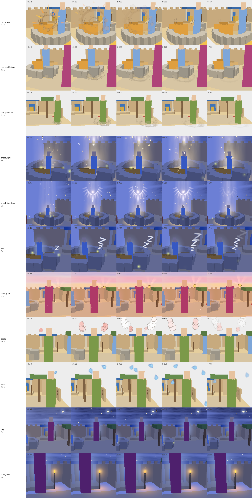

# Daniel — effects

Owner: Effects role ([CONTRACT.md](CONTRACT.md) §1, §8). Light and mood: [DESIGN.md](DESIGN.md) "Light and mood per part".
Engine, look rules and API are the same as the earlier packs: read [../david-goliath/FX.md](../david-goliath/FX.md),
[../esther/FX.md](../esther/FX.md) and [../ruth/FX.md](../ruth/FX.md) first.

*Contact sheet: each row is one effect at 8 / 25 / 45 / 65 / 85 % of its duration, rendered from the real C# effect code
by `Fx/Preview~/run.sh daniel` over a **stand-in** Babylon (boxes at the CONTRACT §6 positions: city wall + blue gate,
palace dais / columns / throne / torch pole, house, window wall + rug, palm, market, the den as a ring of stone blocks
with its opening, the stone open or shut; actors as coloured slabs at the story.py marks, lions as low wide slabs) with
a depth buffer. The frame's `StoryTint` result is multiplied over the set. `angel_light`, `zzz` and `lamp_flame` are
shown with `night` running underneath. `@side` / `@stone` / `@run` are the same id from another camera or anchor. The
harness camera mirrors world X, as on the earlier sheets; it does not affect the device.*

## Files

| File | What |
|---|---|
| `unity/Assets/DoodLive/DavidGoliath/Fx/StoryFxDaniel.cs` | `DanielFx` (registry, palette, dawn tint), the 4 new ids, `StoryFxAlias` (the `steam` / `sweat` aliases). Pure: no engine calls |
| `DGFxEffects.cs` (1 line) | `FxLibrary` also registers `DanielFx.Defs`; an existing id is never replaced |
| `Fx/Preview~/DanielPreview.cs`, `Harness.cs` (1 line), `run.sh`, `render.py` | `run.sh daniel` → `fx_contact_daniel.png`. `run.sh` also takes `FXPREVIEW_WORK=<dir>` to build somewhere other than `$TMPDIR/dgfx-preview` (so two roles can run it at once) |

No runtime file: `dawn_glow` posts to Ruth's `StoryTint`, and Ruth's `StoryTintStage` (auto-created) already draws the
multiply overlay, sets `_DoodStageTint / _DoodStageLight / _DoodStageRim` and fills `RuthFx.Actors` for the halos.

## Ids story.py plays

| id | source | status |
|---|---|---|
| `roar_shake`, `angel_light`, `zzz`, `dawn_glow` | **new** (StoryFxDaniel.cs) | below |
| `dust_puff` | **existing D&G id** (Goliath's footsteps) | reused as is: a small grey-paper dust burst + ground ring, stays where it started, scales with `dur`, asks for a tiny 0.004 / 0.25 s stage shake. CONTRACT §8 lists it as new, but the D&G id already exists and is never replaced; it fits the brief ("small ground dust burst at a node") |
| `steam` | alias → Esther `anger_steam` | `StoryFxAlias` resolves the target **by id** at play time (no dependency on Esther's class names) |
| `sweat` | alias → Esther `sweat_drops` | same |
| `sparkle`, `sunset_glow`, `night`, `lamp_flame` | Ruth | reused |
| `prayer_glow`, `tension_dim` | Esther | reused |
| `golden_rays`, `confetti` | D&G | reused |

The harness prints the resolved class of every id above; all 15 resolve.

## New effects

Sizes in art-width units (Daniel 0.34 tall, ~0.22 kneeling; lion shoulder 0.13).

| id | anchor (story.py) | default dur | look | follows |
|---|---|---|---|---|
| `roar_shake` | `lion.head` | 1.2 (story 1.4 / 1.0) | No camera shake. Two rings of sandy-brown crayon dust burst outward in the screen plane around the head (radius to 0.13, a smaller echo at 0.32 s) with a faint ring outline; 7 warm orange / sun dashes shoot out over the upper half; two cartoon shake arcs "(( ))" each side of the head jitter until 70–90 % of `dur`. Fade over the last 0.3 s | yes |
| `angel_light` | `daniel.root` | 8 | The story's peak. A soft warm-white cone of light (top 0.95 above the floor, half width 0.075 → 0.15 at the floor): a wide veil, 5 additive beams that shimmer slowly, a bright core; a glowing pool on the den floor; a gold glow behind Daniel (reads as a rim); 24 motes spiralling slowly down the beam (every third a twinkle). From 0.9 s a faint winged shape of light fades in above and behind Daniel (`AngelLight.AngelHeight` 0.31): soft body, head glow, two raised wings (curved leading edge + 5 hanging feathers each), beating gently at 0.32 Hz; it leaves before the column. Fade in 1.0 s, out 1.2 s | no (stays put) |
| `zzz` | `lion2.head` | 6 (loop) | Cartoon Z letters, cream fill with a navy crayon edge, one every 0.9 s: pop in with an overshoot, grow 0.028 → 0.056, rise 0.16 drifting right on a curve, wobble and tilt, fade near the top (each lives 2.6 s) | yes |
| `dawn_glow` | `stage` | 10 | Stage tint to pink-gold dawn (multiply `DanielFx.DawnTint` (1.0, 0.87, 0.86)). Lilac / pink / gold crayon sky bands behind the city wall, drawn **in front of** night's bands so dawn wins while both run; a sun peeping over the wall at x −0.36, rising 0.25 → 0.33 over `dur`, with 3 soft sunbeams; a rosy back-halo per actor; 14 warm motes. Fade in 1.2 s, out 1.5 s | — |

Budget (max per frame, harness): angel_light + night 92 sprites + 22 ribbons; zzz + night 61 + 21; roar_shake 24 + 11;
dawn_glow 21 + 6. All in the shared atlas, no new textures.

## Notes for Story and Integration (timeline.json as built on 2026-11-14)

1. **`sunset_glow` dur 40 overlaps `night` by 14.6 s** (sunset 136.38–176.38, S09 and night start at 161.75). Both
   tints multiply and both sky bands draw, so S09 starts brownish-orange instead of deep blue and the angel scene is
   muddy. Suggest `dur=25.4` (ends as S09 starts; the 0.8 s fades cross).
2. **`night` dur 32 ends at 193.75, but S10 (the torch-lit night) runs to 197.79**: the last 4 s of S10 would be
   daylight. Suggest `dur≈36.8` so it fades out 0.8 s into S11 under `dawn_glow`.
3. `lamp_flame` is Ruth's small oil-lamp flame (0.034 tall); on the `torch` pole it reads, but as a candle-sized flame
   (see the last row). Fine for now; a bigger torch flame would be a new id.
4. Ruth's `night` draws 7 fireflies at x 0.20–0.56, z −0.22–0.04 (her barley field). In Babylon that is the den, so a
   few fireflies blink inside the den during S09. Harmless, even sweet; noted so nobody is surprised.
5. `angel_light` uses `daniel.root` and does not follow, so the column stays steady while Daniel kneels and pets the lion.

## How it was checked (2026-11-14)

1. **Compile:** all `Fx/*.cs` + `Scripts/DesignTokens.cs` + `DavidGoliath/Scripts/DGActor.cs`, C# 9, netstandard 2.1,
   against Unity 6000.3.27f1's Core / IMGUI / Animation / Director module DLLs: 0 warnings, 0 errors. Unity was **not**
   run (Integration's job).
2. **Preview:** `run.sh daniel` (60 fps, exact triangles, stand-in Babylon with depth, tint multiplied), iterated three
   times: the roar dust was pale sand on sand and hidden behind Daniel → darker brown dust, bigger dashes, camera from
   the side; the angel's wings read as a fountain, then as a drooping fringe → raised leading edge with hanging
   feathers, the small halo ring (read as "< >") replaced by a head glow, the shape lowered to 0.31; the Zs were thin
   and read as a zigzag spring → fatter strokes, navy edge, wider spacing and a curved drift.

## Weakest points (not verified)

| Claim | Level | How to check |
|---|---|---|
| The winged shape is inside the S09 framing on device | D (the harness's S09-like close camera cuts it off at the top; the side view shows it) | Integration: S09 screenshot at ~173 s; if cut off lower `AngelLight.AngelHeight` (0.26 puts the wings round Daniel's head) |
| `lion.head`, `lion2.head`, `babylon.stoneShut/stoneOpen`, `babylon.torch` resolve to the expected points | D (models not built yet; stand-in positions from CONTRACT §6) | Integration: check the node transforms after import |
| The roar reads with the real lion behind Daniel from the viewer side in S08 | D (stand-in slabs) | Device screenshot at ~157.5 s |
| D&G `dust_puff` reads on the Babylon sand | D (grey-paper dust on sand is low contrast in the preview, still visible) | Device screenshot at ~159 s and ~233 s |
| dawn_glow sky bands sit behind the real city wall (front z ≈ −0.56, top ≤ 0.30) and hide the sun's lower half | D (stand-in wall) | S11 screenshot |
