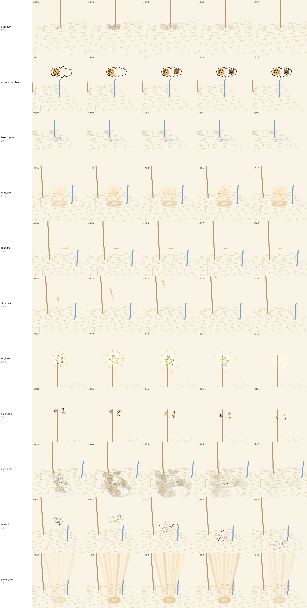

# David & Goliath — effects

Owner: Effects role (CONTRACT §1). Code: `unity/Assets/DoodLive/DavidGoliath/Fx/`. Read with
[CONTRACT.md](CONTRACT.md) §8, [STORYBOARD.md](STORYBOARD.md) and `assets/david-goliath/timeline.json`.



*Contact sheet: each row is one effect at 8 / 25 / 45 / 65 / 85 % of its duration, rendered from the real C# effect
code (see "How it was verified"). The paper background, the 0.1 art-unit grid, and the blue (David, 0.30) and brown
(Goliath, 0.80) bars are scale references only. The atlas is in
[`Preview~/atlas.png`](../../unity/Assets/DoodLive/DavidGoliath/Fx/Preview~/atlas.png).*

## Look

The page is a white sheet with crayon colouring. Additive glow disappears on white paper (we checked this in the first
preview: sparkles, rays and the stone glow could not be seen). So almost every effect is **alpha-blended crayon**: waxy
diagonal grain, pencil-ink outlines (`#2B2118`), and Paper & Crayon token colours (`DesignTokens`). The additive
material is used only for the white core of `hit_flash`, which sits over Goliath's coloured head. Effects for ages 4–9 follow three
rules. There is no red on impacts. There is at most one soft flash, warm white at 35 %, so no strobe. Nothing covers David's
face during his key line in S07.

## Effect table

Times are from `timeline.json`. Sizes are in art-width units (1.0 = art width). "Follow" means the effect tracks the bone
every frame; otherwise it stays where it started.

| id | timeline t (s) @ bone | dur | look | colours | sound pairing (timeline sfx) | follow / shake |
|---|---|---|---|---|---|---|
| `dust_puff` | 1.30 @ goliath.footL, 2.40 @ footR, 3.50 @ footL | 0.6 | 10 lumpy crayon dust blobs push out along the page and fade, over a pencil ring that grows to 0.28 | paper deep `#E4D3AE` → soft ink `#6B5B4A` | `giant_step` (same t) | stays · shake 0.004 / 0.25 s |
| `memory_lion_bear` | 38.80 @ david.head | 3.8 | Thought bubble 0.17 above his head with 3 puffs leading up to it. A **friendly** lion face pops in at +0.2 s and a bear face at +1.6 s. Each wiggles for 0.6 s, then everything shrinks away over the last 0.45 s | lion orange/sun, bear brown/tan, paper bubble, ink lines | `lion_roar` 39.0 (lion pop), `bear_growl` 40.4 (bear pop) | follows |
| `brook_ripple` | 53.60 @ david.handR | 2.4 | Pale blue water patch on the page. A splash of 9 droplets, then 5 sky-blue crayon rings (≤ 0.15) at +0, 0.55, 0.95, 1.35, 1.75 s, each 0.05 s before a stone clack | sky `#4BA3E3` | `water_splash` 53.6; `stone_clack` 54.2 / 54.6 / 55.0 / 55.4 / 55.8 | stays |
| `faith_glow` | 62.20 @ david.chest | 5.6 | Gold pool of light under him that breathes at 0.7 Hz. A soft sun glow **behind** him (pushed 0.07 away from the camera; the depth test hides it behind his body). 18 gold sparkles rise from 0 to 0.34 on a ring of radius 0.08–0.115. Sparkles in front of his face (above 0.17, on the camera side) drop to 15 % opacity | gold `#E3B04B`, sun `#FFC93C`, orange | music `theme_faith` (58.0); line dg_14 | follows |
| `sling_trail` | 70.20 @ david.slingPouch | 2.4 | Crayon ribbon over the last 0.22 s of the pouch path (width 0.03 → 0.006), plus gold/orange twinkles dropped every 0.06 s that sink and shrink | orange → sun | `sling_whoosh` 70.2 | follows (trail) |
| `stone_trail` | 72.60 @ david.stone | 0.5 | Orange → sun ribbon over the last 0.14 s of the stone's path, a sun-coloured glow around the stone (0.08), and two soft-ink speed lines | orange, sun, soft ink | `sling_snap` 72.6 | follows (trail) |
| `hit_flash` | 73.05 @ goliath.head | 0.4 | Pops 0.05 in front of the forehead. A crayon star (0.17, overshoot) with 8 radial "pow" strokes, 10 twinkles flying out, and a white core glow. Screen flash 0.35 | sun, orange, warm white | `stone_hit` 73.05; music `sting_hit` | follows · shake 0.012 / 0.35 s · flash 0.35 |
| `dizzy_stars` | 73.30 @ goliath.head | 1.0 | 4 stars (sun and pink, 0.055) circling 0.07 above the head at 1.3 rev/s, with twinkles between them. Pop in, then fade over the last 25 % | sun, pink `#F49AC1` | (rides on `sting_hit`) | follows |
| `dust_burst` | 75.20 @ goliath.hips | 1.6 | 38 dust blobs along his body on the page (hips −0.30 … +0.35 in Z, because he falls toward +Z), 2 big pencil rings, and 10 pebbles that hop twice | paper deep → soft ink, stone `#B9B4AA` | `giant_fall` 75.2 | stays · shake 0.03 / 0.9 s |
| `confetti` | 80.20 @ david.head | 3.0 | 64 crayon confetti pieces (rectangles and dots, 7 crayon colours) burst up to about 0.2 above his head. They flutter down (drag, terminal fall speed 0.3/s, sway, flip), then lie flat on the page and fade over the last 0.6 s | red, orange, sun, leaf, sky, pink, grape | `victory_chime` 80.0; music `theme_victory` | stays |
| `golden_rays` | 84.30 @ david.root | 4.0 | 7 soft crayon light beams from 1.0 above and slightly behind him down onto him (width 0.09 → 0.035, each pulsing out of phase), a gold pool on the page, and 16 motes drifting down the beams. Fade in 0.7 s, out 0.9 s | gold, sun, orange | line dg_18 (moral) | follows |

Every id the timeline uses is implemented, and there are no extra ids (checked by script, see below). The ids in the role brief
(`stone_glow`, `impact_burst`, `ground_shake`, `victory_rays`, `shield_clang`) are **not** in the timeline. Their jobs are done by
`stone_trail` (glow), `hit_flash` (impact), the shake built into `dust_puff` / `hit_flash` / `dust_burst`, and `golden_rays`.
`spear_clang` (8.3 s) is SFX-only in the timeline, so it has no fx.

## API (CONTRACT §8 plus the extras)

```csharp
using DoodLive.DavidGoliath;

DGFx.Stage = charactersHolder;          // REQUIRED: local unit = 1 art width, local y = 0 is the page
DGFx.ShakeTarget = shakePivot;          // optional: identity child of Stage that both characters sit under
DGFx.Prewarm();                         // optional: build the 1024² atlas now (else on the first Play)

DGFx.Play(fx.id, Bone(fx.at), fx.dur);  // contract signature; unknown id = warning, no throw; dur <= 0 = designed dur
DGFx.Paused = true / false;             // tap = pause/resume: freezes effects and shake
DGFx.StopAll();                         // replay / seek / sheet lost: destroys effects, resets shake + flash
DGFx.Shake(ampArtUnits, seconds);       // extra shakes if the director wants them (they add)
DGFx.Flash(0..1);                       // extra soft flash
DGFx.DrawFlashOverlay = false;          // draw the flash yourself from DGFx.FlashAlpha
Vector3 o = DGFx.ShakeOffset;           // current shake offset (art units, stage-local)
bool ok = DGFx.Has("confetti");  IEnumerable<string> all = DGFx.Ids;
DGFxInstance inst = DGFx.Spawn(id, at, dur, seed);   // same as Play, returns the instance
```

**Camera shake in AR:** the phone is the camera, so we never move it. "Shake" moves the stage pivot `ShakeTarget`
by `ShakeOffset` (smooth noise at about 18 Hz, mostly vertical, so the page thumps). In the cinematic/demo view the
director may also add `ShakeOffset`, converted to world units, to its own camera. Peak amplitudes are 0.004 (step),
0.012 (hit) and 0.03 (fall) art units.

**Bone lookup** (`"david.slingPouch"` → Transform) belongs to the director. The effects receive a Transform.

## How it works

- `DGFx.cs` is the public static API. `DGFxRuntime.cs` holds the `DGFxInstance` component (one dynamic mesh per effect,
  rebuilt in `LateUpdate` after the Animator has posed the bones), `DGFxAssets` (atlas and the two materials), and `DGFxRunner`
  (a hidden singleton that runs shake and flash).
- `DGFxEffects.cs` holds the 11 effect definitions. Each one is a **pure function of (t, anchor, camera, seed)**. Particles
  use deterministic hashes and closed-form motion (ballistic with linear drag), so a pause, frame drops or a replay
  never change the result. Trails read a recorded history of the bone (`FxTrack`).
- `DGFxCore.cs` holds the context, sprite/ribbon batch and maths, plus `FxMeshBuilder` (camera-facing quads, ground-flat quads, and
  camera-facing ribbons). It uses only managed `Vector3`/`Color` maths, no engine calls.
- `DGFxPaint.cs` is the procedural atlas (pure C#, signed-distance shapes with crayon grain): soft dot, dust, star,
  sparkle, ring, confetti rectangle and dot, streak, ribbon, pebble, glow disc, puff, lion, bear, bubble.
- `Resources/DGFx/DGFxUnlit.shader` is a URP unlit shader with vertex colour, depth test on and depth write off. Blend mode is set per
  material. It sits in a `Resources` folder so the player always includes it. If it is missing, the code falls back to
  `Sprites/Default` with a warning.
- **Why not ParticleSystem / LineRenderer** (the contract lists them as examples): there are three reasons. A LineRenderer's width and the
  ParticleSystem's gravity do not follow a scaled stage (the stage is about 0.2 m per art unit), pausing must freeze
  them exactly, and the same code must run outside Unity so it can be checked. A hand-built mesh under `Stage`
  scales with the page automatically. (The ParticleSystem module is available to the project through AR Foundation; we do not use it.)
- Linear colour space (`m_ActiveColorSpace: 1`): vertex colours are converted sRGB → linear in C#. The atlas is
  an sRGB texture.
- Cost: at most 64 sprites per effect and at most 3 effects at once (73.05–73.5). The atlas build is about 1M pixel evaluations,
  done once (call `Prewarm()` while the sheet is being found).

## How it was verified (2026-10-27)

1. **Compile:** all of `Fx/*.cs` plus `Scripts/DesignTokens.cs`, compiled with Unity 2022.3.62f3's own Roslyn
   (`DotNetSdkRoslyn/csc.dll`, C# 9) against `UnityEngine.CoreModule.dll`, `UnityEngine.IMGUIModule.dll` and
   netstandard 2.1. Result: exit 0, no warnings. Unity itself was **not** run (Integration owns that).
2. **Run outside Unity:** `Fx/Preview~/run.sh` builds the real `DGFxPaint/DGFxCore/DGFxEffects.cs` under .NET 8.
   It simulates each effect at 60 fps along a synthetic bone path at the timeline duration, dumps the exact triangles that
   `FxMeshBuilder` would upload, and rasterises them in Python (perspective camera, texture lookup, alpha/additive blend
   in linear space). Output: `Preview~/fx_contact.png` and `Preview~/atlas.png`. Unity ignores the `Preview~` folder.
3. **Coverage:** a script compared the `fx` ids in `timeline.json` with the `Id`s in `DGFxEffects.cs`. Nothing is missing and nothing is extra.
4. A grep of the type names against `unity/Assets` found no collisions.

## Weakest points (not verified)

| Claim | Level | How to check |
|---|---|---|
| The custom shader compiles under URP 14 on Android and renders in the AR camera pass | D (written to match `PaperLit.shader`; no HLSL compiler run) | Integration: open the project, check the Console for shader errors, then play the demo run |
| The sizes read well on a phone (art width ≈ 0.18–0.2 m, phone about 0.3 m away) | D (preview camera ≈ 1.2 art units away) | QA: screenshot S05 / S09 / S11 on the device with the SystemUI clock |
| The sling trail shows a full arc | D. In the preview it reads as a short stroke because the synthetic path radius was 0.07; the real arc depends on the `slingPouch` path in `david_sling_windup` | Integration: watch 70.2–72.6; if it is too short, raise `span` in `SlingTrail` |
| The bubble does not overlap Goliath's head in S05 | D (bubble at head + 0.17, drawn toward the camera's right) | QA screenshot at 40 s |

## Requests to other roles

- **Integration:** set `DGFx.Stage` to the transform whose local unit is one art width with the page at local y = 0 (the
  character holder in `PlaceOnSheet`/`FitToSheet`). Insert an identity child `DGShake` between the holder and both characters
  and assign it to `DGFx.ShakeTarget`. Never point it at the holder, because `FitToSheet` already writes to the holder. Call
  `DGFx.Paused` on tap, `DGFx.StopAll()` on replay or leaving the sheet, and `DGFx.Prewarm()` when the D&G sheet is detected.
  Optional: set `DrawFlashOverlay = false` and draw `FlashAlpha` with `DesignTokens.Paper` in the IMGUI layer, so it sorts
  under the chips.
- **Skeletal animation:** the `stone` bone must actually travel from the pouch to Goliath's forehead between 72.6 and 73.05.
  `stone_trail` follows the bone and draws nothing useful if the stone stays parented to the hand.
- **Story / Contract:** no change needed. If an extra fx id is wanted (e.g. `spear_clang` sparks at 8.1), add it to the
  timeline and it takes about 30 lines in `DGFxEffects.cs`.
