# David & Goliath — storyboard

> Generated by `docs/david-goliath/storyboard/build_storyboard.py` from the same data as `assets/david-goliath/timeline.json`. Edit the script, not this file.

Duration **89.0 s**, 11 shots, 18 lines. Contact sheet: [`storyboard/board.png`](storyboard/board.png). Story and line list: [STORY.md](STORY.md).

## Conventions for every role

- Positions are CONTRACT section 2 art-width units (XZ on the page). Both actors start on their default marks (David −0.25, 0; Goliath 0.22, 0).
- **Staging:** Goliath stays at the back of the page (z ≈ −0.25), David in front (z ≥ 0). Goliath falls toward +Z (the viewer), so his 0.8-tall body lands beside David, never on him.
- `acting` entries start a clip at `t` and hold it until the next entry for that actor. A one-shot clip that ends early should hold its last frame (except `fall`, which hands over to `down`). Walking to `to` uses the clip's own speed; the next entry for that actor is the latest arrival time.
- `face` is `david`, `goliath` or `viewer` (+Z, toward the phone). `viewer` is a contract clarification, see the request in the Story report.
- `camera` is a hint for the demo / cinematic view (as in `web/battle`); in live AR the phone is the camera and Integration may ignore it. `yawDeg` 0 = looking from +Z; positive = orbiting toward +X. Orbit speed: about 8°/s.
- Music: a new cue crossfades out the previous one (0.6 s). `sting_hit` is a one-shot; silence after it until `theme_victory`.
- Lines: subtitles show the current language only; `maxSec` is the hard budget for the recorded clip. A line by David or Goliath runs while that actor is in `talk` (jaw flap).

## Expected clip lengths (for Animation)

| Clip | Length | Clip | Length |
|---|---|---|---|
| david_kneel_pick | 3.0 s (one stone lifted) | goliath_taunt | ≤ 1.2 s (spear shake) |
| david_sling_release | 0.6 s, stone leaves pouch at 0.15 s | goliath_laugh | 1.2–2.0 s |
| david_victory | ≤ 2.0 s (jump, arms up) | goliath_roar | 1.2 s |
| david_pray | loop or hold (head bowed, hands together) | goliath_hit_react | 0.9 s (head snaps back) |
| david_run | loop, ~0.6 art-width/s | goliath_fall | 1.6 s, forward onto the face, lands at +1.2 s |
| david_sling_windup | loop, 1 turn ≈ 0.5 s | goliath_charge | loop, slow, ~0.1 art-width/s |

## Shots

### S01 · 0.0–8.0 s · 以拉谷 / The Valley of Elah

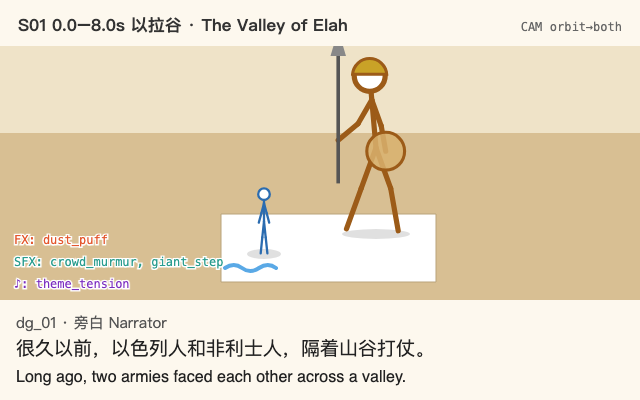

- **Camera:** orbit on both, dist 1.6, height 0.45, yaw -25°
- **Action:** Wide slow orbit over the page. Goliath stomps to his place at the back of the page; dust puffs at each step. David stands small at the front-left, watching.
- **Direction:** Goliath keeps z = -0.25 (back of the page) until he falls; David stays in front (z >= 0).
- **Acting:** 0.00 david `idle` face goliath; 0.00 goliath `idle` face david; 1.00 david `walk` → (-0.3, 0.1) face goliath; 1.00 goliath `walk` → (0.22, -0.25) face david; 3.00 david `idle` face goliath; 4.60 goliath `idle` face david
- **Line `dg_01`** 0.5 s (5.2 s max) · Narrator: 「很久以前，以色列人和非利士人，隔着山谷打仗。」 / “Long ago, two armies faced each other across a valley.” — 1 Samuel 17:1-3
- **FX:** 1.30 `dust_puff` @ goliath.footL 0.6 s; 2.40 `dust_puff` @ goliath.footR 0.6 s; 3.50 `dust_puff` @ goliath.footL 0.6 s
- **SFX:** 0.00 `crowd_murmur`; 1.30 `giant_step`; 2.40 `giant_step`; 3.50 `giant_step`
- **Music:** 0.00 `theme_tension`

### S02 · 8.0–18.6 s · 巨人的挑战 / The giant's challenge

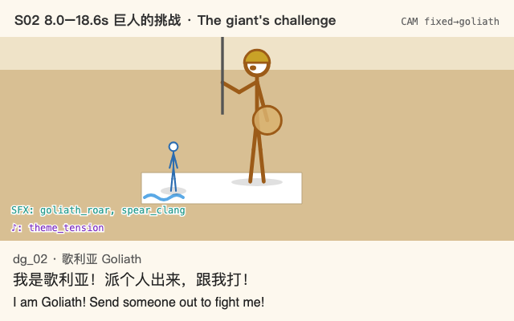

- **Camera:** fixed on goliath, dist 1.1, height 0.12, yaw 15°
- **Action:** Low hero angle looking up at Goliath. He taunts with his spear, shouts his challenge, then the narrator tells how big he is; he ends with a roar.
- **Direction:** Low camera makes him feel huge. Roar at 17.6 is the button at the end of the shot.
- **Acting:** 8.00 goliath `taunt` face viewer; 8.40 goliath `talk` face viewer; 12.40 goliath `idle` face viewer; 17.60 goliath `roar` face viewer
- **Line `dg_02`** 8.4 s (4.0 s max) · Goliath: 「我是歌利亚！派个人出来，跟我打！」 / “I am Goliath! Send someone out to fight me!” — 1 Samuel 17:8-10
- **Line `dg_03`** 12.6 s (4.4 s max) · Narrator: 「他差不多有三米高，穿着铜盔甲，拿着大枪。」 / “He was almost three metres tall, in bronze armour!” — 1 Samuel 17:4-7
- **FX:** —
- **SFX:** 8.30 `spear_clang`; 17.60 `goliath_roar`
- **Music:** (continues)

### S03 · 18.6–26.4 s · 军队害怕了 / The armies are afraid

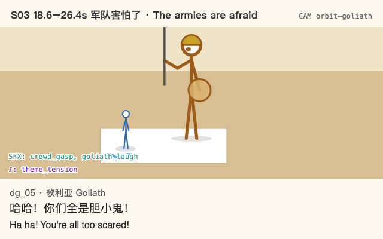

- **Camera:** orbit on goliath, dist 1.4, height 0.35, yaw -40°
- **Action:** Off-screen soldiers gasp and murmur. Goliath laughs at them and mocks them.
- **Direction:** Soldiers are voice + crowd SFX only; nothing is drawn for them.
- **Acting:** 19.40 goliath `laugh` face viewer; 22.40 goliath `talk` face viewer; 25.40 goliath `idle` face david
- **Line `dg_04`** 19.6 s (2.6 s max) · Soldiers (off): 「他太大了！谁也不敢去！」 / “He's too big! No one dares!” — 1 Samuel 17:11, 24
- **Line `dg_05`** 22.4 s (3.0 s max) · Goliath: 「哈哈！你们全是胆小鬼！」 / “Ha ha! You're all too scared!” — 1 Samuel 17:10, 16
- **FX:** —
- **SFX:** 19.00 `crowd_gasp`; 19.40 `goliath_laugh`
- **Music:** (continues)

### S04 · 26.4–38.0 s · 牧羊少年大卫 / David the shepherd

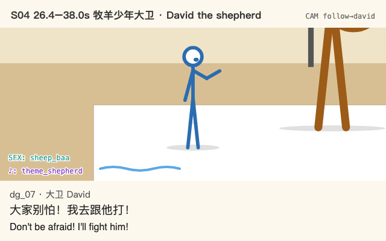

- **Camera:** follow on david, dist 0.8, height 0.25, yaw 30°
- **Action:** Music turns gentle. David walks forward to centre-left; a sheep bleats off-screen. He says he will go; King Saul (off-screen) says he is only a boy.
- **Direction:** David faces the viewer while speaking to the (off-screen) Israelite army, then turns to Goliath.
- **Acting:** 26.60 david `walk` → (-0.2, 0.05) face viewer; 29.40 david `idle` face viewer; 31.80 david `talk` face viewer; 34.80 david `idle` face viewer
- **Line `dg_06`** 26.6 s (5.0 s max) · Narrator: 「这时，放羊的少年大卫来了。他一点也不怕。」 / “Then David came, a young shepherd boy. He was not afraid.” — 1 Samuel 17:20-23
- **Line `dg_07`** 31.8 s (2.8 s max) · David: 「大家别怕！我去跟他打！」 / “Don't be afraid! I'll fight him!” — 1 Samuel 17:32
- **Line `dg_08`** 35.0 s (3.4 s max) · Saul (off): 「你还是个孩子，怎么打得过他？」 / “You're just a boy. How can you win?” — 1 Samuel 17:33
- **FX:** —
- **SFX:** 27.20 `sheep_baa`
- **Music:** 26.40 `theme_shepherd`

### S05 · 38.0–51.4 s · 狮子、熊和盔甲 / Lion, bear and armour

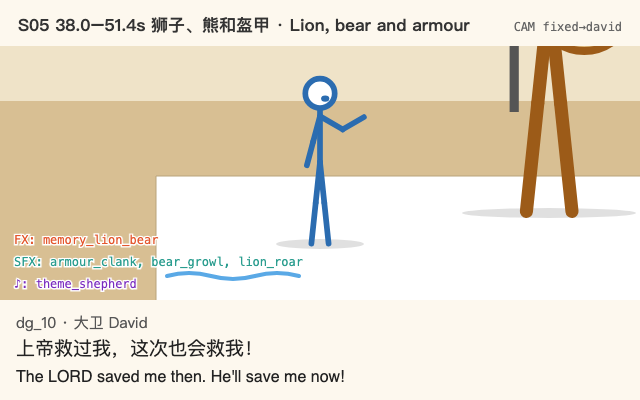

- **Camera:** fixed on david, dist 0.7, height 0.22, yaw 0°
- **Action:** Close on David. A memory bubble shows a lion and a bear above his head while he tells Saul. Then an off-screen clank: he takes off Saul's heavy armour.
- **Direction:** Armour is never modelled: voice + clank SFX only.
- **Acting:** 38.40 david `talk` face viewer; 46.80 david `idle` face viewer; 47.00 goliath `idle` face david; 47.40 david `talk` face viewer; 50.80 david `idle` face goliath
- **Line `dg_09`** 38.6 s (4.3 s max) · David: 「我放羊时，打败过狮子，也打败过熊！」 / “I kept sheep. I beat a lion and a bear!” — 1 Samuel 17:34-36
- **Line `dg_10`** 43.1 s (3.9 s max) · David: 「上帝救过我，这次也会救我！」 / “The LORD saved me then. He'll save me now!” — 1 Samuel 17:37
- **Line `dg_11`** 47.4 s (3.3 s max) · David: 「这盔甲太重了，我不穿了。」 / “Too heavy! I'll go without this armour.” — 1 Samuel 17:38-39
- **FX:** 38.80 `memory_lion_bear` @ david.head 3.8 s
- **SFX:** 39.00 `lion_roar`; 40.40 `bear_growl`; 47.20 `armour_clank`
- **Music:** (continues)

### S06 · 51.4–58.0 s · 五块光滑的石头 / Five smooth stones

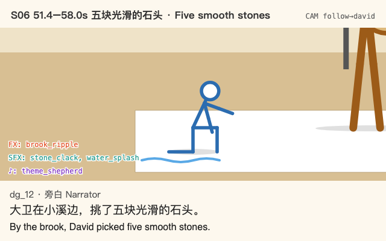

- **Camera:** follow on david, dist 0.6, height 0.12, yaw 50°
- **Action:** David walks to the brook at the front-left of the page, kneels and picks stones (ripples, five clacks), then walks back to face Goliath.
- **Direction:** kneel_pick is one clip; play it once (about 3 s). The five clacks are SFX, one stone per clack.
- **Acting:** 51.40 david `walk` → (-0.32, 0.2) face viewer; 53.00 david `kneel_pick` face viewer; 56.20 david `walk` → (-0.22, 0.05) face goliath; 57.80 david `idle` face goliath
- **Line `dg_12`** 51.6 s (4.0 s max) · Narrator: 「大卫在小溪边，挑了五块光滑的石头。」 / “By the brook, David picked five smooth stones.” — 1 Samuel 17:40
- **FX:** 53.60 `brook_ripple` @ david.handR 2.4 s
- **SFX:** 53.60 `water_splash`; 54.20 `stone_clack`; 54.60 `stone_clack`; 55.00 `stone_clack`; 55.40 `stone_clack`; 55.80 `stone_clack`
- **Music:** (continues)

### S07 · 58.0–67.8 s · 我靠耶和华的名 / In the name of the LORD

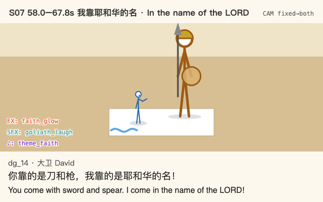

- **Camera:** fixed on both, dist 1.3, height 0.3, yaw 90°
- **Action:** Side-on two-shot. Goliath laughs and sneers at the little boy. David answers with the key line; a warm glow rises around him and the music turns brave.
- **Direction:** Heart of the story: no FX should hide David's face during dg_14.
- **Acting:** 58.00 goliath `laugh` face david; 58.80 goliath `talk` face david; 62.00 goliath `idle` face david; 62.20 david `talk` face goliath
- **Line `dg_13`** 58.8 s (3.2 s max) · Goliath: 「小不点，你也想跟我打？」 / “Little boy, you want to fight me?” — 1 Samuel 17:42-44
- **Line `dg_14`** 62.2 s (6.0 s max) · David: 「你靠的是刀和枪，我靠的是耶和华的名！」 / “You come with sword and spear. I come in the name of the LORD!” — 1 Samuel 17:45
- **FX:** 62.20 `faith_glow` @ david.chest 5.6 s
- **SFX:** 58.00 `goliath_laugh`
- **Music:** 58.00 `theme_faith`

### S08 · 67.8–72.6 s · 奔跑与甩石 / The run and the sling

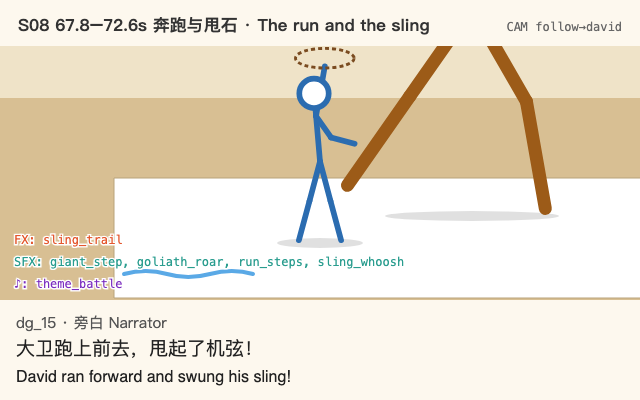

- **Camera:** follow on david, dist 1.0, height 0.2, yaw -60°
- **Action:** Goliath roars and lumbers forward; David runs to meet him and spins the sling over his head.
- **Direction:** David runs toward Goliath (17:48), not away. Sling cord spins; trail FX on the pouch.
- **Acting:** 67.80 goliath `roar` face david; 68.20 david `idle` face goliath; 68.60 david `run` → (-0.12, 0.05) face goliath; 69.00 goliath `charge` → (0.16, -0.22) face david; 70.20 david `sling_windup` face goliath; 72.40 goliath `idle` face david
- **Line `dg_15`** 68.6 s (3.0 s max) · Narrator: 「大卫跑上前去，甩起了机弦！」 / “David ran forward and swung his sling!” — 1 Samuel 17:48-49
- **FX:** 70.20 `sling_trail` @ david.slingPouch 2.4 s
- **SFX:** 67.80 `goliath_roar`; 68.60 `run_steps`; 69.00 `giant_step`; 70.00 `giant_step`; 71.00 `giant_step`; 70.20 `sling_whoosh`
- **Music:** 67.80 `theme_battle`

### S09 · 72.6–76.6 s · 一块石头 / One stone

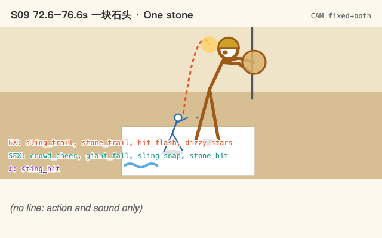

- **Camera:** fixed on both, dist 1.6, height 0.6, yaw 44°
- **Action:** Release. Side-on two-shot, square to the line between them: the stone flies from the pouch to Goliath's forehead: flash, dizzy stars, then the giant topples forward onto the page toward the viewer. Dust bursts, the page shakes.
- **Direction:** Stone flight 0.45 s from david.slingPouch to goliath.head (forehead). Goliath falls toward +Z (viewer), so he lands beside David, not on him (1 Sam 17:49 'fell upon his face').
- **Acting:** 72.60 david `sling_release` face goliath; 73.05 goliath `hit_react` face david; 74.00 david `idle` face goliath; 74.00 goliath `fall` face viewer; 75.80 goliath `down` face viewer
- **Line:** none (action and sound only)
- **FX:** 72.60 `stone_trail` @ david.stone 0.5 s; 73.05 `hit_flash` @ goliath.head 0.4 s; 73.30 `dizzy_stars` @ goliath.head 1.0 s; 75.20 `dust_burst` @ goliath.hips 1.6 s
- **SFX:** 72.60 `sling_snap`; 73.05 `stone_hit`; 75.20 `giant_fall`; 76.00 `crowd_cheer`
- **Music:** 73.05 `sting_hit`; 76.00 `theme_victory`

### S10 · 76.6–80.0 s · 巨人倒下了 / The giant falls

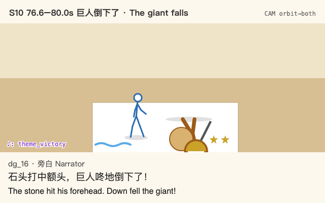

- **Camera:** orbit on both, dist 1.3, height 0.6, yaw -30°
- **Action:** High slow orbit. Goliath lies still on the page (down loop). The off-screen army cheers.
- **Direction:** Keep it gentle: no blood, no sword (17:51 is left out for ages 4-9).
- **Acting:** 77.20 david `walk` → (-0.2, 0.2) face viewer; 79.40 david `idle` face viewer
- **Line `dg_16`** 76.6 s (3.9 s max) · Narrator: 「石头打中额头，巨人咚地倒下了！」 / “The stone hit his forehead. Down fell the giant!” — 1 Samuel 17:49-50
- **FX:** —
- **SFX:** —
- **Music:** (continues)

### S11 · 80.0–89.0 s · 勇气和信靠 / Courage and trust

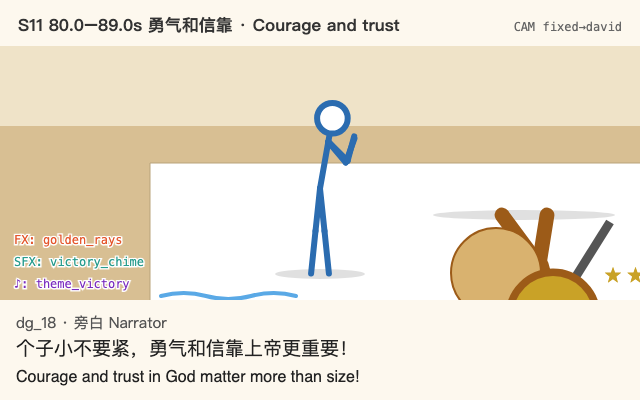

- **Camera:** fixed on david, dist 0.8, height 0.4, yaw -40°
- **Action:** David faces the viewer: victory jump, confetti, then he bows his head and prays while golden rays fall and the narrator gives the moral.
- **Direction:** Ends on David praying; the app shows the replay chip after 89.0. Camera front-left of David so the fallen Goliath (lying toward +Z on the right) stays behind him, not in front of him.
- **Acting:** 80.00 david `victory` face viewer; 81.40 david `talk` face viewer; 84.20 david `pray` face viewer
- **Line `dg_17`** 81.4 s (2.6 s max) · David: 「这场仗，是属于上帝的！」 / “The battle belongs to the LORD!” — 1 Samuel 17:47
- **Line `dg_18`** 84.3 s (4.3 s max) · Narrator: 「个子小不要紧，勇气和信靠上帝更重要！」 / “Courage and trust in God matter more than size!” — 1 Samuel 17:45-47 (moral)
- **FX:** 80.20 `confetti` @ david.head 3.0 s; 84.30 `golden_rays` @ david.root 4.0 s
- **SFX:** 80.00 `victory_chime`
- **Music:** (continues)

## Delivery lists

**FX ids (Effects → `DGFx.Play`):** `dust_puff`, `memory_lion_bear`, `brook_ripple`, `faith_glow`, `sling_trail`, `stone_trail`, `hit_flash`, `dizzy_stars`, `dust_burst`, `confetti`, `golden_rays`

**SFX ids (Music & SFX → `audio/sfx/<id>.wav`):** `crowd_murmur`, `giant_step`, `spear_clang`, `goliath_roar`, `crowd_gasp`, `goliath_laugh`, `sheep_baa`, `lion_roar`, `bear_growl`, `armour_clank`, `water_splash`, `stone_clack`, `run_steps`, `sling_whoosh`, `sling_snap`, `stone_hit`, `giant_fall`, `crowd_cheer`, `victory_chime`

**Music cues (Music & SFX → `audio/music/<cue>.wav`):** `theme_tension` (0.0–26.4 s), `theme_shepherd` (26.4–58.0 s), `theme_faith` (58.0–67.8 s), `theme_battle` (67.8–73.0 s), `sting_hit` (73.0–76.0 s), `theme_victory` (76.0–89.0 s)

**Voice lines (Voice → `audio/voice/{zh,en}/<id>.wav`):** `dg_01`, `dg_02`, `dg_03`, `dg_04`, `dg_05`, `dg_06`, `dg_07`, `dg_08`, `dg_09`, `dg_10`, `dg_11`, `dg_12`, `dg_13`, `dg_14`, `dg_15`, `dg_16`, `dg_17`, `dg_18`
