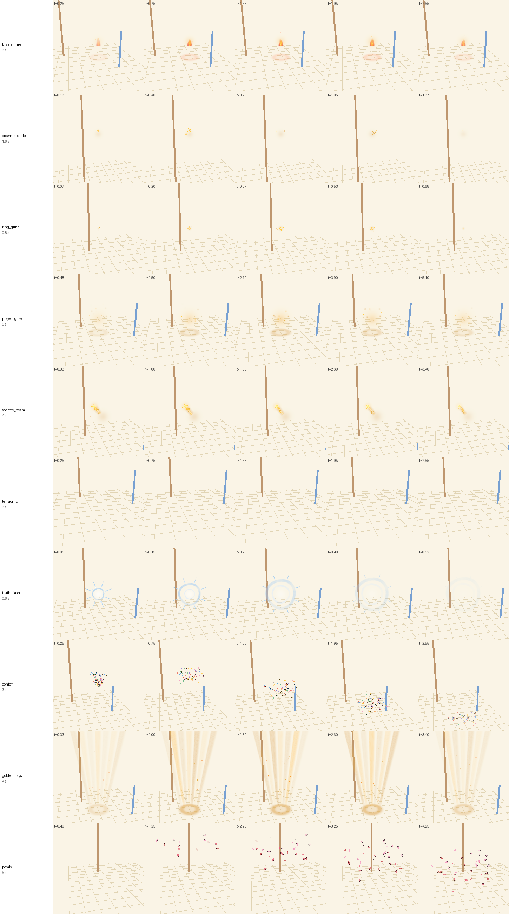

# Esther — effects

Owner: Effects role ([CONTRACT.md](CONTRACT.md) §1, §8). Light and mood: [DESIGN.md](DESIGN.md) "Light and mood per part".
Engine, look rules and API are the same as David & Goliath: read [../david-goliath/FX.md](../david-goliath/FX.md) first.



*Contact sheet: each row is one effect at 8 / 25 / 45 / 65 / 85 % of its duration, rendered from the real C# effect
code by `Fx/Preview~/run.sh esther`. Paper background, 0.1 art-unit grid; the coloured bars are the D&G scale
references (0.30 and 0.80), not Esther figures. `tension_dim` draws no sprites (see below), so its row is empty.*

## Files

| File | What |
|---|---|
| `unity/Assets/DoodLive/DavidGoliath/Fx/StoryFxEsther.cs` | The 8 new effect definitions (pure: no engine calls), `EstherFx` (registry, palette, `BeamTarget`), `StoryLight` (dim / flash requests) |
| `unity/Assets/DoodLive/DavidGoliath/Fx/StoryFxEstherRuntime.cs` | `StoryFxStage`: hidden singleton that draws the dim overlay, sets the global shader values, draws the cold flash, feeds the beam target |
| `DGFxEffects.cs` (3 lines) | `FxLibrary` also registers `EstherFx.Defs`; a D&G id is never replaced |
| `DGFx.cs` (1 line) | `DGFx.StopAll()` also calls `StoryLight.Reset()` |
| `Fx/Preview~/run.sh`, `Harness.cs` | `run.sh esther` previews the Esther ids; also finds the Unity 6 `CoreModule.dll` path |

The files sit in `DavidGoliath/Fx/` (not `Story/Fx/`) so they compile into the same assembly and namespace
(`DoodLive.DavidGoliath`) as `DGFx`; there are no asmdefs. When Integration moves the engine to `Story/`, move these
two files with it.

## Playing

```csharp
DGFx.Play("brazier_fire", palace.Find("flameL"), 999f);   // same entry point as D&G; dur <= 0 = designed default
DGFx.StopAll();                                             // replay / seek / leaving the sheet: ends fire, dim, flash
```

`dur 999` simply runs for 999 s; every effect (including the looping fire) is a `DGFxInstance` that `StopAll()`
destroys, so nothing leaks into a replay. If the anchor Transform is destroyed while an effect plays, the effect
falls back to the stage origin; stop it first.

## Effect table

Sizes in art-width units (Esther 0.34 tall, king 0.40, dais top ≈ 0.07). "Follows" = tracks the anchor every frame.

| id | anchor (`at`) | default dur | look | colours | follows |
|---|---|---|---|---|---|
| `brazier_fire` | `palace/flameL`, `palace/flameR` (one Play each) | 999 (loop) | 5 crayon flame tongues (camera-facing ribbons, 0.03–0.09 tall, wide bulb at the base, tips sway), a warm-white core, 7 sparks that rise 0.10–0.18 and wink out, a soft sun glow behind the flame, a warm pool on the page (0.22). Flicker = 3 summed sines; each brazier gets its own phase from its seed so L and R never flicker in step. Fade in 0.5 s, out 0.6 s at the end of `dur` | red `#E8553D` → flame `#FF8A3D` → sun; core `#FFF1C8` | yes |
| `crown_sparkle` | `king/crown` (or `king/head`) | 1.6 | 7 four-point twinkles (≤ 0.055) pop one after another on a ring 0.025–0.042 around and above the crown, a bigger twinkle on top in the first 0.55 s, faint gold halo behind | sun, gold, warm white | yes |
| `ring_glint` | `king/ring` (S04 give) or `haman/ring` | 0.8 | One glint 0.012 in front of the ring: crossed sparkles (0.075 + 0.04) and a small gold glow that swell and shrink, 3 tiny sparks spin out | sun, gold, warm white | yes |
| `prayer_glow` | `esther/chest` | 6 | Soft warm halo **behind** her (0.28, pushed 0.06 away from the camera; the depth test hides it where her body is), a smaller warmth at the chest, a gold pool on the page that breathes at 0.4 Hz, 14 slow motes rising from 0.07 below to 0.14 above the chest (period 2.8–4.2 s). Motes in front of her face drop to 20 %. Fade in 1.0 s, out 1.2 s | sun, gold | yes |
| `sceptre_beam` | `king/sceptreTip` | 4 | The emotional high point. A beam grows from the knob toward Esther in 0.6 s: three layered strokes (gold 0.075, sun 0.036, warm-white core 0.012) that breathe at 1.1 Hz, 12 sparkles gliding along it, a glowing knob (halo + slow star + small additive core), an opening burst of 10 twinkles, and a gold glow behind Esther. The beam stops 0.03 short of her. Target: `EstherFx.BeamTarget` (see below). Fade in 0.25 s, out 0.8 s | gold `#E3B04B`, sun, `#FFF1C8` | yes (tip) |
| `tension_dim` | `stage` (anchor unused) | 8 (use the scene length, or 999 + StopAll) | Darkens and cools the whole stage to evening blue, opacity up to `StoryLight.DimStrength` = 0.45. Fade in 1.2 s, out 1.5 s. Effects keep glowing through it (fire, prayer glow). Draws no sprites itself — see wiring | overlay `#121A47`-ish (0.07, 0.10, 0.28) | — |
| `truth_flash` | `esther/handR` (she points) or `haman/head` | 0.6 | One **cold** white screen flash (0.5, gone in 0.35 s, no strobe) plus at the anchor: a white burst, two ice-blue rings growing to 0.36 / 0.24, 8 short ice rays, 6 sparks flying out | ice `#D6EAFF`, sky `#4BA3E3`, white | yes |
| `confetti` | `esther/head` (best), or `stage` | 3 | **Shared with D&G** (same id, same code): 64 crayon confetti bits burst ~0.2 up, flutter down, lie on the page. For a bigger celebration play it twice (e.g. `esther/head` and `king/head`, a few tenths apart) | 7 crayon colours | no |
| `golden_rays` | `esther/root` (or `stage` for the centre) | 4 | **Shared with D&G**: 7 soft gold beams from 1.0 above onto the anchor, gold pool on the page, 16 drifting motes | gold, sun, orange | yes |
| `petals` | `palace/table` | 5 | 36 rose petals appear 0.32–0.48 above the anchor within radius 0.26, spawning over the first 55 % of `dur`, fall slowly (0.07–0.11 / s) with sway and flutter, then lie flat on the page (hidden by the table where they land on it) and fade over the last 0.8 s. Petal = soft ellipse 0.03 × 0.019 with a darker crayon edge | pink `#F49AC1`, rose `#E8607A`, blush `#FBD3DF`, crimson `#C8323F` | no |

Ids not redefined: `confetti` and `golden_rays` already exist in `DGFxEffects.cs`; the dictionary keeps the D&G
version, so both stories get identical effects. If Esther needs a different look later, it must be a new id
(e.g. `confetti_banquet`), because the contract forbids changing D&G's.

## Wiring for Integration

### tension_dim (and truth_flash)

`tension_dim` and `truth_flash` post their levels to `StoryLight`. `StoryFxStage` (created automatically at start-up
by `[RuntimeInitializeOnLoadMethod]`, hidden, `DontDestroyOnLoad`) resolves them every frame and does **both** of:

1. **Overlay (default, works with no other change):** a camera-facing quad with feathered edges, created as a child
   `StoryFx_Dim` of `DGFx.Stage`. Every frame it is placed between the camera and the stage (just in front of the
   nearest corner of `StoryFxStage.DimBounds`, stage-local, default centre (0, 0.33, 0), size 1.15 × 0.70 × 1.35) and
   sized to cover that box on screen, plus 12 %. Colour `StoryFxStage.DimColour`, opacity = current dim (≤ 0.45). It uses
   the DGFx unlit shader (alpha blend, no depth write) at render queue **3005**, so the opaque stage is dimmed and all
   DGFx effects (queue 3010/3020) draw on top, undimmed. It is on the stage's layer. **Requirements:** `DGFx.Stage` set
   (as for D&G) and `Camera.main` is the AR camera. In AR, the real table just around the page inside that box is
   dimmed too (soft edges); if that looks wrong, tighten `DimBounds`.
2. **Global shader values (optional, nicer):** `_DoodStageDim` (float, 0..0.45) and `_DoodStageTint` (colour, white →
   `StoryFxStage.CoolTint` (0.45, 0.52, 0.80) at full dim). If the stage shader (e.g. `PaperLit`) multiplies its albedo
   by `_DoodStageTint`, set `StoryFxStage.DimOverlay = false` to drop the quad. Unset globals default to 0 / black in
   Unity, so a shader that reads `_DoodStageTint` must treat it as optional (e.g. `lerp(1, tint, step(0.0001, _DoodStageDim))`)
   or the stage turns black outside the story.

`DGFx.StopAll()` clears both at once. While `DGFx.Paused`, the dim holds. `truth_flash` draws its cold flash with IMGUI
over the screen when `DGFx.DrawFlashOverlay` is true (the same switch as D&G's warm flash); read
`StoryFxStage.ColdFlash` (0..1) and `StoryFxStage.FlashColour` to draw it yourself.

### sceptre_beam target

The effect only receives the sceptre tip. The other end is `EstherFx.BeamTarget` (stage-local art units), default
(0, 0.24, −0.12) = Esther's chest standing at the foot of the steps. Better: before S08 set
`StoryFxStage.BeamTarget = <esther chest bone Transform>`; the runtime converts it to stage-local every frame, so the
beam follows her as she climbs. Set it back to null (and `EstherFx.BeamTarget = EstherFx.DefaultBeamTarget`) when
leaving the story if another pack uses the beam.

### Other calls

- Start both braziers at the start of S01 with `dur` 999 (or the timeline's length); `DGFx.StopAll()` on replay.
- `DGFx.Prewarm()` when the Esther sheet is detected (same atlas as D&G; no new textures except the 64 × 64 dim mask).

## How it was checked (2026-11-13)

1. **Compile:** all `Fx/*.cs` + `Scripts/DesignTokens.cs`, C# 9, against Unity 6000.3.27f1's
   `UnityEngine.CoreModule.dll` and `UnityEngine.IMGUIModule.dll` (netstandard 2.1, dotnet SDK): build succeeded, no
   errors or warnings. Unity itself was **not** run.
2. **Preview:** `Fx/Preview~/run.sh esther` runs the real effect code at 60 fps and rasterises the exact triangles
   (contact sheet above). Max sprites per effect: 64 (confetti), 36 (petals), 26 (sceptre_beam), fire 10 + 5 ribbons.
3. Not previewed: `StoryFxStage` (overlay, globals, cold flash) — it needs a real camera and stage.

## Weakest points (not verified)

| Claim | Level | How to check |
|---|---|---|
| The dim overlay sits in front of the stage, covers it, and the effects draw over it | D (geometry reasoning; never rendered) | Integration: play S03 in the Editor with `tension_dim`, look from the front and from a low side angle |
| Render queue 3005 is after the stage and characters (opaque, ≤ 2500) and the AR background | D | Same; if the characters use a transparent queue > 3005 they will draw over the dim — lower the quad's queue in `StoryFxStage.Build` |
| Sizes read well next to the real models (flame 0.09 tall on the brazier, petals 0.03, sparkles ≤ 0.085) | D (preview uses grid scale only; no palace / character models yet) | QA screenshot of S01, S08 and S11 on device with the SystemUI clock |
| The beam reaches Esther, not past her | D (default target is a guess from the contract marks) | Set `StoryFxStage.BeamTarget` to her chest bone; watch S08 |
| Crown sparkle is faint on uncoloured (white) paper | C-ish (seen faint in the preview) | Check on device; raise alpha / size in `CrownSparkle` if needed |
