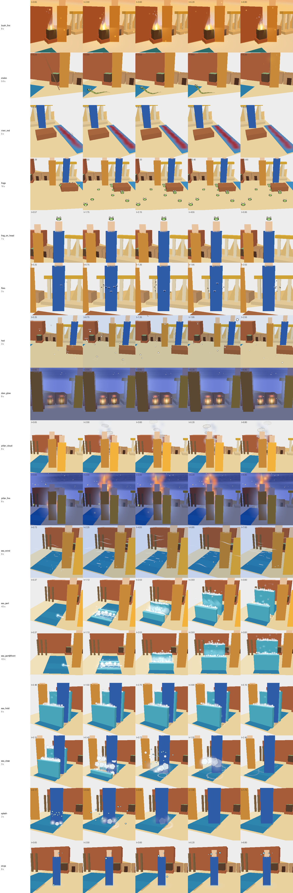

# Exodus — effects

Owner: Effects role ([CONTRACT.md](CONTRACT.md) §1, §8). Light and mood: [DESIGN.md](DESIGN.md) "Light and mood per part".
Engine, look rules and API are the same as the earlier packs: read [../ruth/FX.md](../ruth/FX.md) (and through it the
Esther and David & Goliath FX docs) first.



*Contact sheet: each row is one effect at five moments of its duration, rendered from the real C# effect code by
`Fx/Preview~/run.sh exodus` over a **stand-in** Egypt (boxes at the CONTRACT §6 positions, actors as coloured slabs at the
story.py marks) with a depth buffer and the frame's `StoryTint` multiplied over the set. The sea rows also draw the two
walls at the height `ExodusStage` would give the real `seaWallBack` / `seaWallFront` nodes that frame, hide the lane
water when the runtime would, and include `sea_hold` (what the runtime spawns). `bush_fire` is shown over
`sunset_glow`, `door_glow` and `pillar_fire` over `night`. As on the earlier sheets the harness camera is mirrored (world +X
appears on the left); this does not affect the device.*

## Files

| File | What |
|---|---|
| `unity/Assets/DoodLive/DavidGoliath/Fx/StoryFxExodus.cs` | The 15 new ids + the internal `sea_hold` (pure: no engine calls). `ExodusFx` (registry, palette, CONTRACT §6 fallbacks, measured node boxes, frog / drop / foam / flame helpers, `Actors`). `ExodusSea` (the sea state: `Open`, `SetState`, wall geometry) |
| `unity/Assets/DoodLive/DavidGoliath/Fx/StoryFxExodusRuntime.cs` | `ExodusStage`: hidden singleton (auto-created, `DefaultExecutionOrder(200)`) that moves the set's sea nodes, keeps `sea_hold` alive while the sea is open, measures node bounds, fills `ExodusFx.Actors`; `ExodusStage.Seek(...)` for the director's fast-forward |
| `DGFxEffects.cs` (1 line, after Daniel's) | `foreach (var d in ExodusFx.Defs) if (!map.ContainsKey(d.Id)) map[d.Id] = d;` — an existing id is never replaced |
| `Fx/Preview~/ExodusPreview.cs`, `Harness.cs` (1 line), `run.sh`, `render.py` (`egypt_scene` + dispatch) | `run.sh exodus` → `fx_contact_exodus.png` |

`DGFx.cs` and `StoryDirector.cs` are **not** changed by this role. One line in `StoryDirector.EndSeek` is needed (below).

## Wiring for Integration

### 1. Fast-forward into S12 / S13 (required, one line)

`BeginAt` only replays effects whose window still overlaps the seek time. `sea_part` (S11, 4.5 s) is long over by S12,
yet the walls must still stand. The sea state therefore lives outside the effect, in `ExodusSea.Open` (0 = rest,
1 = parted). `DGFx.StopAll()` (called by `Begin`) resets it to rest through `StoryLight.Epoch`. In
`StoryDirector.EndSeek(float t)`, add this as the **first line after `seeking = false;`**, before the replay loop:

```csharp
ExodusStage.Seek(seekFx, t);   // Exodus: walls stand if a sea_part has started and no sea_close has finished by t
```

- It does nothing when `seekFx` holds neither `sea_part` nor `sea_close`, so it is safe for every story.
- S12 start: parted (walls up, lane hidden, `sea_hold` foam / caustics running); the replayed `sea_close` then collapses
  them on cue. S13 / S14 start: rest. S11 start: rest, and `sea_part` plays normally.
- Equivalent low-level call if you prefer to decide yourself: `ExodusSea.SetState(bool parted)` (after `DGFx.StopAll`).
- Nothing else is needed for normal play, replay, pause (`DGFx.Paused` freezes the swell clock) or leaving the sheet.

### 2. Set nodes the runtime drives (CONTRACT §6)

Found by name under `DGFx.Stage` (inactive included) on the first frame of a new stage:

| Node | What the runtime does |
|---|---|
| `seaWallBack`, `seaWallFront` | Captures the rest `localScale` once; full height = rest with `y / 0.02` (`ExodusSea.RestScale`); an unscaled wall (y ≥ 0.2) is taken as full. Each frame: `SetActive(Open > 0.003)`, `localScale.y = full.y × lerp(0.02, 1, Open × swell)`; swell = ±1.2 % at 1.6 rad/s once standing |
| `seaWaterLane` | `SetActive(false)` while `Open > 0.12` (`ExodusSea.LaneHideAt`); a foam burst covers the switch both ways |
| `nileWater`, `doorMarks`, `seaBed`, `seaWaterLane`, both walls | Stage-local mesh bounds go to `ExodusFx.Boxes`; `river_red` and `door_glow` place themselves on them, the sea effects take x range, inner faces and heights from the walls (falls back to CONTRACT numbers if missing or implausible) |

**Requirement for the Set role:** each wall's **origin sits at its base (y = 0)**, because the runtime scales about the
origin. A missing node is logged once (`[ExodusFx] set node(s) … not found`) and skipped; the sprites still play.

### 3. Other notes

- `sea_hold` is internal: the runtime spawns it via `DGFx.Spawn("sea_hold", seaNode, 1e6)` while `Open > 0.001` and destroys it
  at rest. `DGFx.StopAll()` kills it; the runtime respawns it on the next frame if the seek left the sea parted.
- `hail` and `sea_wind` post cool `StoryTint` requests, so Ruth's `StoryTintStage` (already in the build) draws them.
- `frogs` and `bush_fire` read `ExodusFx.Actors` (filled by the runtime from the `DGActor`s under the stage, rescanned
  every 0.5 s, only while one of them plays). Nothing to wire.
- `river_red` does **not** change the `nileWater` material: `DGPaperLit` has no tint input, and the child's own colour must
  turn red whatever it is. It lays a red layer of soft ground sprites just above the water surface instead (same visible
  result, no shader change, no material instance).
- `.meta` files for the two new `.cs` files are generated by Unity on import.

## Effect table

Sizes in art-width units (Moses 0.37 tall, Pharaoh 0.39, Miriam 0.34). Anchors and durations as story.py.

| id | anchor (story.py) | dur | look | follows |
|---|---|---|---|---|
| `bush_fire` | `egypt.bushFlame` | 58 (loop) | 9 amber→gold flame tongues (0.07–0.12) around the crown, back to front, plus a gold→white and a white core tongue; violet + pale-violet halo behind, warm pool on the page, a wide faint additive glow; a warm glow on the bush-facing side of any actor within 0.45 (chest height, never on the face); 9 slow sparks (white / gold / pale violet). Breathes at 1.7 rad/s, no flicker. Nothing dark is ever drawn (the bush is not charred). Fade 1.2 / 1.5 s | yes |
| `snake` | `moses.handR` | 5.6 | 0–0.38 s: a wooden staff (0.32) topples forward from the hand and lands with a sand puff; to 0.8 s it shortens and turns green; then a 0.16 green-brown snake wriggles on the page in front of Moses (travelling wave, head raised 0.03, goggle eyes, dark back diamonds, a pink forked tongue every 1.4 s), turning slowly. Last 0.9 s: the held tail straightens first, the body rises into a vertical staff through the hand (head = crook), turns wood-brown, gold sparkles; fades in the last 0.15 s as the real staff prop shows | rise only |
| `river_red` | `egypt.nile` | 5 | Red soft layer over the `nileWater` bounds (fallback x −0.59…−0.51, z −0.30…0.21): blooms outward from the middle in 0.6 s, two ripple rings, six darker swirls drifting downstream, holds, fades over 1 s | no |
| `frogs` | `stage` | 16 | 12 cartoon frogs (0.034: ink-outlined green body, pale belly, goggle eyes, croak sac) leave the river 0.17 s apart, 3 hops each to spots across the floor (pushed 0.075 away from any actor's feet), sit and croak now and then, blink; in the last ~1.6 s hop back into the river and fade. Drawn back to front | no |
| `frog_on_head` | `pharaoh.head` | 7 | One frog (0.040) hops from the floor onto the head top (`ExodusFx.HeadTop` = 0.062 above the bone), squashes on landing, croaks every 1.7 s (sac + bounce + a little ring), hops off the other side at the end | yes |
| `flies` | `egypt.palace` | 3 | 16 flies (dark dot 0.010, two fluttering white wings) on tilted orbits 0.03–0.075 round a point 0.17 up, 0.13 in front of the palace node (fallback (−0.36, −0.48)), the swarm wanders; 3 little ink "buzz" squiggles. Wing flutter is a size wobble, not a blink | yes |
| `hail` | `stage` | 3 | 34 icy crayon stones (0.013–0.021) fall over the floor at 1.4 / s with a faint streak, bounce twice, slide a little, fade; a white ring per impact; cool tint (0.86, 0.92, 1.0) via StoryTint. No new stones in the last 0.9 s | no |
| `door_glow` | `egypt.doorMarks` | 30 | Per doorway (two when the marks span > 0.10, at ±0.03 in from the ends): warm light in the doorway, a warm-white additive core, a red-gold glow on the lintel and both posts, a warm pool on the ground in front, 3 slow motes; pulses 0.86–1.0 at 0.35 Hz. Drawn after the night overlay, so it pops | no |
| `pillar_cloud` | `egypt.pillarWest` | 40 | A 0.50-tall column at the node (fallback (0.16, −0.12)) that builds up from the ground over 1.8 s: 26 soft puffs on a two-strand helix rising forever (radius 0.030→0.058, turning 0.8 rad/s), shaded grey on the far side, every 4th a crayon cloud outline; soft inner light, a ground glow, 7 rising glow motes. Fade 1.4 s | no |
| `pillar_fire` | `egypt.pillarWest` | 10 | Same column in orange / ember with additive gold cores on the near side, 4 tall flame tongues climbing it, 12 embers, a warm ground glow | no |
| `sea_wind` | `egypt.sea` | 9 | Cool tint (0.80, 0.87, 1.0) + cool rim; 12 wavy white streaks racing east→west over the sea and the west beach (0.32–0.48 / s), 22 spray drops torn off the water in low arcs, 8 white-cap streaks on the surface, 8 sand grains from the far shore | no |
| `sea_part` | `egypt.sea` | 4.5 | **Hero.** Drives `ExodusSea.Open` by `ExodusSea.Curve`: waits 10 %, rises (smooth, +5 % bump) to 1 at 85 %. 0–1.05 s: a bright foam seam with a twinkling head runs along the lane west→east leaving ripple rings. ~0.9–2.3 s: a foam burst over the lane (hides the lane water going). While rising: spray and foam thrown up from both crests (strength = rise speed), cyan mist along the walls. 72–95 %: a soft warm path of light runs along the opened lane; 78–100 %: twinkles pop along the crests. Gentle rumble 0.0022 decaying over 3.2 s. No flash | no |
| `sea_hold` (internal) | sea node | ∞ | While `Open > 0`: a white foam line + 10 bobbing foam blobs on each crest, foam at each wall's foot, light rippling up the inner faces, 3 spray flicks off the crests, a shimmering net of 12 light rings + a cool pool on the sea-bed, 3 fish glints inside the back wall. All scaled by `Open`, so it grows with `sea_part` and falls with `sea_close` | — |
| `sea_close` | `egypt.sea` | 3 | Walls drop in 0.5 s (`Open = 1 − k²`; the splash sfx is 0.4 s after the start in story.py): foam curtains fall from both crests to the lane middle, then 26 drops / foam leap up along the lane and fall back, 10 big foam heaps, spray mist, 7 ripple rings settle across the sea. Ends at rest (lane water back). Rumble 0.003 / 1.3 s | no |
| `splash` | `pharaoh.root` | 2 | Two white rings + a pale-blue wet patch spreading on the ground, 6 foam heaps, 20 crayon water drops in arcs | no (start point) |
| `drips` | `pharaoh.head` | 12 | 6 drips round the head-cloth edge: each swells for 0.55 s, falls, leaves a tiny ring on the page; period 1.3–2.1 s; a wet patch grows under him | yes |

Reused, not redefined: `dust_road`, `sunset_glow`, `night`, `prayer_glow`, `sparkle`, `confetti`, `golden_rays`
(Ruth / Esther / D&G versions; all present in the build, checked by the harness).

**Budget** (max quads per frame from the harness; Ruth's `night` is 58 + 3 ribbons): sea_part ≈ 45 + sea_hold ≈ 60
(102 together); sea_close + hold 100; frogs 94; pillar_fire ≈ 58 + 7 ribbons (116 with night); hail 60; splash 50;
flies 48; river_red 42; sea_wind 34 + 12 ribbons; bush_fire ≈ 14 + 14 ribbons; door_glow ≈ 19 (+ night); snake 18 + 4
ribbons; drips 13; frog_on_head 9. Busiest real moment, S11: sea_wind + sea_part + sea_hold + pillar_fire ≈ 200 quads in
one shared atlas, two materials, the existing `DGFxUnlit` shader. No new shader, texture or material.

## How it was checked (2026-11-14)

1. **Compile:** all `Fx/*.cs` (including `StoryFxExodusRuntime.cs` and Daniel's in-progress file) + `Scripts/DesignTokens.cs`
   + `DavidGoliath/Scripts/DGTimeline.cs` + `DGActor.cs`, C# 9, Unity 6000.3.27f1's own Roslyn (`csc.dll`, LESSONS L38)
   against netstandard 2.1 and the Core / IMGUI / Animation / Director / JSONSerialize module DLLs: 0 errors, 0 warnings.
   Unity itself was **not** run (only Integration runs Unity).
2. **Preview:** `run.sh exodus` (60 fps simulation of the real code, exact triangles, stand-in set with depth, tint,
   simulated wall height and lane), iterated three times: an engine call (`Quaternion.AngleAxis`) in the snake found
   and removed; river red too weak → two layers; pillar outlines looked like popcorn → soft body, few outlines, flame
   tongues for fire; foam blobs read as rocks → every other blob soft; frogs, flies, hail, drips enlarged; door glow
   and bush halo strengthened.
3. **Other packs:** `run.sh`'s build ran the D&G, Esther, Ruth and Daniel rows with the new registration line: all ids
   resolve to their old classes, no exceptions (outputs written to a temp dir; their PNGs were not touched).
4. **Not exercised:** `ExodusStage` itself (node lookup, scaling, `SetActive`, bounds measuring, `sea_hold` spawning,
   `Seek`) needs Unity and the real `egypt.glb`, which did not exist yet when this was written.

## Weakest points (not verified)

| Claim | Level | How to check |
|---|---|---|
| The walls rise from the page: each wall's origin is at its base and its rest scale.y is 0.02 of full | D (CONTRACT wording; `egypt.glb` not built yet) | Integration: select `seaWallBack` in the imported set, read `localScale` and pivot; play S11 in the Editor. If the walls grow from their middle, ask the Set role to move the origin to the base (or tell Effects) |
| `ExodusStage.Seek` in `EndSeek` gives standing walls at S12 and rest at S13 | D (logic read against `StoryDirector.BeginAt` / `EndSeek`, not run) | Integration: "keep reading" into S12 and S13 in the Editor, then on the phone |
| Spray, mist, crest foam sit on the real walls' crests (x range / inner faces / tops measured from the meshes) | D (stand-in boxes only; real crests curl over the lane) | Look at S11 from the orbit camera; if foam floats off the curl, tune `ExodusSea.TopBackY / TopFrontY` or the measured box use |
| S11 stays smooth on a Pixel 8 (≈ 200 quads, several large soft additive sprites: mist 0.14, light path, caustic pool, pillar glow) | D (quad counts are A from the harness; fill rate never measured) | Integration: GPU profiler / frame time on device during S11 |
| `river_red` covers the river without staining the banks (layer = nileWater bounds × 1.25) | D | Device screenshot of S06; shrink `size` in `ExRiverRed` if the sand turns pink |
| Snake reads from the S04 camera (diagonal across the view, head raised) and lines up with `grab_tail` / the staff prop show at its end | D (stand-in hand position, no animation) | Play S04 in the Editor |
| `frog_on_head` sits on the nemes, not inside it (`ExodusFx.HeadTop` = 0.062 above the head bone) | D (bone origin height unknown) | S06 screenshot; adjust `ExodusFx.HeadTop` |

中文速览：15 个新特效 + 内部 `sea_hold` 都在 `StoryFxExodus.cs`；海水状态 `ExodusSea.Open` 独立于特效存在，快进时导演在
`EndSeek` 里加一行 `ExodusStage.Seek(seekFx, t);` 即可（S12 开头墙立着，S13 开头已复原）。海墙节点的原点必须在底部。
离线编译通过、预览图已出；Unity 和真机都没跑过。
