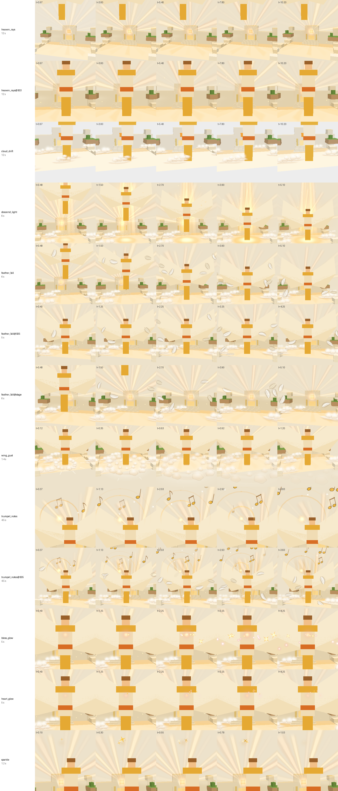

# Gabriel — effects

Owner: Effects role ([CONTRACT.md](CONTRACT.md) §1, §8). Light and mood: [DESIGN.md](DESIGN.md) "Light and mood".
Engine, look rules and API are the same as the earlier packs: read [../david-goliath/FX.md](../david-goliath/FX.md),
[../ruth/FX.md](../ruth/FX.md) and [../daniel/FX.md](../daniel/FX.md) first.

*Contact sheet: each row is one effect at 8 / 25 / 45 / 65 / 85 % of its duration, rendered from the real C# effect code
by `Fx/Preview~/run.sh gabriel` over a **stand-in** heaven (CONTRACT §6 positions: cloud floor, wall + gate house with
the rosette glow and 5 steps, two floating boxes, front cloud boxes) with a depth buffer. Gabriel is a 0.62-high slab
with a 1.0-wide wing slab at the `SKY` mark (0, 0.02); in the descent rows he is lifted per frame. The frame's
`StoryTint` result is multiplied over the set. From `descend_light` down, `heaven_rays` and `cloud_drift` run
underneath, as in the story. `@S03` / `@S05` / `@stage` are the same id from another camera, anchor or companion set
(`trumpet_notes@S05` also plays `golden_rays` and `feather_fall`). The harness camera mirrors world X.*

## Files

| File | What |
|---|---|
| `unity/Assets/DoodLive/DavidGoliath/Fx/StoryFxGabriel.cs` (+ `.meta`) | `GabrielFx` (registry, palette, stage points, the shared `Puff` / `Feather` / `Note` / `Stroke` drawing) and the 7 effect classes. Pure: no engine calls |
| `DGFxEffects.cs` (1 line) | `FxLibrary` also registers `GabrielFx.Defs`; an existing id is never replaced |
| `Fx/Preview~/GabrielPreview.cs`, `Harness.cs` (1 line), `run.sh`, `render.py` (`heaven_scene`) | `run.sh gabriel` → `fx_contact_gabriel.png` |

No runtime file. `heaven_rays` posts its golden-hour tint to Ruth's `StoryTint`; `StoryTintStage` already draws it.
The atlas is full (15 cells) and belongs to D&G, so feathers and notes are built from ribbons and dots, no new texture.

## Ids

| id | source | status |
|---|---|---|
| `heaven_rays`, `cloud_drift`, `descend_light`, `feather_fall`, `wing_gust`, `trumpet_notes` | **new** | below |
| `bless_glow` | **new**, replaces `heart_glow … to="viewer"` in S06 | see "heart_glow" below |
| `sparkle`, `heart_glow` | Ruth | exist, unchanged |
| `golden_rays` | D&G | exists, unchanged |

The harness prints the class each id resolves to; all 10 resolve.

### `heart_glow` with `to="viewer"`

`DGDirector.Fx` calls `DGFx.Play(id, at, dur)` and never passes `to`. Ruth's `heart_glow` sends its motes to
`EstherFx.BeamTarget` when a runtime set it, otherwise to a point 0.12 to the right of the anchor. In this pack that is
a second small glow in the air beside his shoulder with motes going sideways to it (row `heart_glow` on the sheet):
harmless, but not "toward the viewer". The id cannot be redefined (never replace an existing id), so the viewer
version is a new id, **`bless_glow`**: same anchor, same duration. Story: change the S06 line to
`fx("bless_glow", "gabriel.chest", dur=5.0, dt=0.6)`.

## New effects

Sizes in art-width units (Gabriel 0.62 tall, wingspan 1.0).

| id | anchor (story.py) | default dur | look | follows |
|---|---|---|---|---|
| `heaven_rays` | `stage` | 999 (loop) | Golden hour. A breathing amber glow on the rosette (`GabrielFx.GateGlow`, (0, 0.30, −0.49)); 11 soft god rays fanning up and out from it (0.7–1.1 long, gold / amber with a pale additive core), each pulsing on its own 7–11 s period while the fan sways ±3°; they lean only 5–15° toward the viewer, so they stay behind the centre stage and the actor is always in front of them. 6 pale shafts lie over the clouds from the foot of the stair, none down the middle. 5 slow haze bands in front of the wall, 18 floating motes. Requests a mild warm multiply tint (`GabrielFx.GoldenTint` (1.0, 0.955, 0.86), strength `GabrielFx.GoldenHour`, 0 = off). Fade in / out 1.5 s | — |
| `cloud_drift` | `stage` | 999 (loop) | 8 low wisps crossing the page left to right at 0.02–0.036 /s, 0.016–0.05 above the cloud floor (`GabrielFx.CloudTop` 0.04): a tapering white streak with a peach shadow and three soft puffs. Never above knee height; the near ones are thinner | — |
| `descend_light` | `gabriel.root` | 6 | A warm column from 1.8 high down to the clouds, **behind** him (0.10–0.22 away from the viewer: he and his wings cover it, so it is backlight and never washes the face); a gold halo behind him larger than the wings (rims their edge); a pool of light on the clouds that grows and brightens as the node comes down (reads the node height); 26 motes spiralling down round him, none across the middle at head height. Fade in 0.8 s, out 1.2 s | yes |
| `feather_fall` | `gabriel.chest` / `stage` | 6 | White feathers (0.09–0.13 long: warm pencil edge, white or cream vane, shaft line), one every 0.5 s, 5–7 in the air at once. On a node each leaves the wing where the wing was at that moment (0.15–0.44 to the side, just in front of the wing, never in front of the face) and then falls by itself at 0.10–0.15 /s with a pendulum sway, tilting into each swing and turning its vane to and from the viewer; one that reaches the cloud floor settles flat and fades in 0.6 s, one still in the air after 3.3 s fades there. On `stage` (anchor on the page) they come down from 0.50–0.72 over the whole stage, never over the centre line. The last feather starts 1.6 s before the end | yes (source only) |
| `wing_gust` | `gabriel.root` | 1.4 | A ring of 13 cloud puffs rolls outward over the page to radius 0.48, growing as it slows; a smaller second wave of 8; a soft ring on the clouds; 10 short speed strokes in the first half. Everything below 0.15. Scales with `dur`. No shake | no (stays where it started) |
| `trumpet_notes` | `gabriel.trumpet` | 4.5 | From the bell (`anchor + GabrielFx.BellOffset`): golden notes with a dark gold edge (eighth with a flag, beamed pair, quarter), one every 0.26 s, each popping out with an overshoot and floating up and out along its own direction of an upper fan (golden-ratio spread), growing 0.036 → 0.058 and rocking, a white twinkle behind every other one; soft sound arcs widening from the bell every 0.55 s, open at the bottom so nothing sweeps down across the face; a warm glow pulsing on the bell. Nothing new starts in the last 0.9 s | yes |
| `bless_glow` | `gabriel.chest` | 5 | A gold glow behind him at chest height, a small rose-gold light on the cuirass (below the chin), and 16 little lights that leave the chest toward the camera, opening left and right and a little down like open arms, growing as they come and fading before they reach the viewer. Fade in 0.8 s, out 1.0 s | yes |

Budget (max per frame, harness): heaven_rays 43 sprites + 28 ribbons; cloud_drift 144 + 16; descend_light 56 + 11;
feather_fall 0 + 21; wing_gust 130 + 10; trumpet_notes 28 + 23; bless_glow 36 + 0. The S05 peak (both loops, notes,
`golden_rays`, feathers) is 232 sprites + 93 ribbons.

## Wiring for Integration

Public statics in `GabrielFx`, all stage-local art units, set once after the stage is built if the models differ:

| Static | Default | Change it when |
|---|---|---|
| `GateGlow` | (0, 0.30, −0.49) | the `gateGlow` node is elsewhere: `stage.InverseTransformPoint(gateGlow.position)` |
| `CloudTop` | 0.04 | the cloud floor in the centre stage is higher or lower (ground effects sit just above it) |
| `BellOffset` | (0, 0.08, 0.16) | the notes do not start at the bell. It is a guess at "from the `trumpet` bone to the bell while blowing, bell up and toward the viewer". Simplest fix: add a `bell` empty at the bell and play on `gabriel.bell` with `BellOffset = Vector3.zero` |
| `GoldenHour`, `GoldenTint` | 1, (1.0, 0.955, 0.86) | the warm tint is too much over a child's colours (0 = rays only) |

## Notes for Story (timeline.json as built on 2026-11-14)

1. S06: `heart_glow` → `bless_glow` (above).
2. `wing_gust` does not follow: it rolls out from where `gabriel.root` was when it started. Put it on the frame the
   feet touch (`fly_down`) and on the frame he springs (`fly_up`), from the Animation role's ANIMATION.md, instead of
   the estimated `dt=4.2` / `dt=0.5`.
3. `descend_light` (11.28–17.28) ends 0.4 s before the S02 pause does; `dur=6.4` lets its 1.2 s fade finish exactly
   on the cut to S03.
4. `feather_fall` in S02 (12.28–18.28) runs 0.6 s into S03; only fading feathers are left by then (the last one
   starts at 16.68). Fine as is.
5. `trumpet_notes` and `golden_rays` together are the brightest moment, as DESIGN asks; `golden_rays` stands behind
   him (its rays come from above and behind), so it does not cross the face.
6. `heaven_rays` and `cloud_drift` have `dur=999`: they fade in over 1.5 s at the start and are cut at the end of the
   play. For a soft end give both `dur = duration − 0.2`.

## How it was checked (2026-11-14)

1. **Compile:** every `Fx/*.cs` the harness lists + `Scripts/DesignTokens.cs`, C# 9, against Unity 6000.3.27f1's
   `UnityEngine.CoreModule.dll` under .NET 8: 0 warnings, 0 errors. Unity itself was **not** run (Integration's job).
2. **Preview:** `FXPREVIEW_WORK=/tmp/gabriel_fx/work run.sh gabriel` (60 fps, exact triangles, depth, tint), plus
   560 px close-ups of single frames. Five rounds: the cloud puffs were the D&G `Dust` cell, whose grey pencil outline
   read as stones on the cream floor, then soft dots that vanished white-on-cream → `Puff` (tan crayon underside, white
   lobes on top); feathers were small, fell fast and started behind the wing slab (hidden) → longer, slower, started
   higher and just in front of the wing; the gust ring line was a heavy dark loop → soft white ring with a faint line.

## Weakest points (not verified)

| Claim | Level | How to check |
|---|---|---|
| The notes start at the trumpet bell | D (`BellOffset` is a guess; the character is not built yet) | Device screenshot at ~58.5 s; move the offset or add a `bell` empty |
| The golden-hour tint looks right over real colouring and the camera image | D (stand-in colours only) | Device, S01 and S03; set `GabrielFx.GoldenHour` 0.5 or 0 if the page turns too yellow |
| Feathers, white on the real white wings, still read | D (they have a tan edge; over the stand-in wing they read) | Device screenshot at ~14 s and ~60 s |
| Feather sources stay put above 60 fps | D (`FxTrack` keeps 256 samples = 4.3 s at 60 fps; a feather lives ≤ 3.9 s. At 120 fps the oldest feathers' source slides with the node for their last ~1.8 s) | Only matters if the app runs above 60 fps |
| `heaven_rays` sits on the real rosette and clears the real gate top (h ≤ 0.42) | D (CONTRACT position, stand-in gate) | S01 screenshot; set `GabrielFx.GateGlow` from the node |
| `descend_light` column and halo are inside the S02 follow framing | D (harness camera is further back than "follow, dist 0.7") | S02 screenshot at ~13 s |
| The file compiles inside Unity with its `.meta` (hand-written guid) | B (compiled outside Unity against Unity's DLL) | Integration's first import |
