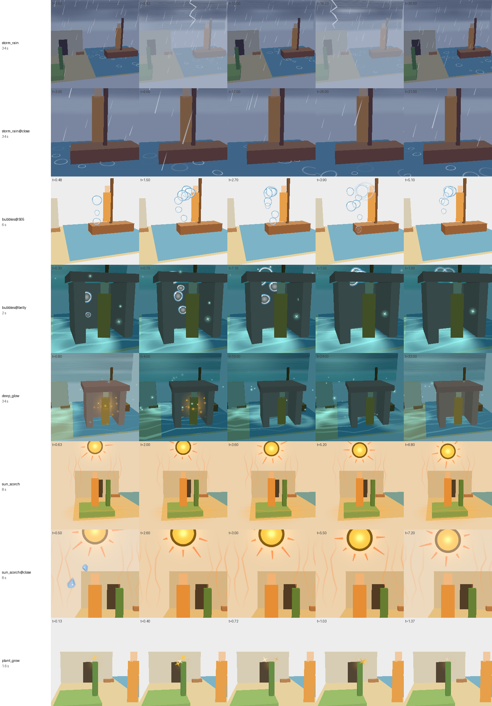

# Jonah — effects

Owner: Effects role ([CONTRACT.md](CONTRACT.md) §1, §8). Light and mood: [DESIGN.md](DESIGN.md) §4.
Engine, look rules and API are the same as the earlier packs: read [../david-goliath/FX.md](../david-goliath/FX.md) and
[../gabriel/FX.md](../gabriel/FX.md) first.

*Contact sheet: one row per effect at five moments, rendered from the real C# code by `Fx/Preview~/run.sh jonah` over a
**stand-in** coast (CONTRACT §6 positions: sea, ship, beach, Nineveh wall with gate, hill, plant stem; the `belly` rows
add a box dome at (-0.20, 0.08)) with slab actors, a depth buffer, and the frame's StoryTint, cold flash and dim
applied. `storm_rain` runs with `tension_dim` underneath, as in the story; its frames 2 and 4 are caught in a flash.
`bubbles@belly` and `deep_glow` are inside the fish; `sun_scorch@close` also plays `sweat` (first frames) to check the
face. `plant_grow` is the alias of `sparkle`. The harness camera mirrors world X.*

## Files

| File | What |
|---|---|
| `unity/.../Fx/StoryFxJonah.cs` | `JonahFx` (registry, tints, palette) and the 4 effect classes. Pure: no engine calls. No `.meta` yet (Unity writes it at the first import) |
| `assets/jonah/manifest.json` | `fx.class` = `JonahFx`, `fx.aliases` = `plant_grow` → `sparkle`. The lead adds registry / library / strings |
| `Fx/Preview~/JonahPreview.cs`, `Harness.cs`, `run.sh`, `render.py` (`coast_scene`) | `run.sh jonah` → `fx_contact_jonah.png` (additive edits) |

No runtime file: the tints go through Ruth's `StoryTint`, the flash through Esther's `StoryLight` (the stage runtime
already draws both). `DGFxEffects.cs` is **not** edited: `python3 tools/story/merge_packs.py` generates the two
registration lines (`JonahFx.Defs` and the alias); until then `--check` reports `DGFxEffects.cs` stale, and the
harness takes the new ids straight from `JonahFx.Defs`.

## Ids

| id | source | status |
|---|---|---|
| `storm_rain`, `bubbles`, `deep_glow`, `sun_scorch` | **new** | below |
| `plant_grow` | alias of `sparkle` (manifest) | no C# |
| `golden_rays` (D&G), `splash` `sea_wind` (Exodus), `zzz` (Daniel), `tension_dim` `prayer_glow` (Esther), `heart_glow` (Ruth) | exist | unchanged |
| `steam`, `sweat` | `StoryFxAlias` in Daniel's file | unchanged, not redefined |

The harness prints the class each id resolves to; all 14 resolve.

## New effects (art-width units; Jonah about 0.30 tall)

| id | anchor | default dur | what it draws | follows |
|---|---|---|---|---|
| `storm_rain` | `stage` | 20 | Cool grey multiply tint (`JonahFx.StormTint`, 0.85). Three dark sky bands behind the set, four heavy clouds drifting across. 90 slanted rain streaks (0.085 long, 0.30 slant, 0.55-0.85 s per fall) at every depth; 14 ripples on the sea. 1-3 soft lightning flashes: StoryLight cold flash rising in 0.12 s and falling in 0.5 s at `LightningLevel` 0.55 of `StoryLight.FlashStrength` (peak opacity about 0.28), plus a thin cool-white bolt far back in the sky. Flash times: 5.7 s, 16.1 s, 26.5 s for the 34 s run (override with `JonahFx.FlashTimes`). Fade in 1 s, out 1.5 s | — |
| `bubbles` | `fish.jaw` | 5 | A bubble every 0.16 s: pale-blue crayon rim, faint white fill, highlight; radius 0.016-0.036 growing by a third; rises 0.25 with a wobble, then pops (ring puff + 4 droplets, 0.14 s). Each starts where the node was at birth (a swimming fish leaves a trail). Spawning stops so every bubble pops before the end. Fade 0.2 s / 0.3 s | yes |
| `deep_glow` | `stage` | 20 | Deep teal multiply tint (0.92), teal bands behind the set, 9 slow caustic lines wandering on the page, 6 slow light ripples on the floor, 28 drifting motes, a faint light from far above. Everything is faint and on the floor or behind the actors: nothing brightens a face. Fade 1.5 s / 1.5 s | — |
| `sun_scorch` | `jonah.head` | 8 | Warm multiply tint (0.75), warm pool on the floor, a sun 0.24 above the node and 0.05 behind it (yellow-orange crayon disc, glow, ten turning rays, easing down 0.04 over the run), six wavy orange heat lines at both sides of the node (none within 0.09 of the middle), three shimmer lines on the ground. Fade 0.8 s / 1.2 s | yes |

## Timing suggestions for the lead

- `storm_rain` 34 s from `jn_06 end + 0.6` matches `rain_loop`. The second `thunder` (`jn_06 end + 6.6`) falls 6.0 s in,
  0.3 s after the first flash at 5.7 s: the light comes first, as it should. The first thunder (+0.9) has no flash: the
  rain is still fading in. A third thunder at about `jn_06 end + 17.0` (flash 2 at 16.1 s) and a fourth at about
  `+ 27.4` (flash 3 at 26.5 s) would match the others; or set `JonahFx.FlashTimes` to the thunder times minus 0.3 s.
- The rain and tint are gone at `t = 76.39`, 4 s before `rain_stop` (80.45): extend `dur` to about 36.5 (the fade-out
  then ends at `rain_stop`) if the rain should run until the sea calms. Nothing else overlaps
  (F2): `deep_glow` starts at 101.68, after the rain is gone.
- `deep_glow` (34 s from 101.68, to 135.7) outlasts S06 (ends 126.96): it runs into S07 for 8.7 s. Shorten to about 25 s
  (end 1.5 s before the shot change; its fade-out is 1.5 s) unless the camera still shows the fish inside at S07.
- `bubbles` (88.12, 6 s) is in S05, on a calm sea: fine. The 2 s burst at 100.48 ends 1.2 s before `deep_glow`.
- `sun_scorch` (206.89, 8 s) ends at 214.9, 1.9 s into S12; the golden-hour `golden_rays` starts at 213.03. They overlap for
  1.9 s: shorten `sun_scorch` to 6.0 s (the fade-out ends at the shot change).

## Weak or unverified

- All previews are over a stand-in set with box actors; the real sea, ship and belly colours are not seen. Check a
  frame of S03 and S06 after the set is in (F4: white rain on pale sky, pale motes on the belly's ribs).
- `StoryTint` stacks multiplicatively with `tension_dim`'s own dim: in S03-S04 both run; the page may look darker on
  the phone than in the sheet. Lower `JonahFx.StormTint`'s level (0.85) if so.
- `bubbles`: node `fish.jaw` must move smoothly; its `Follow` track is sampled at each bubble's birth.
- The flash needs `StoryFxStage.DrawFlashOverlay` (default on).
- Mesh load: `storm_rain` has about 95 ribbons in the air (3 points each); not timed on the phone.
