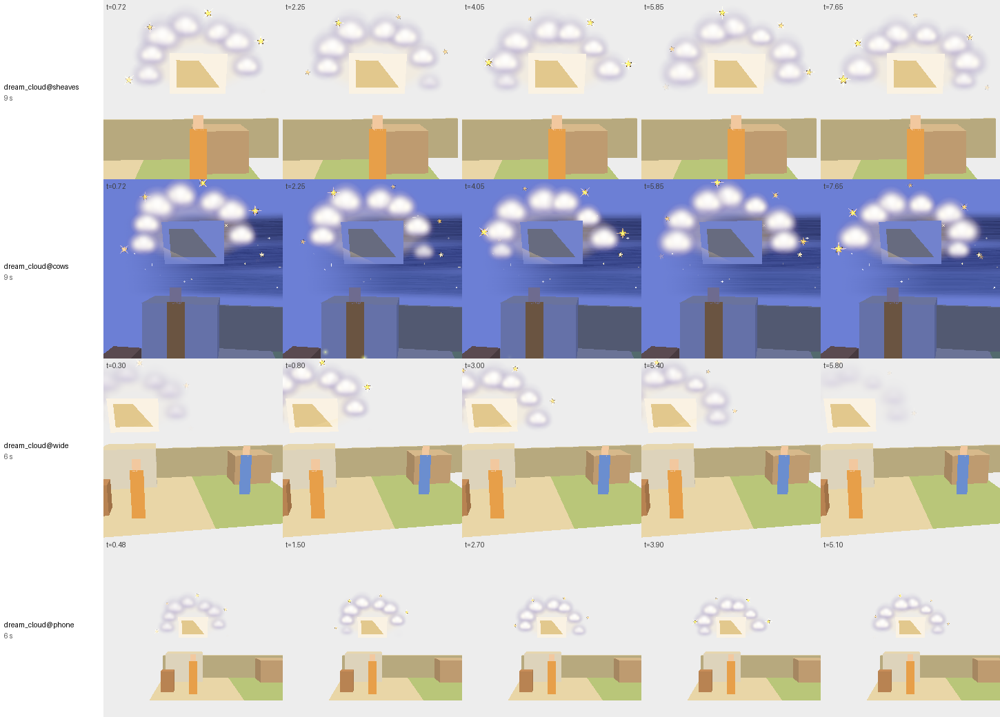

# Joseph — effects

Owner: Effects role ([CONTRACT.md](CONTRACT.md) §1, §8). Light and mood: [DESIGN.md](DESIGN.md) §4.
Engine, look rules and API are the same as the earlier packs: read [../david-goliath/FX.md](../david-goliath/FX.md) and
[../gabriel/FX.md](../gabriel/FX.md) first.

*Contact sheet: `dream_cloud` at 8 / 25 / 45 / 65 / 85 % of its length, rendered from the real C# code by
`Fx/Preview~/run.sh joseph` over a **stand-in** twolands (pasture, sand, tent, palace, granary boxes) with a flat dream
panel facing +Z and tilted 15 degrees to the camera, and a slab actor. Rows: `@sheaves` (pale daylight, the hard case:
cloud on a pale panel), `@cows` (at night: the `night` effect underneath), `@wide` (the whole page, the last two frames
show the fade-out), `@phone` (page seen from phone distance). The harness camera mirrors world X.*

## Files

| File | What |
|---|---|
| `unity/.../Fx/StoryFxJoseph.cs` | `JosephFx` (registry, ring size, palette) and `DreamCloud`. Pure: no engine calls. No `.meta` yet |
| `assets/joseph/manifest.json` | `fx.class` = `JosephFx`; the lead adds registry / library / strings |
| `Fx/Preview~/JosephPreview.cs`, `Harness.cs`, `run.sh`, `render.py` (`twolands_scene`) | `run.sh joseph` → `fx_contact_joseph.png` (additive edits) |

`DGFxEffects.cs` is **not** edited: `python3 tools/story/merge_packs.py` generates the registration line; until then
`--check` reports it stale, and the harness takes `dream_cloud` from `JosephFx.Defs`.

## Ids

`dream_cloud` is **new**. Every other id in the timeline exists and is unchanged: `sparkle` `steam` `tension_dim`
`coins_spray` `prayer_glow` `night` `zzz` `golden_rays` `famine_haze` `sweat` `heart_glow` `confetti` (the harness
prints the class each resolves to; all 13 resolve). No alias was needed.

## `dream_cloud` (node, default 6 s)

A ring of 12 cloud puffs on an ellipse around the node, turning once in 36 s, each breathing 6 %; each puff is a white
three-lobe cloud on a lilac crayon edge with a lilac underside (so white on a pale panel still reads, F4). 7 gold
stars (Star cell, soft sparkle behind) twinkle just outside the ring, drifting the other way. The ring bobs 0.008 and
sits on a faint gold halo (0.22). Fade in 0.8 s, out 0.8 s. Follows the node.

- **Open at the bottom (2026-11-15, after the phone review):** the lower puffs covered Pharaoh's face under the cows
  panel and both heads in S06. A puff or star now fades out as it turns below the panel's middle
  (`JosephFx.OpenBelow`), and the halo is raised and flattened, so the ring is an arch over the panel and the people
  under it stay clear (`fx_contact_joseph.png` re-rendered; see `FIXLOG-20261115.md`).
- It never covers the panel: the inside of the ellipse (`JosephFx.RingRx` 0.175, `RingRy` 0.140, plus half a puff) is empty,
  and the puffs stand 0.02 **behind** the node (away from the camera), so the panel's depth test hides any overlap.
- The effect only receives the node's position, not its bounds, so one ring fits all five panels (0.22-0.24 wide). It is
  1.4 puff-widths clear of a 0.22 panel and about 1 of a 0.24 one. If Integration can read the panel's size, set the two
  statics before `Play`; otherwise it is fine as is.

## Timing suggestions for the lead

- Fades are 0.8 s each, so a cloud that ends with its shot should end 0.8 s before the cut. Current ends: 34.08 (S02,
  ends 50.17), 46.61 (S02), 113.48 (S05, ends 127.18), 122.07, 149.86 (S06, ends 153.64), 198.64 (S09, ends 202.2): all
  well inside their shots. Nothing overlaps another `dream_cloud` on the same node.
- `js_14` plays `night`, `zzz` and `dream_cloud` together (103.1-125): the ring sits on a dark page (row `@cows`); the
  lilac edge and gold stars still read. If the panel feels crowded, start `dream_cloud` 1 s later (dt +1.0).
- Because the panel fades in from nothing at the same moment, give the panel node 0.3 s to appear first (dt +0.3).

## Weak or unverified

- Previewed on stand-in boxes, with a flat pale panel; the real panel's colour and relief are not seen. Check F4 (white
  ring on a pale-cream panel and on the sunny Egyptian day, S06-S07) on the first device frame.
- The panel size is assumed (0.22-0.24 wide, about 0.16-0.17 high; CONTRACT gives only the width). If the real panels
  are taller than 0.28, raise `RingRy`.
- Mesh load: about 125 sprites at once; not timed on the phone.
