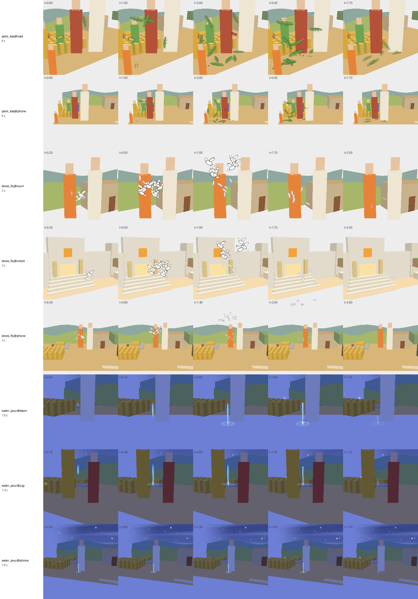

# The King Who Serves — effects

Owner: Effects role ([CONTRACT.md](CONTRACT.md) §8, [DESIGN.md](DESIGN.md) §4). Engine and look rules: same as the
earlier packs ([../miracles/FX.md](../miracles/FX.md)).

*Contact sheet from `Fx/Preview~/run.sh lastsupper` (real C# code, off Unity). **Stand-in sets**, because there is no
Jerusalem stand-in and `render.py` was not changed: the Ruth yard (warm sand ground, slab actors at the CONTRACT heights)
for the road and the court; the Gabriel heaven (cream floor and walls) as the worst case for white doves on the cream
court (F4); the Ruth yard under the real `night` effect and its tint for the room. Rows: `palm_toss@road` (about the S02
camera), `palm_toss@phone`, `doves_fly@court` (about the S05 camera, seller slab behind the cages, Jesus slab beside),
`doves_fly@cream`, `doves_fly@phone`, `water_pour@basin` (node on the floor), `water_pour@jug` (node at hand height),
`water_pour@phone`.*

## Ids (every id `story.py` uses resolves)

| id | Where it comes from |
|---|---|
| `golden_rays` | D&G (`DGFxEffects.cs`) |
| `sparkle` `heart_glow` `sunset_glow` `night` `dust_road` `lamp_flame` | Ruth (`StoryFxRuth.cs`) |
| `coins_spray` `music_notes` | Prodigal (`StoryFxProdigal.cs`) |
| **`palm_toss` `doves_fly` `water_pour`** | new, `StoryFxLastSupper.cs`, class `LastSupperFx` |

No aliases (F1): no existing effect throws leaves, flies birds or pours a stream. The nearest were Ruth's `petals` /
D&G `confetti` (flat colour bits, the contract says "not petals, not confetti") and Gabriel's `feather_fall` (feathers,
no birds). Checked with the same rule as `check.py` (`string Id => "..."` over all `.cs`): 12 ids used, 0 missing.

## Files

| File | What |
|---|---|
| `unity/.../Fx/StoryFxLastSupper.cs` | `LastSupperFx` (registry, palette, road stretch, `Stroke` / `Lens` / `Frond` / `Feather` drawing) and the 3 effects. Pure, no engine calls. No `.meta` yet (Unity writes it) |
| `Fx/Preview~/LastSupperPreview.cs`, `Harness.cs` (1 line), `run.sh` (compile lines, usage line, copy step) | `run.sh lastsupper` -> `fx_contact_lastsupper.png` (additive edits; `render.py` untouched) |
| `assets/lastsupper/manifest.json` | `fx.class` = `LastSupperFx` (only the `fx` section changed) |

No runtime file: nothing here ends other effects or talks to the stage. `DGFxEffects.cs` is not edited; `merge_packs.py`
registers `LastSupperFx.Defs` from the manifest (`merge_packs.py --check` now lists `DGFxEffects.cs` as stale, as expected,
next to `library.json` and `strings.json`, which were stale already because the pack is not merged yet).

## Effects

- **`palm_toss`** (node = `jerusalem.road`, default 8 s, no follow): about four a second (one every 0.25 s, jittered),
  a palm frond, or in 18 % of cases a red / blue / yellow scrap of coat cloth (DESIGN §3 colours), is tossed from the
  crowd at the road's back edge (y 0.18, z −0.01) or, 22 % of the time, from the children at the right front corner
  (y 0.11), rises fast to 0.05-0.10 above the start, tumbles, drifts down slowly with a sway and lands flat on the road
  band (z 0.06-0.15), lies for 1.2 s and fades over 0.6 s (the `palmsRoad` prop is the lasting layer). 1.1-1.5 s in the
  air. Nothing starts that would still be in the air at the end. Fade in 0.2 s, out 0.6 s.
  **Where:** the road node is long and bent and its pivot says little, so when the anchor lies on the road's footprint the
  toss uses the straight stretch where `palmsRoad` lies (centre (0.34, 0.105), ±0.21 in x: x 0.13-0.55). Any other node:
  the same stretch centred on that node. A frond is 0.07-0.09 long (green blade with a dark edge, a pale rib with a bare
  stem, four leaflets). About 13 fronds alive at once (≈ 90 short ribbons).
- **`doves_fly`** (node = `jerusalem.cagesOpen`, default 3 s, no follow): seven doves pop out of the node one after
  another over 0.4 s (small to full size in 0.3 s), flap about 2.4 beats a second (side view: wings above the back and
  below the belly, a shaded far wing a beat behind), spiral up (alternate doves turn opposite ways, radius to 0.14) and
  drift apart and a little back. Height above the cages ≈ 0.22 at 1 s and 0.8 at 2.5 s; at the S05 distance they leave
  the top of the frame at about 1.2-1.6 s, at the phone wide view at about 2.0 s. Six small feathers puff up out of the
  cages and fall slowly, swaying, gone by 2.9 s. Doves are outlined ellipses: white fill, the atlas disc's soft grey
  outline, a grey-blue far wing, a peach beak and an ink eye, so they **read on the cream court and the white temple
  (checked on the cream heaven stand-in, F4)**. Body 0.040 long. Fade out 0.35 s. 49 sprites, 18 ribbons at most.
- **`water_pour`** (node = basin or jug, default 1.8 s, **follows** the node): a thin stream (0.012 wide at the top, 0.008
  at the bottom, mid blue with a pale highlight line) from 0.10 above the node down to the node + 0.012. Its front falls
  in 0.15 s, its tail falls after it in the last 0.22 s; while pouring, the top 25 % fades in so it never starts at a hard
  point in the air. Where it lands: a ring every 0.17 s spreading to radius 0.034 (inside a 0.08 basin) flat on the
  water, a soft pale glint (additive, low, steady) and six tiny drops hopping out and back. Fade in 0.05 s, out 0.2 s.

## Timing suggestions for the lead

| Shot | Call in `story.py` | Suggestion |
|---|---|---|
| S02 | `palm_toss` on `jerusalem.road`, dur 8.0, with `palmsRoad` grow 0.5 | Fine. The first fronds land at ≈ 1.2 s, after the road layer has popped in: they settle on top of it. If the S02 shot is shorter than 8 s, set dur to the shot length (F2); the last tosses stop by themselves so none is cut off mid-air. `dust_road` on the donkey overlaps without fighting (dust is on the ground, fronds above it). |
| S05 | `doves_fly` on `jerusalem.cagesOpen` dt 1.7 dur 3.0 | Good: the cage swap is at 1.6, so the doves burst 0.1 s after the doors open; `dove_flutter` at 1.7 matches. The flock is out of the S05 frame by ≈ 3.3 (shot time), feathers by 4.6, so the `seller1` wail (`ls_12`, pre 2.4) plays over the last feathers: good comedy timing. dur 3.0 is right; less than 2.5 would cut the feathers. |
| S07 | `water_pour` on `jesus.basin` dt 1.8 dur 1.8 | Works on the floor: stream from y UPPER + 0.11 into the basin. **Jesus holds no jug** (`basinJug` hides at 1.6, Jesus has no `jug` prop), so the stream comes out of the air above the basin; the soft top hides the start, but if it reads oddly on the phone, either give Jesus a jug for the pour (props role) or drop to dur 1.2 so it is a short splash. Starts 0.2 s after the basin appears: good. |
| S12 | `water_pour` on `peter.jug` dt 0.2 dur 1.4 | **Lead decision.** The contract stream goes *down into* the node, so on the jug the water pours *into* Peter's jug from the air. For water poured from the jug onto Andrew's feet, anchor it on Andrew's foot instead: `fx("water_pour", "andrew.footR", dur=1.4, dt=0.2)` (the stream then starts 0.10 above the foot ≈ the kneeling Peter's hand height, and the ripples and drops land on the foot). That is a `story.py` change, not mine. Keep `splash_small` at 0.6. |
| S07-S12 | `night` + `lamp_flame` ×2 | Unchanged. The blue stream reads on blue night in the stand-in; on the amber lamp-lit room it should read better (warm against cool). |

## Weak / unverified

- **Stand-in sets only**; not seen on the real Jerusalem GLB, the real actors or the device. The real `road` pivot,
  `cagesOpen` height and `basin` / `jug` pivots were not available: `palm_toss` relies on the CONTRACT §6 road stretch,
  `doves_fly` assumes the node sits at the cages (≈ table top), `water_pour` assumes the node is at the bottom of the
  basin / jug (the water surface is taken as node + 0.012).
- **Faces:** one or two doves cross the dove seller's head at ≈ 0.8-1.2 s after the burst (he stands right behind the
  cages; the stand-in shows it at `doves_fly@court` t = 1.0). They are small and gone within 0.2 s, so I left it; if the
  lead dislikes it, the drift could lean toward the viewer side away from him (one constant in `DovesFly.Path`).
  Fronds pass in front of actors' bodies at moments, never stay.
- The cloth scraps are flat atlas rectangles; at the phone wide view they are small (a few pixels) and read as colour
  flecks, not cloth.
- Compiled only by the off-Unity preview (.NET 8 against `UnityEngine.CoreModule`, C# 9: 0 errors, 0 warnings). Not
  compiled in Unity; the local function inside `DovesFly.Dove` needs C# 7+ (Unity 2022 has 9).
- Cost estimated from the preview counts (≤ 91 ribbons for `palm_toss`, ≤ 49 sprites + 18 ribbons for `doves_fly`), not
  profiled on a phone.
