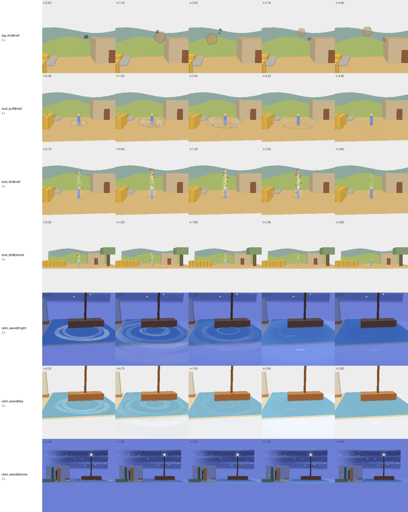

# Miracles — effects

Owner: Effects role ([CONTRACT.md](CONTRACT.md) §8, [DESIGN.md](DESIGN.md) §4). Engine and look rules: same as the
earlier packs ([../jonah/FX.md](../jonah/FX.md)).

*Contact sheet from `Fx/Preview~/run.sh miracles` (real C# code, off Unity). **Stand-in sets**: the Ruth yard for the roof
rows (a slab "man" under the node), the Jonah coast for the lake rows (sea plane y 0.012; the night rows also run the real
`night` effect and its tint). Rows: `dig_dirt@roof` (empty stand-in yard, node at y 0.22), `dust_puff@roof` (check only), `dust_fall@roof`, `dust_fall@phone`,
`calm_wave@night`, `calm_wave@day`, `calm_wave@phone`.*

## Ids (every id `story.py` uses resolves)

| id | Where it comes from |
|---|---|
| `dust_puff` `golden_rays` | D&G (`DGFxEffects.cs`) |
| `heart_glow` `sparkle` `sunset_glow` `night` | Ruth (`StoryFxRuth.cs`) |
| `zzz` | Daniel |
| `tension_dim` | Esther |
| `storm_rain` | Jonah |
| `wave_splash` | alias of `splash` (Exodus), manifest `fx.aliases` |
| **`dig_dirt` `dust_fall` `calm_wave`** | new, `StoryFxMiracles.cs`, class `MiraclesFx` |

(`boing`, `cheer`, `crumble`, `thunder` ... are `sfx(...)` cues, not effects.)

## Files

| File | What |
|---|---|
| `unity/.../Fx/StoryFxMiracles.cs` | `MiraclesFx` (registry, palette, end requests) and the 3 effects. Pure, no engine calls. No `.meta` yet (Unity writes it) |
| `unity/.../Fx/StoryFxMiraclesRuntime.cs` | hidden singleton (same pattern as Esther's `StoryFxStage`, boots itself): ends the instances `calm_wave` asks for. Engine code, **not** in the off-Unity preview, so only reviewed, not compiled here |
| `Fx/Preview~/MiraclesPreview.cs`, `Harness.cs` (1 line), `run.sh` | `run.sh miracles` -> `fx_contact_miracles.png` (additive edits; `render.py` untouched, uses the existing `ruth` and `coast` stand-ins) |

`DGFxEffects.cs` is not edited; `merge_packs.py` registers `MiraclesFx.Defs` and the alias from the manifest.
No shared FX file was changed.

## How `calm_wave` ends the storm

On its first frame (`t == 0`) it adds `storm_rain` and `tension_dim` to `MiraclesFx.EndRequests`. The runtime singleton drains
that list in `LateUpdate` and destroys the running `DGFxInstance`s with those ids (at most one frame later). The stage tint
(`StoryTint`) and dim (`StoryLight`) those effects posted stop being renewed and expire by themselves, the same way a
normal end releases them. Rain and clouds vanish at once; the tint/dim release follows the stage's own smoothing, so the
change is "at once", not a pop. If `calm_wave` is skipped or seeked past, nothing changes. `DGFx.StopAll` still clears everything.

## Effects

- **`dig_dirt`** (node = `galilee.roofHole`, default 5 s, no follow): a brown clod or soft dust puff is tossed up and
  sideways every 0.4 s (about 2.5 a second, jittered, either side), flies a short arc and lands at the node's height, then
  fades; some clods bring a tiny crumb. Nothing starts that would still be in the air at the end. Fade in 0.3 s, out 0.5 s.
  Replaces `dust_puff` in S04. Arc height is about 0.03-0.06 art units, so it stays near the roof top.
- **`dust_fall`** (node = `galilee.roofHole`, default 3 s, no follow): a warm additive shaft from the node down to the floor
  (y 0.004), low opacity (0.12-0.20) so it never hides a face; 28 brown specks and crumbs falling with gravity and a slight
  sway, each landing in a small soft puff. Fade in 0.3 s, out 0.7 s.
- **`calm_wave`** (node = `galilee.lake`, default 3 s, no follow): five rings (0 / 0.28 / 0.56 / 0.84 / 1.12 s, 1.25 s each)
  flatten as they go (fainter, shorter reach), flat on the node's y + 0.006; a pale-blue glow disc and nine slow glints fade
  in from 1.0 s (0.9 s) and stay to the end; fade out 0.6 s. No flash, nothing over actors.

## Timing suggestions for the lead

| Shot | Call in `story.py` | Suggestion |
|---|---|---|
| S04 | `dig_dirt` on `roofHole`, dur 5.0 | Replaces `dust_puff` (not suitable, see below). Match `dig_loop` sfx (dt 0.6); it lands on the node's height, so it needs the node on the roof top. |
| S05 | `dust_fall` dt 0.2 dur 3.0 | Fine. The roof hole appears at dt 0.6, so the first falling crumbs (0.2) come just before it opens: good, the roof "gives". If it should read as a trickle that grows, use dur 3.5. Keep `crumble` sfx at the same dt. |
| S12 | `calm_wave` dt -0.4 dur 3.0 | Works: ripples run -0.4..~1.9, sheen 0.6..2.6. The sheen is the quiet "glass" moment; **dur 4.0-4.5** gives it ~1 s more before the fade without overlapping `night` badly. Start with `wind_stop` (dt -0.4) as written. |
| S12 | `night` dt 0.2 dur 14.0 | `calm_wave` ends the storm tint at about -0.4; the night tint then fades in from 0.2: a 0.6 s grey beat between them. If it looks like a dip, start `night` at dt -0.2 (they do not fight: different layers). |
| S12 | `sparkle` on the lake dt 0.4 | Overlaps the rings; fine (rings are alpha, sparkle is additive). |

## `dust_puff` check (CONTRACT §8: report, do not change)

**It does not read as roof dirt.** `DustPuff` is a one-shot ground puff: it draws at `Ground(c.start)` (y = 0.004, the page
floor, not the node's height), a flat ring plus ten lumpy outlined clouds that spread once over the whole `dur` and fade.
With `dur 5.0` it is one slow, large, grey-beige puff on the ground under the roof, not dirt flying up from digging. It also
adds a stage shake (0.004 for 0.25 s) at the start. If the lead wants dirt flying up while the friends dig, the options are a
new effect (a third id, needs the owner's approval; CONTRACT §8 allows two) or accept the ground puff at the friends' feet.

## Weak / unverified

- Stand-in sets only; not seen in the real GLB or on the device. Real node heights (`roofHole`, `galilee.lake`) were not
  available: `dust_fall` assumes the node is above the floor; `calm_wave` assumes the node
  sits on the lake surface.
- `StoryFxMiraclesRuntime.cs` and the actual ending of `storm_rain` / `tension_dim` are untested (need the engine); the
  request list itself is checked in the preview (`calm_wave end requests posted: storm_rain,tension_dim`).
- The shaft is additive warm white; over the green stand-in it looks yellow-green, over the real warm interior it should
  read as daylight. Check on the device.
