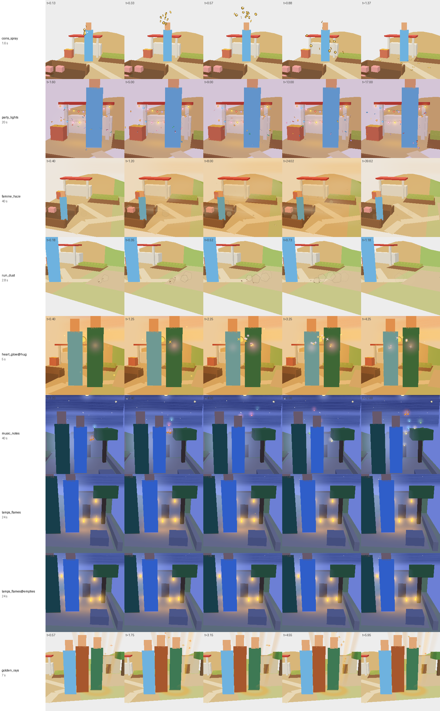

# The prodigal son — effects

Owner: Effects role ([CONTRACT.md](CONTRACT.md) §1, §8). Light and mood: [DESIGN.md](DESIGN.md) "Light and mood per part".
Engine, look rules and API are the same as the earlier packs: read [../exodus/FX.md](../exodus/FX.md) and
[../ruth/FX.md](../ruth/FX.md) first.

*Contact sheet: each row is one effect at five moments, rendered from the real C# effect code by
`Fx/Preview~/run.sh prodigal` over a **stand-in** homeland (boxes at the CONTRACT §6 positions, actors as coloured slabs at
the story.py marks) with a depth buffer and the frame's `StoryTint` multiplied over the set. `music_notes` and both
`lamps_flames` rows are shown over `night`, `heart_glow@hug` over `sunset_glow`. As on the earlier sheets the harness
camera is mirrored (world +X appears on the left); this does not affect the device.*

## Files

| File | What |
|---|---|
| `unity/Assets/DoodLive/DavidGoliath/Fx/StoryFxProdigal.cs` | The 6 new ids (pure: no engine calls). `ProdigalFx`: registry, palette, CONTRACT §6 fallbacks, tints, `Lamps` list |
| `unity/Assets/DoodLive/DavidGoliath/Fx/StoryFxProdigalRuntime.cs` | `ProdigalStage`: hidden singleton (auto-created, `DefaultExecutionOrder(-20)`) that finds every `lampsFlame*` empty under `DGFx.Stage` and writes their stage-local positions to `ProdigalFx.Lamps` each frame |
| `DGFxEffects.cs` (1 line, after Exodus) | `foreach (var d in ProdigalFx.Defs) if (!map.ContainsKey(d.Id)) map[d.Id] = d;` — an existing id is never replaced |
| `Fx/Preview~/ProdigalPreview.cs`, `Harness.cs` (1 line), `run.sh`, `render.py` (`homeland_scene` + dispatch) | `run.sh prodigal` → `fx_contact_prodigal.png` |

`DGFx.cs` and `StoryDirector.cs` are **not** changed, and **no director line is needed** (unlike Exodus).

## Timeline ids (for the Story role)

story.py uses these ids as they are, with one change:

| story.py now | Use instead | Why |
|---|---|---|
| `fx("lamp_flame", "homeland.lampsFlame", dur=60.0)` | `fx("lamps_flames", "homeland.lamps", dur=60.0)` | Ruth's `lamp_flame` lights one point (its anchor). `lamps_flames` lights **every** `lampsFlame*` empty of the set in one call. Its anchor only matters when the set has no lamp empties (see fallback below); `homeland.lampsFlame` also works |

All other fx lines are fine as written: `party_lights` on `homeland.tavern`, `coins_spray` on `son.handR`,
`famine_haze` on `stage`, `sparkle` on `son.head` / `son.chest`, `sunset_glow` / `night` on `stage`, `run_dust` on
`father.root`, `heart_glow` with `to`, `music_notes` on `homeland.house`, `golden_rays` on `father.root`.

## Wiring for Integration

### 1. Fast-forward (nothing to add)

`famine_haze` is a stage tint like Ruth's `night`: it posts a `StoryTint` request every frame (drawn by Ruth's
`StoryTintStage`, already in the build) and has a long `dur` (40 s, "until S08 starts"). `StoryDirector.EndSeek` already
replays every fx whose window overlaps the seek time, with the time that is left, so "keep reading" into S06 or S07
starts with the haze on (it fades in over 1.6 s, as `night` does over 0.8 s). The same holds for `sunset_glow`, `night`,
`party_lights`, `music_notes` and `lamps_flames`. `DGFx.StopAll()` drops the tint at once (StoryLight.Epoch).

### 2. Set nodes (CONTRACT §6)

| Node | Used by | If missing |
|---|---|---|
| `lampsFlame*` empties (any name that starts with `lampsFlame`: `lampsFlame`, `lampsFlame.001`, `lampsFlame_2` …) | `lamps_flames`: one flame per empty. Empties only (a node with a `MeshFilter` is skipped, and so is a group whose children are lamp empties). Rescanned when the stage changes, after every `DGFx.StopAll`, and once a second while `lamps_flames` plays and none were found | Logged once (`[ProdigalFx] no 'lampsFlame*' empties …`). Flame at the anchor if it is not at the set origin, else five CONTRACT points: three lamps on the feast table (−0.45 / −0.38 / −0.31, y 0.055, z ≈ −0.16) and two lanterns at the door (x −0.45 / −0.31, y 0.135, z −0.355) |
| `tavern` (origin at the footprint centre on the ground, as the set scripts build it) | `party_lights`: strings along the awning front at z = origin + 0.118, x ± 0.155, y 0.205 (`ProdigalFx.TavernFrontDz / TavernHalfWidth / StringY`, public, tune here) | Anchor at the origin → CONTRACT centre (0.40, −0.47) |
| `house` | `music_notes`: notes rise from the door (origin + (0, 0.10, 0.108)), two windows (± 0.08, 0.13) and the roof edge (0.215) | Anchor at the origin → CONTRACT centre (−0.38, −0.47) |

Lamp empties keep their positions while `lamps` is hidden (the director's `prop` only disables renderers), so the
flames can be lit the moment the lamps are shown.

## Effect table

Sizes in art-width units (son 0.34 tall, father 0.36, brother 0.37). Anchors and durations as story.py.

| id | anchor (story.py) | dur | look | follows |
|---|---|---|---|---|
| `coins_spray` | `son.handR` (S04, at the `toss` marker) | 1.6 | A small twinkle at the hand, then 12 gold coins (0.021–0.026, ink-outlined gold disc with a light middle) leave the hand over 0.24 s in a fountain (up 0.85–1.15 /s, out 0.08–0.26 /s, a little toward the camera), spinning (edge-on narrows them, a white glint when a face turns to the camera), land ~0.1–0.25 around him, bounce once or twice, slide and lie flat with an occasional slow glint; soft shadows; all fade in the last 0.35 s | no (start point) |
| `party_lights` | `homeland.tavern` (S04) | 20 | Two sagging strings of bulbs (11 + 8; thin dark wire; crayon dot + additive glow in seven crayon colours) along the awning front and down to the market stall, brightening in a slow travelling wave (0.78–1.0, never off: no strobe), sway gently; a warm pool on the ground and a warm wash behind; 20 paper confetti specks fluttering down and bobbing in front of the tavern. Also a soft rosy dusk `StoryTint` (0.86, 0.78, 0.88) at 75 % (`ProdigalFx.PartyDusk = false` turns it off) | no |
| `famine_haze` | `stage` (S05–S07) | 40 | Hot dry `StoryTint` (1.0, 0.88, 0.70) at 90 %; bleached sky bands behind the hills and a pale white-hot sun; two depth-tested dust veils behind the actors wash out the backdrop, tavern and field (the "desaturated" distance) while the figures in front stay clear; 8 low dust banks drifting west over the far country; 4 faint wavy heat-shimmer lines just above the ground; 28 dust motes on the wind; little gusts lifting dust. Fade in 1.6 s / out 1.4 s. Survives fast-forward (above) | no |
| `run_dust` | `father.root` (S09) | 2.8 | Every 0.075 s while the anchor moves faster than 0.06 /s: a dust puff (Dust / soft cell, road colour, 0.03 → 0.08) at alternating feet that rolls back and up and thins out over 0.75 s, plus two dark grains flicked back in little arcs. Direction and strength come from the anchor's recorded track, so it stops by itself when he stops to hug (no dust under the hug) | yes |
| `music_notes` | `homeland.house` (S11–S13) | 40 | A steady stream (9 slots, 3.4–4.2 s each) of crayon music notes (quarter, eighth with a flag, or two beamed eighths; 0.026–0.035 tall; coloured head with ink outline, coloured-dark stem; soft additive glow behind so they pop at night) popping out of the door, windows and roof edge, rising 0.20 while drifting 0.12 toward the courtyard / viewer, swaying and rocking, fading near the top | no |
| `lamps_flames` | `homeland.lamps` (S11–S13) | 60 | Ruth's `lamp_flame` look (orange tongue + warm-white core, warm light behind, an additive heart, an occasional spark) at **every** lamp empty (up to 12), each with its own flicker phase; the ground pools are shared out (alpha / √n) so five lamps light the courtyard like one warm area instead of an orange blob; hanging lanterns throw a wider, fainter pool | no |

Reused, not redefined: `sparkle`, `heart_glow`, `golden_rays`, `night`, `sunset_glow` (and `lamp_flame`), all present in
the build and checked by the harness.

**Budget** (max quads per frame from the harness, own effect only): party_lights 79 + 2 ribbons; famine_haze 46 + 7
ribbons; coins_spray 40; music_notes ≈ 38; lamps_flames ≈ 35 + 14 ribbons (7 lamps); run_dust 17. Busiest real moment,
S11–S13: `night` (58 + 3) + `lamps_flames` + `music_notes` ≈ 135 quads + 17 ribbons — below Exodus S11 (≈ 200). One
shared atlas, two materials, the existing `DGFxUnlit` shader: no new shader, texture or material. The largest soft
sprites are `famine_haze`'s two veils (1.45 × 0.46 and 0.95 × 0.22) and dust banks (≤ 0.46): the most fill of this pack.

## How it was checked (2026-11-14)

1. **Compile:** all 17 `Fx/*.cs` (Prodigal, Exodus, Daniel, Ruth, Esther, D&G + runtimes) + `Scripts/DesignTokens.cs` +
   `DavidGoliath/Scripts/DGTimeline.cs` + `DGActor.cs`, C# 9, Unity 6000.3.27f1's own Roslyn (`csc.dll`, LESSONS L38)
   against netstandard 2.1 and the Core / IMGUI / Animation / Director / JSONSerialize / Audio module DLLs, `-warn:4`:
   0 errors, 0 warnings. Unity itself was **not** run.
2. **Preview:** `run.sh prodigal` (60 fps simulation of the real code, exact triangles, stand-in set with depth and
   tint), iterated twice: coins enlarged (0.017 → 0.021+), run dust bigger and longer-lived, shimmer lines fainter
   (they read as a smear across the son), music notes bigger with larger heads and coloured stems (ink stems vanished on
   the night blue).
3. **Other packs:** the same build ran the D&G, Esther, Ruth, Daniel and Exodus rows with the new registration line
   (`dotnet fxpreview.dll <tmp> <set>` + `render.py`, output in a temp dir; their PNGs in `Preview~` were not touched):
   all rows render, no id `MISSING`, no exceptions. The new ids did not exist before, so no earlier id is shadowed.
4. **Not exercised:** `ProdigalStage` (finding the empties, stage-local positions, rescans) needs Unity and the real
   `homeland.glb`, which does not exist yet (the set is being built in parallel). The director's fast-forward replay of
   `famine_haze` was read in `StoryDirector.EndSeek`, not run.

## Weakest points (not verified)

| Claim | Level | How to check |
|---|---|---|
| `lamps_flames` finds the set's lamp empties (names start with `lampsFlame`, empties without a mesh) and puts a flame on each | D (CONTRACT wording; `homeland.glb` not built yet; Blender's duplicate names assumed to keep the prefix) | Integration: after importing the set, play S11 in the Editor; if the console shows `[ProdigalFx] no 'lampsFlame*' empties`, check the empty names in `pr_homeland.py` |
| Party strings hang just in front of the awning, not through it (origin + 0.118 in z, y 0.205) | D (stand-in awning; real awning height ≤ 0.22 and front edge ≤ −0.36 from CONTRACT) | S04 screenshot; tune `ProdigalFx.StringY / TavernFrontDz / TavernHalfWidth` |
| Fast-forward into S06 / S07 starts with the haze on | D (logic read against `BeginAt` / `EndSeek`: same path as `night`, which is device-tested in Ruth) | Integration: "keep reading" into S06 in the Editor |
| The famine veils wash out the background without greying the faces and stay smooth on a Pixel 8 | D (stand-in depth only; fill rate never measured) | S05–S07 on device; lower the veil alphas (0.36 / 0.20) in `PrFamineHaze` if the actors look foggy or frames drop |
| `run_dust` puffs land at the father's feet (`father.root` assumed at ground level; y is forced to the page anyway) and his run is fast enough (> 0.06 /s) to make dust | D (no `clips.json` run speed yet; the preview assumed 0.32 /s) | S09 in the Editor |
| The coins clear the son's face (they fly up past it for ~0.2 s; not bright, but they cross it) | D | S04 screenshot from the storyboard camera |

中文速览：6 个新特效都在 `StoryFxProdigal.cs`；`StoryFxProdigalRuntime.cs` 找场景里所有 `lampsFlame*` 空节点。时间线要把
`lamp_flame` 那一行改成 `fx("lamps_flames", "homeland.lamps", dur=60.0)`（Ruth 的 `lamp_flame` 只点一盏灯）。`famine_haze`
和 `night` 一样走导演现有的快进重放，不用加任何代码。离线编译通过、预览图已出、其他五个包的预览照常；Unity 和真机都没跑过。
