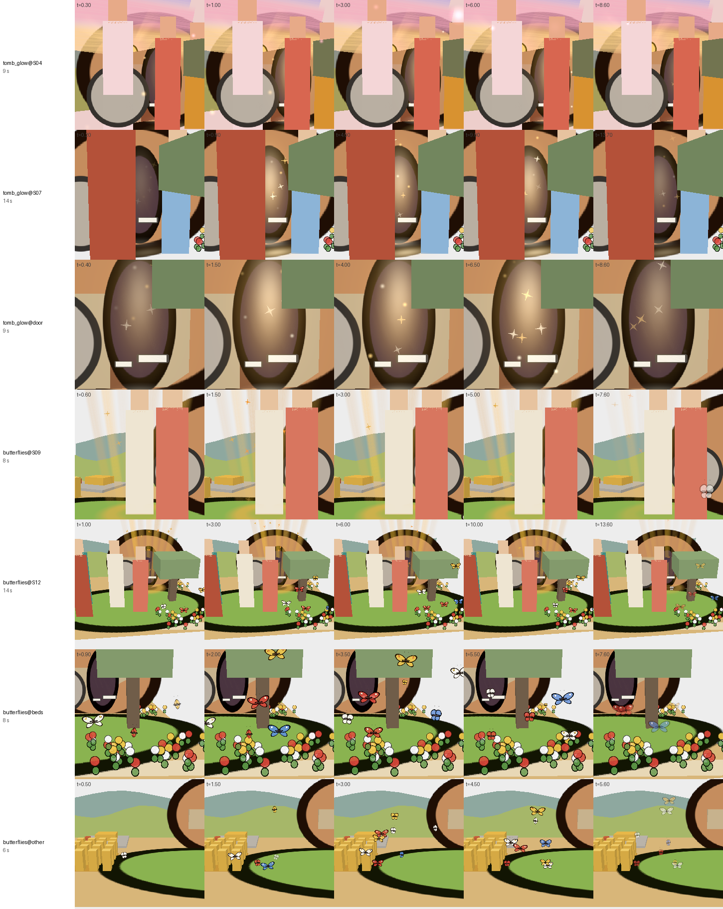

# He Is Risen! — effects

Owner: Effects role ([CONTRACT.md](CONTRACT.md) §8, [DESIGN.md](DESIGN.md) §4). Engine and look rules: same as the
earlier packs ([../lastsupper/FX.md](../lastsupper/FX.md)).

*Contact sheet from `Fx/Preview~/run.sh risen` (real C# code, off Unity). **Stand-in set**: there is no garden in
`render.py` (not changed), so `RisenPreview.cs` draws one into the batch over the Ruth yard: a green lawn, the reddish rock
hill (#C9946A) with the dark door (#4A3440) at the CONTRACT §6 position, two white linen bars inside, the rolled-away stone
and white / red / yellow blooms in both flower beds. The Ruth yard's olive tree and house still stand in the way in some
rows. Cameras are rough guesses from the shot `dist` / `height` / `yawDeg` (the sign of yaw is not known to the preview).
Rows: `tomb_glow@S04` (under the real `dawn_glow`, women and angel slabs in front), `tomb_glow@S07` (John and Peter slabs),
`tomb_glow@door` (close, no actors: the cloths check), `butterflies@S09` (under `golden_rays`, Jesus and Mary slabs),
`butterflies@S12` (wide, under `golden_rays` on the door), `butterflies@beds` (close over the front bed: the F4 check on
lilies, grass and path), `butterflies@other` (anchor off the beds).*

## Ids (every id `story.py` uses resolves)

| id | Where it comes from |
|---|---|
| `angel_light` `dawn_glow` | Daniel (`StoryFxDaniel.cs`) |
| `dust_burst` `golden_rays` | D&G (`DGFxEffects.cs`) |
| `sunset_glow` `lamp_flame` `heart_glow` | Ruth (`StoryFxRuth.cs`) |
| `run_dust` | Prodigal (`StoryFxProdigal.cs`) |
| `tension_dim` | Esther (`StoryFxEsther.cs`) |
| **`tomb_glow` `butterflies`** | new, `StoryFxRisen.cs`, class `RisenFx` |

The four the planner assumed (`angel_light`, `dawn_glow`, `run_dust`, `dust_burst`) all exist under those ids. **No
aliases** (F1): the nearest existing effect to `tomb_glow` is Exodus `door_glow`, but it is tied to Exodus' `doorMarks`
box and paints red blood-mark glows on the lintel and posts, so it is not right here; nothing existing draws butterflies
(`petals` / `confetti` are flat colour bits). Checked with the `check.py` rule (`Id => "..."` over all `.cs`): 11 fx ids
used, 0 missing.

## Files

| File | What |
|---|---|
| `unity/.../Fx/StoryFxRisen.cs` | `RisenFx` (registry, palette, flower-bed layout) and the 2 effects. Pure, no engine calls. No `.meta` yet (Unity writes it) |
| `Fx/Preview~/RisenPreview.cs`, `Harness.cs` (1 line), `run.sh` (2 compile lines, usage line, copy step) | `run.sh risen` -> `fx_contact_risen.png` (additive edits; `render.py` untouched) |
| `assets/risen/manifest.json` | `fx.class` = `RisenFx` (only the `fx` section changed) |

No runtime file. `DGFxEffects.cs` is not edited; `merge_packs.py` registers `RisenFx.Defs` from the manifest.

## Effects

- **`tomb_glow`** (node = `garden.tombDoor`, the door centre (−0.33, 0.15, −0.30); default 9 s, no follow): a warm light
  inside the opening (0.13 × 0.34, facing +Z): a wide soft gold layer and a brighter warm-white heart at the **upper**
  middle of the door, so the folded cloths low on the ledge keep their shape and stay the whitest thing in the door
  (checked in `tomb_glow@door`); a faint amber halo on the rock round the door; a gold pool on the ground in front (0.22 ×
  0.12); a thin bright line along the threshold; ten slow golden motes drifting out (0.08) and up (0.07) over 3.2-4.6 s
  each, every third a slow small twinkle. Breathes ±8 % at 0.22 Hz. All additive except the pool, all at or in front of
  the door plane and depth-tested, so people peeking in stay in front of it. Fade in 0.8 s, out 0.8 s. 16 sprites.
- **`butterflies`** (node = `garden.flowers`; default 8 s, no follow): eight butterflies, 2 white, 2 red, 2 yellow
  (the flower colours), 1 more white, 1 blue, rise one after another every ≈ 0.3 s (the last at ≈ 2.3 s) from blooms,
  climb onto slow figure-eight loops (±0.035-0.05 x, ±0.02-0.03 z, wandering 0.025) at 0.08-0.19 above the ground, one
  at 0.24 (peaks 0.275). Wings beat 3.2-3.9 times a second with short glides; the beat narrows the wings, never changes
  brightness (no strobe). Three settle on a bloom (glide down 0.8 s) from about 35-50 % of `dur`, sit 2.2-3.2 s
  opening and closing their wings slowly, then fly on; when that would end within 2 s of the end they stay. All fade
  over the last 0.8 s. Wingspan ≈ 0.04, every wing outlined in dark ink (atlas Pebble cell) with a small spot on the upper
  wings, so the white and yellow ones read on lilies, grass and the pale path (F4, `butterflies@beds`). 72 sprites max.
  **Where:** the `flowers` node is two beds, so when its anchor lies on the beds' footprint (or at the set origin, if
  the merged node's pivot is there) six use the front-left bed and two the hill-foot bed (CONTRACT §6 rects), with homes
  leaning toward each bed's right (garden-side) end where people stand. Any other node: one 0.24 × 0.14 bed centred on it.

## Timing suggestions for the lead

| Shot | Call in `story.py` | Suggestion |
|---|---|---|
| S04 | `tomb_glow` on `garden.tombDoor` dt 1.0 dur 9.0 | Good: it fades in (0.8 s) as Mary and Joanna peek (1.2 / 1.3), so the light seems to meet them. They stand right in front of the door, so from the S04 camera most of the door is behind them; the halo and the motes rising above their heads still show. If S04 ends before 10.0 s after the call, set dur to end at the cut (F2). |
| S07 | `tomb_glow` on `garden.tombDoor` dur 14.0 (dt 0) | **Lengthen.** STORYBOARD gives S07 18.6 s (112.3-130.9), so with 14.0 the light fades out 4.6 s before the cut while we still look into the tomb. Set dur to the shot length (≈ 18.5) so it ends at the cut (F2). It fades in over the first 0.8 s, barely seen. |
| S03 | `angel_light` on `garden.tombStoneAside` dt 1.4 dur 4.0, `dust_burst` on `garden.tombStone` dt 0.8 dur 1.6 | Unchanged effects. The dust burst ends at 2.4, the angel light runs 1.4-5.4: they overlap 1 s, which reads as "dust, then light" (fine). |
| S09 | `butterflies` on `garden.flowers` dt 0.4 dur 8.0 + `golden_rays` on `jesus.root` dt 0.6 | **Lead check on device.** The S09 camera is a tight two-shot on Jesus and Mary (x −0.10 / −0.205); the front bed starts at x −0.30, so in the preview only one or two butterflies reach the frame edge, late. If on device they are not seen, either widen S09 (`dist` 0.6-0.65) or anchor this call on `mary.root` (one bed centred on her feet; then they fly 0.08-0.24 high in front of both bodies, and the highest one can cross Mary's chin for a moment). The rays and the butterflies do not fight: the rays are faint and behind. S09 is 12.7 s, so dur 8.0 ends ≈ 4 s before the cut; fine (Mary runs off), or raise to ≈ 12 to keep them till the end. |
| S12 | `butterflies` on `garden.flowers` dt 0.5 dur 14.0, `golden_rays` on the door | Good: all eight are up by ≈ 3 s; the settlers land around 5-7 s and fly again before the end. At the wide view they are small (≈ 0.04 of the page) but colourful and clearly butterflies. |
| S06 | `run_dust` ×2 | Unchanged (Prodigal). |

## Weak / unverified

- **Stand-in set only**; not seen on the real garden GLB, actors, camera or device. The real `flowers` pivot is unknown:
  if it is neither on the beds nor at the set origin, the butterflies centre on wherever it is (say so to the Set role
  or tell me the pivot).
- **S09 visibility** (above) depends on the real camera and lens; the preview's camera and yaw sign are guesses.
- `tomb_glow` assumes the door faces +Z and its node is at the door centre; depth occlusion by the real rock and the
  peeking actors was not exercised (the preview stand-in is sprites).
- The sparkle twinkles in `tomb_glow` are slow, but up to 4 can be visible at once in a close shot; drop `Motes` or the
  every-third rule if it looks busy on the phone.
- Compiled only by the off-Unity preview (.NET 8 against `UnityEngine.CoreModule`, C# 9: 0 errors, 0 warnings); not in
  Unity. Cost from the preview counts (16 and 72 sprites, 0 ribbons), not profiled on a phone.
