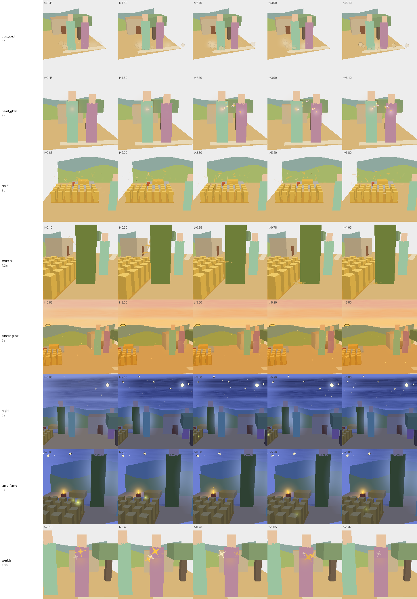

# Ruth — effects

Owner: Effects role ([CONTRACT.md](CONTRACT.md) §1, §8). Light and mood: [DESIGN.md](DESIGN.md) "Light and mood per part".
Engine, look rules and API are the same as David & Goliath and Esther: read [../david-goliath/FX.md](../david-goliath/FX.md)
and [../esther/FX.md](../esther/FX.md) first.



*Contact sheet: each row is one effect at 8 / 25 / 45 / 65 / 85 % of its duration, rendered from the real C# effect code
by `Fx/Preview~/run.sh ruth` over a **stand-in** Bethlehem (boxes at the CONTRACT §6 positions, actors as coloured slabs
at the story.py marks) with a depth buffer. The frame's `StoryTint` result is multiplied over the set, as the device
overlay does. `lamp_flame` is shown with `night` running. Note: the harness camera's right vector is mirrored (world +X
appears on the left), the same as the D&G / Esther sheets; it does not affect the device.*

## Files

| File | What |
|---|---|
| `unity/Assets/DoodLive/DavidGoliath/Fx/StoryFxRuth.cs` | The 8 new ids (pure: no engine calls), `RuthFx` (registry, palette, road / field / sky layout, `Actors` list for halos), `StoryTint` (tint requests) |
| `unity/Assets/DoodLive/DavidGoliath/Fx/StoryFxRuthRuntime.cs` | `StoryTintStage`: hidden singleton (auto-created, `DefaultExecutionOrder(100)`) that draws the multiply overlay, sets the global shader values, feeds `RuthFx.Actors` from the DGActors under `DGFx.Stage` |
| `DGFxEffects.cs` (1 line) | `FxLibrary` also registers `RuthFx.Defs`; an existing D&G / Esther id is never replaced |
| `Fx/Preview~/RuthPreview.cs`, `Harness.cs` (1 line), `run.sh`, `render.py` | `run.sh ruth` → `fx_contact_ruth.png` (stand-in set, tint, depth test) |

`DGFx.cs` is **not** changed: `DGFx.StopAll()` already calls `StoryLight.Reset()`; `StoryTintStage` watches
`StoryLight.Epoch` and drops the tint at once when it changes. Requests that are not renewed (effect destroyed) expire
after two frames and the tint eases out over ~0.8 s.

## Playing

```csharp
DGFx.Play("night", director.transform, 24f);                    // "stage" anchor
DGFx.Play("lamp_flame", bethlehem.Find("lampFlame"), 24f);
DGFx.StopAll();                                                  // replay / seek: ends everything, tints off at once
```

## Effect table

Sizes in art-width units (Ruth 0.33 tall, Naomi 0.31, Boaz 0.38). Fade in / out 0.8 s unless stated.

| id | anchor (story.py) | default dur | look | follows |
|---|---|---|---|---|
| `dust_road` | `stage` | 6 | Low warm haze along the road polyline (−0.68, 0.19) → (−0.40, 0.16) → (−0.28, 0.14) → toward the door, drifting left→right: 14 puffs (every third a soft haze blob 0.10–0.18, the rest crayon Dust puffs 0.034–0.07) rising 0.012→0.047, plus 9 tiny sunlit motes. Road dust `#E9D9B6` / ochre `#D9B77A` | no (stage coords) |
| `heart_glow` | `ruth.chest`, `to: naomi.chest` | 6 | Gold glow behind Ruth's chest + rose glow in front of it (breathes 0.45 Hz); 12 motes (gold / rose / blush, every third a twinkle) glide along a soft arc to Naomi's chest, period 2.0–2.8 s; Naomi's glow grows from t ≈ 1.4 s. Fade in 0.8, out 1.0 | yes (both ends) |
| `chaff` | `bethlehem.field` | 999 (loop) | 34 bits drift with the wind (+X, 0.018–0.032 / s) through a 0.42 × 0.26 box over the field at height 0.06–0.19, fading in and out at the box ends: soft golden slivers (Streak 0.032 × 0.010, tumbling), a few crayon husks, pollen specks that glint now and then. If the node's origin is at the set origin it uses the contract field centre (0.37, −0.11) | no |
| `stalks_fall` | `boaz.handR` | 1.2 | 5 barley stalks (0.05–0.068: straw stem, plump gold ear, two awns) leave the hand 0.05 s apart, tumble (4–7 rad/s) under gravity, land in ≈ 0.3–0.4 s, settle flat with a tiny hop, fade over the last 0.3 s (the `dropped` prop takes over) | no (spawn point) |
| `sunset_glow` | `stage` | 26 | Stage tint to golden hour (multiply `RuthFx.SunsetTint` (1.0, 0.86, 0.66)). Sky behind the hills: three crayon bands rose / orange / gold (z −0.70, y 0.31–0.60); a low sun (0.38, 0.26, −0.68) half hidden by the hills; a golden back-halo behind each actor; 16 additive golden motes | — |
| `night` | `stage` | 24 | Stage tint to night (multiply `RuthFx.NightTint` (0.46, 0.54, 0.90)). Deep-blue crayon sky bands behind the hills (y 0.31–0.62), a cream crayon moon (−0.40, 0.58) with a glow, 44 stars (twinkles 0.012–0.028, every 7th a crayon star 0.034) coming out one by one over the first ~1.2 s, a cool moonlight halo behind each actor (the rim that keeps them readable), 7 fireflies over the barley | — |
| `lamp_flame` | `bethlehem.lampFlame` | 24 | Small oil-lamp flame (orange tongue 0.034, warm-white core 0.019, sways), warm pool on the page 0.46 (alpha) + additive heart 0.20, a 0.22 warm spill around the flame (over the grain heap), 3 occasional sparks. Flicker = 3 summed sines. Fade in 0.6, out 0.8. Drawn after the tint overlay, so it stays warm and pops at night | yes |
| `sparkle` | `naomi.head`, `naomi.baby` | 1.6 | **Reuse**: Esther's `crown_sparkle` under a generic id (7 twinkles on a ring around and above the anchor, a bigger twinkle at the start, faint gold halo). Same code, not a copy | yes |

Reused, not redefined: `petals`, `golden_rays`, `confetti`, `prayer_glow`, `tension_dim` (Esther / D&G versions).

Budget (max per frame, from the harness): night 58 sprites + 3 ribbons; lamp_flame 7 + 2 ribbons (65 with night);
chaff 37; heart_glow 25; dust_road 23; sunset 21 + 3; stalks_fall 20 ribbons. All in the one shared atlas; the overlay
adds one 8-vertex mesh. No new textures (`Texture2D.whiteTexture`).

## Wiring for Integration

### Global tints (sunset_glow, night) — works with no other change

`StoryTintStage` draws a **multiply** quad (`DGFxUnlit` with `_SrcBlend = DstColor`, `_DstBlend = Zero`, white texture,
vertex colour = tint; an outer ring of +15 % feathers back to white) at render queue **3004**, placed just in front of the
nearest corner of `StoryTintStage.TintBounds` (stage-local centre (0, 0.36, −0.05), size 1.40 × 0.76 × 1.45, which also
covers the sky bands) and sized to cover it on screen. Everything opaque (set, characters, AR camera background) is
multiplied; every DGFx effect (queue 3010 / 3020) draws afterwards, untinted, so the lamp pool, stars, moon and halos pop.
Requirements: `DGFx.Stage` set and `Camera.main` = the AR camera (as Esther's dim). In AR the real table inside the box
(soft edges) is tinted too.

Neither `DGPaperLit` nor `DGGround` nor `PaperLit` reads any `_DoodStage*` global today (checked 2026-11-14), and
Esther's `tension_dim` also relies on its overlay quad only. So **nothing is required** for the tints to show.

### Optional, nicer: shader-side tint and a real rim

The runtime sets every frame (after `StoryFxStage`, so the values are combined):

| Global | Value |
|---|---|
| `_DoodStageTint` (colour) | Esther cool dim × Ruth tint (white when nothing plays) |
| `_DoodStageLight` (float) | 0..1, max of Esther dim level and Ruth tint level (0 = no tint; use it to gate) |
| `_DoodStageRim` (colour) | rim colour × level (night: cool (0.45, 0.55, 0.85), sunset: warm (0.45, 0.30, 0.10)) |

To use them, add to the end of `frag` in `DGPaperLit.shader` (characters + set) and `DGGround.shader`:

```hlsl
half4 _DoodStageTint; half4 _DoodStageRim; half _DoodStageLight;      // globals, outside the CBUFFER
...
half on = step(0.0001h, _DoodStageLight);                              // unset globals are 0 -> no effect
c.rgb *= lerp(half3(1, 1, 1), _DoodStageTint.rgb, on);
c.rgb += _DoodStageRim.rgb * pow(rim, 2.0h) * on;                      // DGPaperLit only: rim = 1 - |n.v| (already computed)
```

Then set `StoryTintStage.TintOverlay = false` and `StoryFxStage.DimOverlay = false` (and, if the rim reads well,
`RuthFx.ActorHalo = false`). Keep the overlay until that is verified on device.

### Halos

`RuthFx.Actors` is filled automatically (every 0.5 s rescans `DGActor` under `DGFx.Stage`; uses `DGActor.height`,
set by StorySetup). Nothing to wire.

### heart_glow `to`

`StoryDirector.Fx` already does `StoryFxStage.BeamTarget = Node(f.to)`; `StoryFxStage` copies it stage-local into
`EstherFx.BeamTarget` every frame and `heart_glow` reads that. Nothing to wire. (If `to` is missing, the motes go 0.12 to
the anchor's right.) `BeamTarget` stays pointed at Naomi afterwards; harmless in Ruth.

### Other calls

- `chaff` and `lamp_flame` are loops: `dur 999` / 24 as story.py says; `DGFx.StopAll()` on replay / seek.
- `night` and `lamp_flame` start on the same beat (S09); `sunset_glow` (26 s) ends as S09 starts, so the tint
  cross-fades golden → blue (the two requests multiply while both are live).
- `.meta` files for the two new `.cs` files are generated by Unity on import.

## How it was checked (2026-11-14)

1. **Compile:** all `Fx/*.cs` + `Scripts/DesignTokens.cs` + `DavidGoliath/Scripts/DGActor.cs`, C# 9, netstandard 2.1,
   against Unity 6000.3.27f1's Core / IMGUI / Animation / Director module DLLs: build succeeded, 0 warnings, 0 errors.
   Unity itself was **not** run.
2. **Preview:** `run.sh ruth` (60 fps simulation, exact triangles, stand-in set with depth, tint multiplied), iterated
   four times (dust and chaff too faint → bigger; barley ears with ink-outlined grains read as caterpillars → plain gold
   stroke; stalks hidden behind Boaz from the front → side camera; halo and stars strengthened).
3. Not previewed: `StoryTintStage` itself (overlay placement, blend state, globals) — it needs a real camera and stage.

## Weakest points (not verified)

| Claim | Level | How to check |
|---|---|---|
| The multiply overlay covers the stage and the sky bands, and effects draw over it untinted | D (same geometry as Esther's dim quad, never rendered) | Integration: play S08 and S09 in the Editor, look from the front and from a low side angle |
| `DGFxUnlit` honours `_SrcBlend = DstColor / _DstBlend = Zero` on the material copy (blend is `[_SrcBlend] [_DstBlend]` per material) | D (read from the shader) | Same; if the quad looks solid white/blue, the blend floats did not apply |
| Characters stay readable at night (tint 0.46 / 0.54 / 0.90 + moon halo) | D (stand-in slabs only; Boaz's olive goes very dark) | QA screenshot of S09 on device; lighten `RuthFx.NightTint` or wire `_DoodStageRim` |
| Sky bands sit behind the real hills (z −0.70; hills front ≈ −0.56, top ≤ 0.30) and the sun is half hidden | D (stand-in hills) | Look at S08 / S09 orbit; move `RuthFx.SkyZ` / sun y if the set differs |
| `bethlehem.field` origin is the field centre (else the fallback (0.37, −0.11) is used) and `lampFlame` is the flame point | D (set not built yet) | Integration: check the node transforms in `bethlehem.glb` |
| Stalks and chaff read on a child's colouring (gold on ochre is low contrast) | D | Device screenshot of S04 / S07 |
